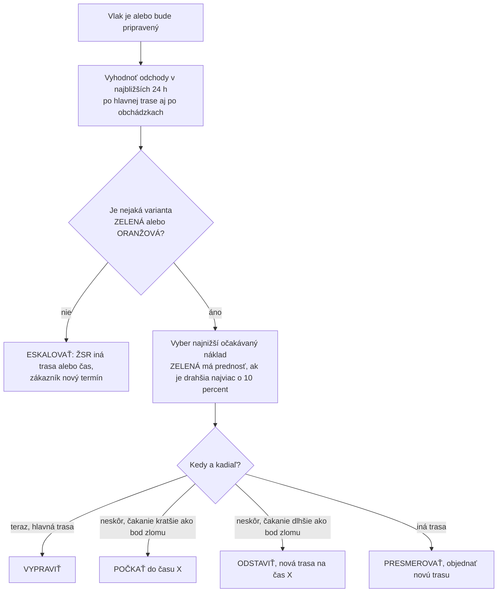

# Časové rezervy a rozhodovanie: vypraviť, počkať, odstaviť, presmerovať

Tento dokument vysvetľuje pravidlá, ktoré má aplikácia používať (sekcia 8 v `PROMPT.md`). Presne ich implementuje `referencia/rozhodovanie.py`. Všetky čísla sú **návrh na začiatok** a treba ich nastaviť podľa vašich dát (kapitola 8).

## Zhrnutie na jednu obrazovku

| Pravidlo | Predvolene | Zmysel |
|---|---|---|
| Rezerva pred výlukou | 30 min | Úsek s výlukou musí byť opustený aspoň 30 min pred jej začiatkom. |
| Rezerva po výluke | 30 min | Do úseku vstúpiť najskôr 30 min po *plánovanom* konci výluky. |
| Rezerva voči termínu | 60 min | Plánovaný príchod (medián) aspoň 60 min pred termínom zákazníka. |
| Rezerva v smene čaty | 60 min | Aj „zlá“ jazda (90. percentil) skončí aspoň 60 min pred limitom smeny. |
| Spoľahlivosť pre ZELENÚ | 90 % | Aspoň 90 zo 100 takýchto jázd príde včas. |
| Bod zlomu čakať/odstaviť | 5 h | Pri dlhšom čakaní je lacnejšie vlak odstaviť (pri vzorových nákladoch). |

**Semafor:** ZELENÁ = vypraviť · ORANŽOVÁ = len s potvrdením dispečera · ČERVENÁ = nevypravovať.

**Rozhodnutia:** VYPRAVIŤ teraz · POČKAŤ (vlak stojí pripravený) · ODSTAVIŤ (dlhšie čakanie, čata sa uvoľní) · PRESMEROVAŤ (iná trasa) · ESKALOVAŤ (nič nie je bezpečné → ŽSR a zákazník).

---

## 1. Prečo rezervy a prečo „percentily“

Zdržania vlakov sú náhodné. Priemer nestačí: ak plánujete na priemer, zhruba polovica vlakov príde neskôr. Preto aplikácia pracuje s rozdelením zdržaní:

- **P50 (medián):** polovica jázd je rýchlejšia, polovica pomalšia – „bežný“ priebeh.
- **P90:** 90 % jázd je rýchlejších – „zlý, ale nie extrémny“ deň.

Pevná rezerva (napr. vždy 60 min) je na jednej trati zbytočne veľká a na inej malá. Preto sa po nazbieraní dát rezervy nastavia **po úsekoch** (a prípadne podľa dennej doby) z P90 skutočných zdržaní.

## 2. Predvolené rezervy a ako ich nastaviť

| Rezerva | Predvolene | Prečo | Ako ju nastaviť z dát |
|---|---|---|---|
| Pred výlukou (`buffer_before_closure_min`) | 30 min | Výluka začína načas a ŽSR nepustí vlak do úseku, ktorý by nestihol opustiť. Meškanie vlaku pred úsekom by inak znamenalo státie pred výlukou. | 90. percentil odchýlky príchodu vlakov k úseku oproti plánu. |
| Po výluke (`buffer_after_closure_min`) | 30 min | Výluky sa niekedy predĺžia, po výluke býva pomalá jazda a čakajú aj iné vlaky. | Rozdelenie skutočného konca výluk oproti plánu (P90) + čas na rozjazd prevádzky. |
| Termín (`deadline_buffer_min`) | 60 min | Rezerva na koniec cesty (vlečka, posun, prevzatie zákazníkom). | P90 meškania na danej relácii. |
| Čata (`crew_buffer_min`) | 60 min | Vlak nesmie zostať stáť bez rušňovodiča – to je jedna z najdrahších situácií. | P90 skutočnej dĺžky smien na relácii. |
| Tolerancia trasy (`path_tolerance_min`) | 15 min | Do akej odchýlky od pridelenej trasy ešte nie je potrebná nová trasa. | Podľa pravidiel ŽSR a vašej praxe. |
| Lehota na novú trasu (`new_path_lead_min`) | 180 min | Ad hoc trasu nemožno získať okamžite. | Podľa lehôt ŽSR a skutočných časov vybavenia vašich žiadostí. |
| Príprava čaty (`crew_prep_min`) | 60 min | Prevzatie rušňa, skúška bŕzd a ďalšie úkony pred odchodom – započítava sa do smeny. | Podľa vašich interných noriem. |

**Úkony počas jazdy** (skúška bŕzd, technická prehliadka vozňov, výmena rušňa alebo čaty, úkony na hraničnom priechode) zadávajte ako súčasť jazdnej doby dotknutého úseku. Ich typické trvanie (P50/P90) treba nastaviť podľa vašich noriem a histórie. Zdroje a orientačné hodnoty sú v `docs/02_ZAVEDENIE_SYSTEMU.md`.

## 3. Semafor

Aplikácia vyhodnotí každú variantu (odchod v čase X po trase Y):

- **ČERVENÁ** (nevypravovať), ak platí čokoľvek z tohto:
  - P(včas) < 70 %,
  - P(neplánovaného zadržania pred výlukou) > 10 %,
  - P(prekročenia smeny čaty) > 10 %,
  - pred úsekom s výlukou nie je kde čakať (hrozí zablokovanie trate),
  - je porušené tvrdé obmedzenie (trakcia, dĺžka vlaku, nápravové zaťaženie, rozchod, znalosť trate…).
- **ZELENÁ** (odporúčané), ak platí všetko:
  - P(včas) ≥ 90 %,
  - P(zadržania pred výlukou) ≤ 2 %,
  - medián príchodu je aspoň 60 min pred termínom,
  - v smene čaty ostáva aspoň 60 min (pri 90. percentile),
  - dáta o polohe a výlukách sú čerstvé.
- **ORANŽOVÁ:** všetko ostatné. Dá sa vypraviť len s výslovným potvrdením dispečera, ktorý vidí dôvody.

## 4. Ako aplikácia rozhoduje

**Očakávaný náklad varianty** = čakanie alebo odstavenie + jazda (čas × sadzba) + očakávaná pokuta za meškanie + riziko neplánovaného zadržania + riziko zablokovania trate + riziko mimoriadnej výmeny čaty + poplatky (nová trasa, dlhšia trasa).

Aplikácia tak vždy porovnáva **istotu** (P(včas), riziko výluky a čaty) s **cenou** (koľko stojí čakanie, obchádzka alebo meškanie). Spoľahlivejšej ZELENEJ variante dá prednosť, aj keď je o niečo drahšia.

## 5. Čakať, alebo odstaviť? (bod zlomu)

- **Počkať** = vlak stojí pripravený (rušeň, vozne, obsadená koľaj, platná skúška bŕzd). Stojí to `cost_wait_ready_per_h` za hodinu.
- **Odstaviť** = presun na odstavnú koľaj, uvoľnenie čaty, neskôr nová skúška bŕzd a nová trasa. Jednorazovo `cost_stable_fixed`, potom už len `cost_stabled_per_h` za hodinu.

Odstaviť sa oplatí, ak čakanie potrvá dlhšie ako

> **T = cost_stable_fixed / (cost_wait_ready_per_h − cost_stabled_per_h)**

Pri vzorových hodnotách: T = 600 / (180 − 60) = **5 hodín**. S vašimi skutočnými nákladmi vyjde iné číslo.

## 6. Najneskorší bezpečný odchod a „bod, odkiaľ niet návratu“

Pri výluke na trase aplikácia ukáže **okná bezpečného odchodu**, napríklad:

> *„Vypraviť najneskôr o 05:40. Inak až po výluke, najskôr o 12:30.“*

- **Najneskorší bezpečný odchod pred výlukou:** vlak úsek s výlukou opustí včas (s rezervou pred výlukou) aj pri zlom priebehu cesty.
- **Najskorší bezpečný odchod po výluke:** vlak k úseku nepríde skôr ako 30 min po plánovanom konci výluky, takže nebude čakať na trati.

**Bod, odkiaľ niet návratu:** idúci vlak sa nepustí za poslednú dopravňu, kde môže bezpečne čakať (dosť dlhá koľaj), ak nie je isté, že úsek s výlukou stihne opustiť. Lepšie je počkať v stanici s vhodnou koľajou ako zostať stáť na trati alebo v malej dopravni a blokovať ju.

## 7. Fiktívny príklad (vypočítaný referenčnou implementáciou)

> Výluka, časy aj náklady sú **vymyslené**. Ide len o ilustráciu výpočtu. Spustenie: `python3 referencia/rozhodovanie.py`.

Vlak Košice → Žilina, termín u zákazníka **18:00**. Výluka **Poprad-Tatry – Liptovský Mikuláš 10:00 – 14:00** (rezervy 30/30 min). Jazdná doba bez zdržaní je 4 h 35 min.

**Scenár 1 – vlak je pripravený načas (05:30, trasa 05:30)**

| Odchod | Rozhodnutie | Stav | P(včas) | P(zadržania) | Príchod P50 / P90 | Očak. náklad |
|---|---|---|---|---|---|---|
| 05:30 | VYPRAVIŤ | ZELENÁ | 99 % | 1 % | 10:21 / 10:41 | 1 548 € |

→ **VYPRAVIŤ.** Najneskorší bezpečný odchod pred výlukou je **05:40**.

**Scenár 2 – vlak je pripravený až o 06:30, obchádzka nie je možná**

| Odchod | Rozhodnutie | Stav | P(včas) | P(zadržania) | Príchod P50 / P90 | Očak. náklad |
|---|---|---|---|---|---|---|
| 09:00 | POČKAŤ | ČERVENÁ | 99 % | 100 % | 17:13 / 17:28 | 3 747 € |
| 12:00 | ODSTAVIŤ | ČERVENÁ | 99 % | 97 % | 17:13 / 17:29 | 3 306 € |
| **12:30** | **ODSTAVIŤ** | **ORANŽOVÁ** | 97 % | 0 % | 17:21 / 17:41 | **2 483 €** |
| 13:00 | ODSTAVIŤ | ORANŽOVÁ | 76 % | 0 % | 17:51 / 18:11 | 2 837 € |

→ Hneď vypraviť nemožno: pridelenú trasu 05:30 vlak zmeškal a nová trasa je k dispozícii najskôr o 09:00 (lehota 3 h). Odchod o 09:00 je ČERVENÝ – vlak by prišiel k výluke a asi 3,5 hodiny by stál v Poprade. Najlepšie je **ODSTAVIŤ** (čakanie 6 h > bod zlomu 5 h) a **objednať novú trasu na 12:30**. Je to ORANŽOVÁ: rezerva voči termínu je len 39 min, preto treba potvrdenie dispečera a je vhodné **vopred informovať zákazníka**.

**Scenár 3 – ako scenár 2, ale existuje obchádzka (fiktívna)**

| Trasa | Odchod | Rozhodnutie | Stav | P(včas) | Príchod P50 / P90 | Očak. náklad |
|---|---|---|---|---|---|---|
| hlavná | 12:30 | ODSTAVIŤ | ORANŽOVÁ | 97 % | 17:21 / 17:41 | 2 483 € |
| **obchádzka** | **09:00** | **PRESMEROVAŤ** | **ZELENÁ** | 100 % | 14:33 / 15:01 | **2 553 €** |

→ **PRESMEROVAŤ** cez obchádzku o 09:00. Je síce o 70 € drahšia, ale ZELENÁ a vlak príde takmer o 3 hodiny skôr. Pravidlo „ZELENÁ má prednosť, ak je drahšia najviac o 10 %“ tu rozhodlo v prospech spoľahlivosti.

## 8. Kalibrácia z histórie (postup)

1. **Zbierať dáta od prvého dňa:** plán verzus skutočnosť po úsekoch (príchod, odchod, prejazd), príčiny zdržaní, skutočné začiatky a konce výluk, dĺžky smien, trvanie úkonov.
2. **Po 4 – 8 týždňoch** (alebo aspoň 30 jazdách na úseku) vypočítať P50 a P90 zdržaní po úsekoch, hraničných priechodoch, dňoch v týždni a denných dobách.
3. **Mesačne navrhnúť nové hodnoty** rezerv a zdržaní. Schvaľuje ich vedúci dispečingu a platia od dátumu (audit).
4. **Kontrola kalibrácie:** zo ZELENÝCH rozhodnutí má prísť včas aspoň 90 % vlakov. Ak je to menej, rezervy sú malé. Ak takmer 100 % a vlaky často zbytočne čakajú, rezervy sú príliš veľké.
5. **Náklady:** vzorové sadzby v `PROMPT.md` nahradiť skutočnými (rušeň, čata, vozne, zmluvné pokuty). Bez nich je porovnanie variantov len orientačné.

## 9. Čo rozhoduje dopravca a čo ŽSR

Dopravca rozhoduje o **pripravenosti** vlaku, o tom, či vlak **použije pridelenú trasu**, či požiada o **novú trasu** alebo o **zrušenie trasy**, a o tom, či vlak **odstaví**. Samotnú jazdu vlaku po sieti, poradie vlakov a povolenie odchodu riadi **ŽSR**. Aplikácia preto odporúča kroky dopravcu a pripravuje podklady na dohodu so ŽSR a so zákazníkom. Riadenie dopravy nenahrádza.
