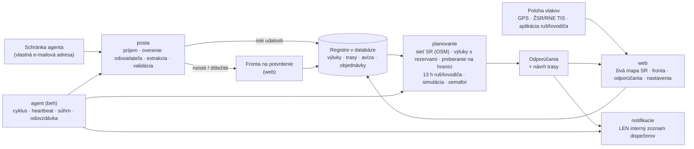

# Architektúra Agenta dispečera

Dokument podľa pravidla 1 v `PROMPT.md`: komponenty, dátový tok, rozhodnutia a ich dôvody.

## Prehľad

**Princíp:** agent je riadený pracovný tok, nie voľne uvažujúci jazykový model. Postup je pevný: udalosť → extrakcia (pravidlá, voliteľne LLM) → validácia → plánovanie (deterministický kód) → odporúčanie → upozornenie len dispečerom. Navonok agent nič nevykonáva.

## Komponenty a súbory

| Komponent | Súbory | Úloha |
|---|---|---|
| Konfigurácia | `vlaky/config.py` | Všetky nastavenia sú premenné prostredia `VLAKY_*` (vzor v `.env.example`). |
| Databáza | `vlaky/db.py`, `vlaky/models.py` | SQLAlchemy 2. SQLite na vývoj a testy, PostgreSQL na serveri. Časy sa ukladajú v UTC. |
| Sieť SR | `vlaky/siet/osm_import.py`, `vlaky/siet/graf.py`, `data/siet/*` | Graf z OpenStreetMap (23 176 uzlov, 27 098 úsekov, 1 115 dopravní s kódmi UIC a skratkami ŽSR). Zabezpečuje hľadanie staníc, trasovanie podľa rozchodu a trakcie, obchádzky, úseky výluk vrátane súbežných koľají a priradenie GPS polohy ku koľaji. |
| Hraničné priechody | `vlaky/hranice.py`, `data/hranice.json` | 23 priechodov podľa Sieťového vyhlásenia ŽSR 2027 a preberacie stanice (PPS). |
| E-maily | `vlaky/posta/*` | Zdroje (adresár, IMAP, Microsoft Graph), parser s prílohami, overenie odosielateľa (zoznam a SPF/DKIM/DMARC), karanténa, extrakcia (pravidlá SK/CZ a voliteľne LLM), validácia, fronta na potvrdenie, použitie udalostí. |
| Plánovanie | `vlaky/planovanie/planovac.py`, `vlaky/rozhodovanie.py` | Vyhodnotenie vlaku: trasa, výluky, pripravenosť, pridelené trasy, rušňovodič, simulácia Monte Carlo, semafor, odporúčanie, návrh trasy. |
| Notifikácie | `vlaky/notifikacie/*` | E-mail (SMTP), Teams, SMS – iba interný zoznam (kontrola v kóde), tieňová prevádzka, deduplikácia, súhrny. |
| Beh agenta | `vlaky/agent/beh.py`, `zdravie.py`, `odovzdavka.py` | Cyklus (schránka → prepočet → upozornenia → návrhy pre nové objednávky), heartbeat na externý monitoring, súhrn INFO, odovzdávka služby, denná správa, zámok proti dvom inštanciám. |
| Stráženie | `vlaky/agent/strazenie.py` | Upozornenia 90/60/30 min pred 13 h limitom rušňovodiča a pri prekročení – od nástupu zmeny v službe (inak naplánovanej, ktorá je na rade, s nástupom najneskôr teraz), idúci vlak bez známeho nástupu podľa odhadu plánovača z posledného odporúčania (`crew.unknown_start`, kľúč `crew:odhad:<id vlaku>:<odhad nástupu>:<úroveň>`, text „odhad – …“); neplánované státie vlaku (> 20 min), GDPR – mazanie starých polôh (90 dní) a obsahu e-mailov (365 dní). |
| Odpovede dispečerov | `vlaky/posta/odpovede.py` | Odpoveď `PRIJAŤ` / `ZAMIETNUŤ dôvod` na e-mail agenta – len z interného zoznamu a po overení odosielateľa, príkaz ako celé prvé slovo prvého riadku a len k aktuálnemu odporúčaniu vlaku (o zastaranom sa nerozhoduje, rovnako ako vo webe). Mení iba stav odporúčania. Nezapísaný príkaz agent dispečerovi krátko vysvetlí e-mailom (len jemu, s odkazom na aktuálne odporúčanie; na odpoveď bez príkazu najviac raz za interval deduplikácie). Automatické správy (neprítomnosť, potvrdenie o prečítaní) nespracúva a neodpovedá na ne. |
| Kalibrácia (F4) | `vlaky/planovanie/kalibracia.py` | Z histórie navrhne P50/P90 dôb preberania na hraniciach a zdržaní na 100 km. Použije sa až po schválení vedúcim (`python -m vlaky kalibracia --aplikovat`). |
| Nasadenie rušňovodičov (F4) | `vlaky/planovanie/nasadenie.py` | Model CP-SAT (OR-Tools): 13 h zmena, odpočinok 11 h, znalosť trate, prekryvy a čo najkratšie presuny. Výsledok je len návrh. |
| Koncepty správ | `vlaky/planovanie/planovac.py` (`_drafts`) | Text objednávky ad hoc trasy pre ŽSR (IS KIS, P5) a informácia pre zákazníka. Agent ich neodosiela. |
| Web | `vlaky/web/*` | Živá mapa SR, tabuľka vlakov, fronta na potvrdenie, odporúčania (prijať, upraviť, zamietnuť), vlaky, výluky, hranice, rušňovodiči (13 h), nastavenia, audit, zdravie, stránka pre rušňovodiča. |
| Prevádzka | `Dockerfile`, `docker-compose.yml`, `deploy/*`, `docs/PREVADZKA.md` | VPS v EÚ, Docker Compose (PostgreSQL, web, agent, Caddy s TLS), zálohy, monitoring, systemd varianta. |
| Ukážka | `vlaky/simulacia/demo.py`, `data/ukazkove_emaily/*` | Fiktívne vlaky, výluky a e-maily na reálnej sieti a simulátor polohy. |
| Referencia | `referencia/*` | Spustiteľná špecifikácia rozhodovacích pravidiel. Kanonický modul `vlaky/rozhodovanie.py` musí dávať rovnaké výsledky (test). |

## Rozhodnutia a ich dôvody

1. **Sieť z OpenStreetMap, nie z RINF.** Dáta OSM pre SR sú čerstvé (extrakt z predchádzajúceho dňa) a obsahujú kódy UIC, skratky ŽSR, elektrifikáciu, napätie, rozchod, rýchlosti a čísla tratí. Prístup k RINF/ERA nebol z vývojového prostredia dostupný. Importér `import-osm` sa dá na serveri spustiť kedykoľvek znova. Údaje TTP od ŽSR sa môžu doplniť cez `LocationInfo` (čakanie, odstavenie, výmena rušňovodiča, dĺžky koľají). Licencia ODbL: uvádzať „© prispievatelia OpenStreetMap“ (mapa to robí).
2. **Výluka zasiahne celý úsek – a nič navyše.** Úsek výluky sa určí ako cesta medzi obvodmi dvoch dopravní (motorová aj elektrická trakcia) po rozchode, ktorý obe dopravne obsluhujú, plus súbežné koľaje rovnakého rozchodu do 40 m. Inak by vlak „obišiel“ výluku po druhej koľaji tej istej trate. Rozchod dopravne určia koľaje pri nej a jej staničné koľaje či výhybky do 400 m; ak dopravne spoločný rozchod nemajú, úsek sa hľadá po oboch. Súbežná trať iného rozchodu (ŠRT popri trati 190 medzi Nižnou Myšľou a Kuzmicami) do úseku nepatrí; dlhá hrana, ktorá leží pri úseku len čiastočne, sa pridá len ako tá istá trať (spoločné číslo trate). Ak by úsek viedol po oboch rozchodoch, rozhodne číslo trate z výluky. Koľaje v obvode koncových dopravní (zhlavia spoločné s inými traťami) sa do úseku nepočítajú, takže výluka odbočnej trate (napr. Vrútky – Martin) nezastaví vlak na hlavnej trati. Výluka, ktorú sa nepodarí umiestniť na sieť, sa neignoruje: vlak, ktorého sa môže týkať, nedostane ZELENÚ a dispečer vidí dôvod.
   - **Výluka alebo mimoriadnosť v jednej dopravni (od = do):** zahŕňa koľaje rozchodu, ktorý dopravňa obsluhuje, ak ich časť leží do 600 m od bodu alebo uzla dopravne (pri odbočke, výhybke č. a vlečke len 200 m) a sú s koľajami dopravne spojené – aj hlavné koľaje, ktoré stanicou len prechádzajú. Trať, ktorá s koľajami dopravne nie je spojená ani do 1,5 km (napr. most), k nej nepatrí. Dopravňa s koľajami jedného rozchodu a bez koľaje pre oba rozchody v obvode (Slivník ŠRT, Ruskov) súbežnú trať iného rozchodu nezahŕňa; výslovne uvedené číslo trate pridá koľaje tejto trate. Vlaku sa takáto výluka týka len v časti trasy v obvode dopravne: idúci vlak, ktorý stanicu prešiel, sa jej netýka a pomalá jazda v stanici sa počíta len v obvode.
   - **Názvy dopravní:** skratky (Výh., Odb., Zast.) sa rozvinú. Pri rovnakých názvoch sa použije poradie vyhľadávania (stanica pred zriaďovacou stanicou) a všetky záznamy s tým istým názvom do 2 km od seba (napr. stanica a zriaďovacia stanica Žilina-Teplička); iný záznam sa použije len vtedy, ak je k druhej dopravni aspoň o polovicu bližšie.
   - **Poistka:** výluka v dopravni, ktorá je bodom trasy vlaku, sa vlaku priradí aj tak; rovnako výluka medzi dvoma dopravňami trasy, ktorej úsek v modeli siete trasu medzi nimi nezasiahne (Žilina-Teplička – Varín). Dopravňa sa pritom počíta, len ak obsluhuje rozchod vlaku. Výnimkou je úsek na trati s číslom z výluky, ktoré trasa medzi dopravňami nemá (výluka trate 190 a vlak na ŠRT).
   - **Obe traťové koľaje:** výluky koľaje toho istého úseku medzi dvoma dopravňami, ktoré v rovnakom čase vylučujú dve rôzne koľaje (1. a 2. TK, ľavú a pravú; dva rozkazy aj s rôznym číslom ROV či trate, dva riadky SROV), alebo jedna výluka koľaje „obe“, „všetky“, „1 a 2“ sú pre čas prekrytia úplná výluka (`planovac._both_tracks_windows`, dôvod „… sú vylúčené obe traťové koľaje (výluky #a a #b) – úsek nie je zjazdný, počíta sa ako úplná výluka“; nepotvrdená ktorákoľvek z nich = nepotvrdené okno). Číslo trate sa neporovnáva (úsek môže patriť viacerým tratiam), koľaj bez čísla či strany („TK“) sa nekombinuje a v stanici (od = do) sa výluky koľají nespájajú. Výluka jednej koľaje, aj oboch koľají v rôznom čase, ostáva zdržaním.
3. **Rozhodovanie je deterministické a testované.** Používa simuláciu Monte Carlo so spoločnými náhodnými číslami. Hrubý prechod 24 h po krokoch `VLAKY_STEP_MINUTES` (predvolene 10 min) ide s 600 vzorkami, najlepší kandidáti sa spresnia s 4 000 vzorkami. Prepočet vlaku trvá 1 – 2 s. Odchody sa hľadajú v pevnej mriežke – v násobkoch kroku v absolútnom čase (napr. 09:10, 09:20, …); prvý skúmaný odchod je čas pripravenosti. Mriežka sa neposúva s časom prepočtu, takže ďalší cyklus agenta bez zmeny údajov dá ten istý odchod aj semafor (pri 15-min cykle a 10-min kroku by sa inak najskorší odchod striedal o 5 min a semafor pri hranici rezervy blikal ZELENÁ/ORANŽOVÁ).
4. **Konzervatívnosť.** Nepotvrdené výluky (aj tie, ktoré čakajú vo fronte na potvrdenie) sa započítavajú. Výluka z e-mailu, ktorú dispečer ešte neoveril (záznam „navrh“ so zdrojovou udalosťou – čaká vo fronte alebo je zapísaná automaticky), sa navyše posudzuje ako poistka ZELENEJ (`_unverified_email`): vlak, ktorého trasa ňou vedie v období možnej jazdy [min(teraz, pripravenosť) − 2 h, pripravenosť + horizont + 2 × jazdná doba + 2 h], nie je ZELENÝ – údaje prečítané z e-mailu (druh, termín, úsek) môžu byť nesprávne. Dôvod je v odporúčaní („… z e-mailu (udalosť #N) ešte nie je overená dispečerom …“) a v `data_age["obmedzenie"]`. Overená a ručne zadaná výluka (aj ručný návrh) poistku nemajú – nepotvrdená výluka bez poistky je v dôvodoch len ako informácia („… ešte nie je potvrdená dispečerom – počíta sa s ňou“). Výluky a ich denné okná, ktoré skončili viac ako 2 h pred možným odchodom vlaku, sa v dôvodoch neuvádzajú medzi výlukami „na trase vlaku“ ani medzi nepotvrdenými – plán vlaku sa ich netýka; neoverenú výluku z e-mailu odporúčanie uvádza ďalej ako poistku („plán vlaku sa jej podľa prečítaného termínu netýka …“). Bez čerstvých dát o polohe, pri polohe mimo plánovanej trasy, pri idúcom vlaku bez záznamu o nástupe rušňovodiča a bez úspešnej kontroly schránky v posledných 30 min nie je ZELENÁ (čas kontroly sa zapíše len po úspešnom a úplnom načítaní schránky – pozri „Nahromadená pošta a čas cyklu“). Rušňovodič bez rezervy do 13 h znamená aspoň ORANŽOVÚ. Obmedzenie (druh „obmedzenie“ – nápravová hmotnosť, dĺžka či hmotnosť vlaku) na zvolenej trase v čase jazdy (odchod až príchod P90 ± 30 min; obmedzenie len pre elektrickú trakciu nie pri motorovom vlaku) vlak nezastaví, ale odporúčanie, varianty aj návrh k objednávke sú nanajvýš ORANŽOVÉ s dôvodom „Obmedzenie na trase – overte parametre vlaku: …“ – plánovač parametre vlaku voči obmedzeniu neoveruje (tvrdá poistka, nie mäkká – zmena na ORANŽOVÚ je nové odporúčanie s upozornením; farba sa potom nemení, kým obmedzenie platí, takže správa sa neopakuje). Vlak bez pridelenej trasy dostane pokyn „objednať trasu“ s lehotou `new_path_lead_min`; odstavenie idúceho vlaku vždy znamená novú trasu s touto lehotou. Výluky sa načítajú pre celé obdobie možného odchodu (aj vlaky a objednávky na niekoľko dní dopredu). Chyba výpočtu jedného vlaku nenechá platné staré odporúčanie: vlak dostane ESKALOVAŤ s popisom chyby. Záznam o chybe výpočtu má vlastný odtlačok: skutočná eskalácia po cykle s chybou (aj po zázname o chybe zo staršej verzie) je nové odporúčanie s upozornením (KRITICKÉ aj SMS) a chyba po eskalácii nie je tichá. Vyššia priorita pri rovnakom odtlačku (napr. KRITICKÉ po DÔLEŽITOM) je vždy nové odporúčanie. Každý vlak sa prepočíta vo vlastnej vnorenej transakcii (SAVEPOINT; na SQLite sa predtým otvorí transakcia `BEGIN IMMEDIATE`), takže ani chyba databázy pri jednom vlaku nezastaví ostatné.
   - **Preberanie na hranici (vlak zo zahraničia):** plánuje sa s dobou preberania P90. Vlak je „v zahraničí“, kým nie je zapísaný jeho príchod na vstupnú hranicu (preberanie „očakávané“ alebo stav „na ceste k hranici“ bez preberania) – nikdy vlak, ktorý podľa svojho stavu už stojí na koľajach ŽSR (prevzatý, odstavený: nedopísané preberanie je len evidencia a limit 18 h mu beží). Avízo v budúcnosti a do 30 min po ňom (príchod sa zapisuje s oneskorením) je plán príchodu: pripravenosť = avízo + P90. Uplynuté avízo bez zapísaného príchodu nie je príchod (rovnako chýbajúce avízo bez budúceho času pripravenosti): bez času pripravenosti zapísaného po avíze sa počíta najskôr s príchodom teraz + P90 („Vlak ešte neprišiel na hranicu (…; avízo …, meškanie … min)“ a či vlak stihne pridelenú trasu); s časom pripravenosti zapísaným po avíze (hlásenie rušňovodiča „pripravený“ alebo dispečer) sa počíta s ním, nie však skôr ako avízo + P90 – pridelená trasa sa nezahodí a dôvod povie „Príchod na hranicu (…) nie je zapísaný“ a čo by sa stalo, keby vlak ešte neprišiel. Pripravenosť staršia ako avízo neplatí. Kým dispečer nezapíše príchod alebo nové avízo, vlak je nanajvýš ORANŽOVÝ.
   - **Výluky čakajúce na potvrdenie:** výluka z e-mailu, ktorá čaká na potvrdenie a dostala záznam „navrh“ (napr. každá výluka do 72 h), spustí prepočet vlakov v tom istom cykle agenta ako automaticky zapísaná výluka (súhrn pošty `planning`); pravidelný prepočet, ktorý je v tom istom cykle na rade, agent vynechá a posunie (`last_evaluate`). Ak prepočet po e-maile zlyhá celý, agent v tom istom cykle prepočíta vlaky znova (inak by ZELENÁ ostala do pravidelného prepočtu); ak zlyhal len pri niektorých vlakoch (tie už majú záznam o chybe výpočtu), znova len tie – a ak zlyhá aj to, cyklus hlási chybu (heartbeat `/fail`). Čakajúce zrušenie či zmena pridelenej trasy (nie ponuka trasy z KIS) a výluka, pomalá jazda či mimoriadnosť bez záznamu pre plánovač (termín sa nepodarilo prečítať, podozrivý e-mail, chyba zápisu, potvrdená udalosť so zlyhaným zápisom) tiež spustia prepočet v tom istom cykle a dispečeri hneď dostanú upozornenie DÔLEŽITÉ s odkazom na každú udalosť (`/fronta/udalost/N`; jedna správa za cyklus, ku každej udalosti len raz, pri viacerých udalostiach predmet s ich počtom; pri čakajúcom zrušení trasy veta, že odchod na novú trasu objednanú podľa prijatého odporúčania plánovač neobmedzí). Prepočet a upozornenie dostane aj výluka, pomalá jazda či mimoriadnosť, pri ktorej sa nepodarilo prečítať žiadnu dopravňu. Plánovač s ich údajmi počítať nevie, preto pri každom vlaku zistí (`vlaky.posta.spracovanie.pending_uncertainty`), či sa ho taká udalosť môže týkať – zrušenie či zmena trasy, s ktorou počíta, alebo úsek výluky na trase vlaku, umiestnený na sieť rovnako ako výluka z registra (aj pre vlak, ktorý začína alebo končí vnútri úseku; úsek, ktorý sa na sieť umiestniť nedá, sa týka vlaku s jeho dopravňou na trase, a ak nie je známa žiadna jeho dopravňa, každého vlaku). Udalosť bez akejkoľvek dopravne (napr. len „trať 180 v km 212,4“) sa s číslom trate (`line_ref`) týka vlakov, ktorých trasa vedie touto traťou, bez neho každého vlaku, ktorého obdobie jazdy sa s ňou prekrýva (bez termínu stále; dôvod „miesto sa nepodarilo prečítať – overte vo fronte“, mäkká poistka – pozri nižšie). Čakajúce zrušenie či zmena pridelenej trasy obmedzí odporúčanie aj pri pláne na novú trasu (zmenená trasa môže vlaku vyhovovať); výnimkou je čakajúce zrušenie pri odchode na novú trasu objednanú podľa prijatého odporúčania, ktoré zrušenie pôvodnej trasy nariadilo – potvrdenie zrušenia z KIS je očakávané a odporúčanie ho len pripomenie. V porovnaní variantov obmedzí čakajúca udalosť k pridelenej trase len varianty na nej. Taký vlak nedostane ZELENÚ, kým dispečer udalosť nepotvrdí (s opravou) alebo nezamietne, a dôvod je v odporúčaní. Výluka, ktorá už má záznam v registri, sem nepatrí (s tou plánovač počíta), rovnako udalosť, ktorej záznam medzitým prevzala novšia zapísaná udalosť (potvrdená zmena či zrušenie tej istej výluky – novšia má prednosť). Ostatné čakajúce udalosti (napr. „iné“) prepočet nespúšťajú. Zápis záznamu „navrh“ beží v samostatnom SAVEPOINT a hodnoty sa skracujú na dĺžky stĺpcov, takže chyba databázy nezahodí udalosti e-mailu. Potvrdenie udalosti nikdy potichu neprepíše úpravy, ktoré dispečer urobil v registri výluk v zázname udalosti (`validation.register_fields`); výslovná oprava vo fronte má prednosť.
   - **Úsek z registra pri udalosti len s číslom výluky:** zmena, zrušenie či nový termín bez úseku („STORNO – ROV 5330/2026“, „Výluka podľa ROV 5310/2026 sa odkladá o týždeň“) dostane úsek z registra výluk (`spracovanie._register_place`) ešte pred poistkou pre celý vozový park a upozornením DÔLEŽITÉ – len keď je to isté: výluky s týmto číslom od tej istej OR a s rovnakým druhom dokumentu (ROV, SROV, telegram, POTR – druh pred číslom v e-maile a v čísle výluky či v e-maile, ktorý ju zapísal; čísla ROV a telegramov sú samostatné rady, výluka zadaná ručne len s číslom sa nepoužije) ležia v registri na jednom úseku a vlastný text e-mailu (predmet, telo bez citácie a podpisu, prílohy) neuvádza iné miesto, ktoré pravidlá neprečítali (`_mail_names_place`: názov dopravne kdekoľvek v texte – aj na začiatku vety, veľkými písmenami, skloňovaný či skrátený, malými písmenami len presný názov stanice –, mesto s viacerými dopravňami, slová úsek, žst., stanica, zastávka, dopravňa, obvod, trať, „tr.“, „TÚ“, „Miesto:“, „medzi“, km, odbočka, vlečka; pozdrav, podpis „OR …“ a mená osôb za titulom miestom nie sú). E-mail, ktorý sa nedá celý overiť (príloha, ktorej text sa nedal prečítať, text dlhší ako 60 000 znakov – `PLACE_SCAN_CHARS`), úsek nedostane; text sa prechádza raz (zámok registra sa nedrží dlhšie ako pri spracovaní pravidlami). Termín sa z registra nedopĺňa (register má pôvodný termín): udalosť bez termínu ostáva bez záznamu pre plánovač, vlaky v úseku nedostanú ZELENÚ, kým termín nedoplní dispečer, a zrušenie bez termínu ruší celú výluku. Udalosť vždy potvrdzuje dispečer; fronta uvedie „Úsek … doplnený z registra výluk podľa čísla …“, alebo prečo sa nedoplnil (iné miesto, iný dokument, výluka bez druhu dokumentu, viac úsekov, iná OR), a čakajúca udalosť potom obmedzí len vlaky v tomto úseku. Zmena s úsekom z registra má dočasný záznam pre plánovač, no rozdeleniu výluky novšou zmenou nebráni – pri potvrdení sa priradí k časti výluky, s ktorou sa jej termín prekrýva (novšia zapísaná zmena toho istého dňa ju nahradí); zrušenie časti výluky na ňu počká.
   - **Poistky ZELENEJ pri zvolenej trase:** výluka mimo siete, čakajúca udalosť z e-mailu, neoverená výluka z e-mailu a obmedzenie na trase sa posudzujú pri trase, ktorú agent odporúča – aj pri obchádzke (PRESMEROVAŤ). Varianty inej trasy s poistkou nie sú ZELENÉ a okná nezvolenej trasy s poistkou (okrem obmedzenia) sa neuvádzajú ako okná bezpečného odchodu; obmedzenie sa pri každej variante posudzuje v čase jej jazdy (`_variant_restrictions`: odchod − 30 min až príchod P90 + 30 min). `pending_uncertainty_routes` posúdi všetky trasy vlaku jedným dotazom; návrh k objednávke (`plan_order`) má rovnaké poistky pri každej trase (aj obmedzenie).
   - **Mäkké poistky ZELENEJ (bez búrky správ):** zmena farby len pre mäkkú poistku – poloha idúceho vlaku práve zostarla (najviac `POSITION_HOLD_MIN` = 30 min po `VLAKY_POSITION_STALE_MINUTES`, poloha na trase), čakajúca udalosť z e-mailu bez miesta (bez dopravne aj trate), neoverená výluka z e-mailu, ktorej všetky okná v období možnej jazdy podľa prečítaného termínu ležia mimo plánu vlaku (okno začína viac ako 2 h po príchode vlaku (P90) alebo skončilo viac ako 2 h pred jeho možným odchodom – pripravenosť, idúci vlak teraz; napr. dnešná výluka a vlak na zajtra; pri dennej výluke sa posudzuje každé okno a okno, ktoré plán zasahuje, je tvrdá poistka s dôvodom o tomto okne; výluka, ktorá skončila pred min(teraz, pripravenosť) − 2 h, vlak neobmedzí vôbec) – aktualizuje doterajšie nové odporúčanie aj s farbou bez nového odporúčania a správy (farba pri mäkkej poistke nikdy nie je ZELENÁ; po jej skončení sa to isté odporúčanie bez správy vráti na ZELENÚ); pri prijatom odporúčaní vznikne nové s prioritou podľa ZELENEJ (zvyčajne INFO – bez e-mailu, len súhrn a web). Odtlačok aj priorita sa počítajú zo ZELENEJ (`fingerprint_color`), semafor ZELENÝ nie je a `data_age["obmedzenie"]` uvádza dôvod. Zhoršenie, ktoré trvá dlhšie (poloha stará viac ako limit + 30 min), je nové odporúčanie s upozornením. O udalosti bez miesta sa dispečer dozvie z jedného upozornenia DÔLEŽITÉ spracovania pošty, o vlaku, ktorého plánu sa neoverená výluka týka, z jeho odporúčania. Dôvody čakajúcich udalostí (`posta.spracovanie.PendingNote`) nesú druh a číslo udalosti a príznak udalosti bez miesta (`fleet`).
   - **Poradie udalostí z e-mailov:** záznam v registri patrí udalosti, ktorá ho naposledy zapísala; staršia udalosť stav novšej neprepíše (pri potvrdení je nahradená a fronta povie „Udalosť potvrdená, ale nič sa nezapísalo“). Potvrdené zrušenie výluky odstráni dočasné záznamy starších čakajúcich zmien tej istej výluky (audit `zmeny_zrusenej_vyluky_odstranene`) – plánovač s ich termínom prestane počítať, fronta pri nich upozorní a ich neskoršie potvrdenie výluku znova nezaloží. Čakajúce zmeny novšie ako zrušenie ostávajú. Ak dispečer potvrdené zrušenie zamietne, výluka sa obnoví a staršie čakajúce zmeny dostanú dočasný záznam znova.
   - **Termíny toho istého ROV:** udalosti jedného e-mailu nie sú zmenou ani zrušením výluky, ktorú zapísala iná udalosť z neho – ROV s dvoma termínmi má po potvrdení oba termíny (potvrdenie druhej udalosti nesmie presunúť prvú). Nová výluka, pomalá jazda či mimoriadnosť s číslom výluky v registri je tou istou výlukou len s rovnakým termínom (začiatok ± 1 h) a obmedzením (druh a koľaj – pozri „Register výluk z e-mailov“ nižšie) alebo keď jej záznam medzitým zapísala novšia udalosť (staršie oznámenie je ňou nahradené); v inom termíne je to ďalší termín ROV a dispečer dostane upozornenie „… v inom termíne … – zapíše sa ako ďalší termín (ROV môže mať viac termínov). Ak ide o presun termínu, pôvodný termín v registri zrušte alebo upravte.“ Zrušenie s termínom patrí termínu, s ktorým sa prekrýva. Zmena, ktorá by viacdennú výluku presunula na kratší termín, ktorý sa s ňou neprekrýva („dňa 25.11. sa presúva na 28.11.“ pri výluke 23. – 27.11.), ju celú nepresunie: čaká na potvrdenie a potvrdenie ponechá pôvodnú výluku a nový termín zapíše ako ďalšiu výluku (s vysvetlením); dispečer upraví termín pôvodnej výluky (napr. ju rozdelí).
   - **Fronta po stranách a odkaz na udalosť:** fronta na potvrdenie má strany po 50 udalostí s celým formulárom (najstaršie prvé – poradie potvrdzovania zmien tej istej výluky ostáva poradím príchodu); ostatné čakajúce udalosti sú na každej strane v krátkom zozname s kotvou `#udalost-N` a zamietnutím. Odkaz v upozornení DÔLEŽITÉ aj v registri výluk je `/fronta/udalost/N`: čakajúcu udalosť ukáže s celým formulárom navrchu fronty (`/fronta?udalost=N`, aj z inej strany), automaticky zapísanú nepotvrdenú v časti „Zapísané automaticky“ a spracovanú s informáciou, ako, kto a kedy ju spracoval (`spracovanie.processed_state` – „zamietnutá (dispecer2, 16.11. 10:30)“, „potvrdená a zapísaná do registra (dispecer1, …)“, „potvrdená …, ale nič sa nezapísalo – záznam medzitým zmenila novšia udalosť #5“); rovnako odpovie web na potvrdenie či zamietnutie udalosti, ktorú medzitým spracoval kolega (nič sa znova nezapíše). Po chybe potvrdenia vo fronte (chybné polia, chyba spracovania, zlyhaný zápis) a po nezapísanom potvrdení tlačidlom Potvrdiť v registri výluk (zlyhaný zápis, záznam medzitým zmenila novšia udalosť) sa dispečer vráti na formulár tej istej udalosti (`/fronta?udalost=N#udalost-N`); neočakávaná chyba pri potvrdení v registri ho vráti do registra výluk.
   - **Súbežná úprava výluky:** formulár úpravy nesie odtlačok stavu záznamu (verzia, stav, údaje, udalosť, ktorej záznam patrí). Ak výluku medzitým zmenil niekto iný (napr. potvrdená zmena z e-mailu alebo kolega), uloženie sa odmietne (HTTP 409, audit `closure_update_conflict`) a formulár ukáže aktuálne údaje aj neuložené zadanie dispečera. Poznámka a technický koniec výluky „do odvolania“ do odtlačku nepatria – posun konca agentom formulár nezneplatní (koniec ošetrí zobrazený koniec). Formulár dočasného záznamu zmeny, ktorý medzitým odstránilo potvrdenie či zamietnutie zmeny (kolega), uloženie nevráti ako „Stránka neexistuje“: ukáže formulár výluky, v ktorej údaje sú (`views_evidencia._replaced_row`; pri rozdelení časť s novým termínom a zoznam častí), s vysvetlením a neuloženým zadaním (HTTP 409, audit `closure_update_conflict` s `nahradeny_zaznam`); starý odkaz na dočasný záznam presmeruje na túto výluku.
   - **Poradie súbežných prepočtov toho istého vlaku** (web „nový vlak“ a potvrdenie avíza, agent a web): určuje ho skutočný začiatok prepočtu – `evaluate_train` ho zaznamená (hodiny servera, nie čas plánu) ešte pred čítaním údajov. `_store` ukladá pod zámkom vlaku (PostgreSQL `pg_advisory_xact_lock(EVAL_LOCK_KEY, id vlaku)` do konca transakcie, SQLite `BEGIN IMMEDIATE`) a začiatok zapíše do `data_age["eval_started"]` nového, aktualizovaného aj nezmeneného prijatého odporúčania. Ak posledné odporúčanie uložil prepočet, ktorý začal neskôr, starší prepočet neuloží nič (ani záznam o chybe výpočtu), nič neoznačí za zastarané a vráti novšie odporúčanie. Prepočet všetkých vlakov ide v poradí podľa id, zámky sa teda berú v rovnakom poradí. Uložený začiatok neskorší ako aktuálny čas o viac ako 5 s (`EVAL_CLOCK_TOLERANCE`) je posun hodín servera späť (NTP po obnovení virtuálneho servera) – výsledok sa uloží a log zapíše upozornenie; pri posune do 5 s sa prepočet nemusí uložiť (zachytí ho najbližší prepočet). Predpokladá sa, že web a agent bežia na tom istom serveri (docker compose), prípadne s hodinami synchronizovanými cez NTP; hodiny databázy sa nepoužívajú. Prepočet z webu posiela upozornenia až po potvrdení prepočtu, keď sú zámky vlakov uvoľnené (bod 5, „Doručovanie“).
   - **Limit 18 h (PIS, odstavenie):** ráta sa od začiatku státia na koľajach ŽSR (`trains.standing_since_utc`), nie od posledného prepočtu. Zapisuje ho len modul `vlaky/planovanie/stav.py`: príchod na vstupnú hranicu zapíše čas príchodu; prevzatie a odstavenie ponechajú doterajší začiatok, inak najskoršiu platnú kotvu (príchod na hranicu, zmeškaná trasa), inak čas zmeny – po jazde vždy čas odstavenia; odchod (aj hlásenie rušňovodiča „odchod“, ktoré zapíše skutočný čas odchodu `trains.departed_utc`), ukončenie, zrušenie a odovzdanie ho vymažú. Pred každou úpravou vlaku vo webe sa začiatok státia zapíše z doterajších kotiev, takže ani zmena času pripravenosti či stavu limit neposunie; hlásenie „pripravený“ nezmení minulý ani chýbajúci čas pripravenosti, ak by tým kotva zmizla. Minulá pridelená trasa je kotvou len pre túto jazdu (trasa vlaku alebo trasa s jeho číslom bez priradeného vlaku v deň jazdy ± 1 deň; vlak bez dátumu jazdy a časov = najbližšia jazda) a len ak na nej vlak stál pripravený na koľajach ŽSR a nevyšiel – nie pri odstavenom vlaku ani pri vlaku ešte v zahraničí. Príchod na hranicu prestáva byť kotvou, keď vlak po ňom skutočne vyšiel. Pre staršie záznamy bez začiatku státia sa použijú náhradné kotvy (príchod na hranicu, čas pripravenosti odstaveného alebo prevzatého vlaku). Ak limit uplynie skôr, ako je vlak pripravený, odporúčanie je len ESKALOVAŤ. Dôvod rozlišuje, či limit už uplynul („stojí dlhšie ako 18 h“), alebo uplynie v uvedenom čase ešte pred pripravenosťou – vtedy môže dispečer vlak ešte pripraviť skôr alebo dohodnúť so ŽSR novú trasu. Návrat z jazdy na stojaci stav je opravou omylom zaznamenaného odchodu (hlásenie „odchod“ alebo stav „v jazde“, keď vlak nevyšiel) – obnoví sa začiatok státia aj čas odchodu spred omylu (`stav.set_status`) a limit 18 h beží ďalej –, ak tak rozhodne dispečer vo formulári vlaku (pri zmene stavu z „v jazde“ voľba „odchod bol omyl – vlak nevyšiel“ / „vlak išiel“), inak ak polohy po odchode ukazujú, že vlak stál (posledná nanajvýš 30 min stará), alebo ak návrat príde do 30 min od odchodu a žiadna poloha neukazuje pohyb viac ako 2 km. Inak (skutočná jazda) státie začína odstavením. Správa po uložení vždy povie, ktoré pravidlo sa použilo. Čas prechodu do stavu „v jazde“ (aj ručnou zmenou vo webe) si modul pamätá v tabuľke key_value („jazda:<id vlaku>“, `stav.running_since`) – slúži aj ako kotva odhadu polohy a nástupu rušňovodiča; pri odchode z jazdy sa záznam zmaže. Aplikácia rušňovodiča pred odoslaním „Odchod“ žiada potvrdenie.
   - **Posuny odchodu:** posun pevného odchodu o menej ako 30 min nie je nové odporúčanie ani upozornenie – porovnáva sa s odchodom, ktorý dispečer dostal. Odchod „čo najskôr“ (idúci vlak, najskoršia nová trasa po lehote P5, najmenej zlá možnosť pri eskalácii) sa s časom posúva sám a nie je zmenou situácie – nevytvára nové odporúčanie ani upozornenie. Pri idúcom vlaku sa namiesto odchodu porovnáva predpokladaný príchod (posun o 30 min a viac = nové odporúčanie, menší posun aktualizuje doterajšie nové odporúčanie bez upozornenia). Či nové odporúčanie po posune odchodu či príchodu príde samostatnou správou, určuje jeho priorita (`_priority`): ORANŽOVÁ, ČERVENÁ, iné rozhodnutie, rušňovodič bez rezervy či potrebná nová trasa = DÔLEŽITÉ alebo KRITICKÉ (e-mail, Teams, SMS); ZELENÉ odporúčanie s rovnakým rozhodnutím (aj ORANŽOVÉ len pre mäkkú poistku – priorita sa ráta zo ZELENEJ) má prioritu INFO – len web a súhrn (`VLAKY_DIGEST_MINUTES`, predvolene 120 min). Idúci vlak s POČKAŤ („pokračovať v jazde o …“ – čas pokračovania sa ráta od aktuálnej polohy a s každou novou polohou sa posúva, príchod určuje koniec výluky; `chosen.floating`, `chosen.compare_arrival`) sa porovnáva podľa príchodu vždy – aj pri starej polohe či bez polohy (vlak hlásený len cez TIS stojí pred výlukou a ďalšie hlásenie pošle až pri odchode) a aj keď dispečer doterajšie POČKAŤ prijal; predĺženie výluky je tak vždy nové odporúčanie (pri ZELENEJ s prioritou INFO – na webe a v súhrne, bez samostatného e-mailu). Za posúvajúci sa s časom (neporovnáva sa – `chosen.arrival_floating`) sa príchod považuje len pri pokračovaní hneď zo starej polohy alebo bez polohy aj času odchodu a pri čakaní pred zatvoreným cieľom po hranicu výpočtu (`until_entry`). Odstavenie sa podľa príchodu neporovnáva. Poloha idúceho vlaku bez GPS sa odhaduje od najneskoršieho možného odchodu: skutočného (hlásenie rušňovodiča), inak od času, keď vlak prešiel do stavu „v jazde“ (vlak išiel najneskôr vtedy – oneskorený vlak, ktorý dispečer označí „v jazde“ pri odchode, tak nie je hneď „podľa plánu v cieli“ a výluky pred ním nezmiznú), inak od minulého plánovaného odchodu (vlak zadaný rovno ako idúci). Odhad neprejde cez blokujúcu výluku, ktorá platila, keď by k nej vlak podľa plánu prišiel – vlak podľa neho čaká pred ňou do jej konca. Stará poloha (staršia ako `VLAKY_POSITION_STALE_MINUTES`) sa nezahodí, ale je dolná hranica: vlak nikdy nie je ďalej, než kde bol naposledy (výluka pred meškajúcim vlakom tak nezmizne), výsledok nie je ZELENÝ a príchod pri pokračovaní hneď sa neporovnáva (s časom sa posúva; pri POČKAŤ áno – pozri vyššie). Zmena farby len preto, že poloha práve zostarla, je mäkká poistka (pozri vyššie) – nové odporúčanie s upozornením vznikne, až keď nová poloha nepríde ani 30 min po limite. Udalosť jazdy ŽSR/TIS/TAF z dopravne na trase je poloha na trase (km dopravne podľa názvu, `_official_progress`) – aj bod východiskovej stanice mimo hrán trasy. Ak by však vlak od nej (bez polohy od odchodu) podľa plánu, aj s čakaním pred výlukami, už bol v cieli, agent odporučí POKRAČOVAŤ ORANŽOVÁ „podľa plánu by už mal byť v cieli – overte polohu a po príchode ukončite jazdu“ – bez výluk za vlakom, bez návrhu trasy a bez eskalácie. Odtlačok eskalácie neobsahuje trasu najmenej zlej možnosti. Prijaté odporúčanie sa pri malej zmene nemení; nahradí ho len podstatná zmena.
   - **Vlak v cieli:** v cieli je idúci vlak na konci trasy (posledných 50 m), vlak, ktorého príchod do cieľovej dopravne hlási ŽSR/TIS (udalosť jazdy cez `/api/udalosti-jazdy` – dopravňa je istá, hoci jej bod leží mimo konca trasy), a vlak v obvode cieľovej dopravne (do 600 m od jej bodu alebo uzla). Trasa v grafe končí na okraji obvodu, preto vlak čakajúci pred vjazdom (napr. 900 m pred koncom trasy) v cieli nie je a rušňovodič sa ráta ako v službe. Pri blokujúcej výluke v cieľovej dopravni alebo na úseku trasy, ktorý do nej vedie, sa uzná len koniec trasy a hlásenie ŽSR/TIS (vlak môže stáť pred stanicou – výluka sa započíta); výluka trate za cieľom (jej druhá dopravňa nie je na trase vlaku) príchod neovplyvní. Príchod je prvá z nepretržitého radu posledných polôh v cieli (aj pri poslednej známej polohe) – ďalšie polohy z cieľa ho ani koniec pracovného času rušňovodiča (príchod + ukončenie) neposúvajú a čakanie pred vjazdom ho neskracuje. Vlak v cieli sa neprepočítava od východiska: dostane POKRAČOVAŤ „vlak je v cieli (…, príchod …) – ukončite jazdu“ bez výluk za vlakom, návrhu trasy, variantov a eskalácie; ZELENÁ len s čerstvou kontrolou schránky a známym nástupom rušňovodiča.
   - **Idúci vlak tesne pred cieľom** (do 2 km pred koncom trasy, `NEAR_DEST_KM`; bez polohy na trase podľa odhadu z plánu – text „podľa odhadu asi … km“): `recommend(allow_stabling=False)` – len POKRAČOVAŤ („… dokončiť jazdu (čakať na vjazd)“) alebo POČKAŤ pred cieľom, bez ODSTAVIŤ, novej trasy a návrhu trasy s jedinou dopravňou. Simulácia nepočíta pracovný čas rušňovodiča (`NEAR_CREW_START`) – posudzuje sa zvlášť pri príchode, resp. po čakaní; vymyslený rušňovodič od odchodu by pri dlhom čakaní pridal 2 h. Ak nič nie je bez rizika, ESKALOVAŤ sa zmení na POČKAŤ/POKRAČOVAŤ ČERVENÁ („Žiadna možnosť nie je bez rizika – najmenej zlá je … informujte zákazníka …“); odchod je plávajúci a zmena sa posudzuje podľa predpokladaného príchodu (`chosen.compare_arrival`, posun o 30 min a viac = nové odporúčanie). Keď je najmenej zlý odchod na konci prehľadávaného obdobia (cieľ zatvorený dlhšie), texty čas odchodu neuvádzajú (`chosen.until_entry` – „dokončiť jazdu po uvoľnení vjazdu“, predmet a SMS „POČKAŤ pred cieľom“, krok na webe „Počkať pred vjazdom do cieľa, kým sa neuvoľní vjazd …“). Uplynutý čas vystriedania rušňovodiča znie „vystriedať ihneď (limit 13 h uplynie/uplynul o …)“.
   - **Rušňovodič bez záznamu o nástupe:** pri idúcom vlaku sa pracovný čas len odhaduje – nástup = najskorší možný odchod vlaku (skutočný z hlásenia „odchod“, inak plánovaný, ak nie je neskorší ako čas prechodu do stavu „v jazde“, inak podľa pridelenej trasy, inak čas prechodu do jazdy) mínus príprava; odhad sa s časom neposúva (budúci plánovaný odchod sa nepoužije). Všade sa uvádza ako „odhad: vystriedať najneskôr o … (nástup rušňovodiča nie je zadaný)“, bez času odchodu ako „limit 13 h sa nedá overiť – zadajte nástup rušňovodiča“; stav je aspoň ORANŽOVÁ, ČERVENÁ, ak by limit prekročil aj odhad. Naplánované vystriedanie nezakryje zmenu, ktorá prebieha, ani naplánovanú zmenu, ktorá je na rade – k odchodu patrí zmena, ktorá je na rade, nie neskoršie vystriedanie. Zaznamenaná zmena má vždy svoj nástup (k menu rušňovodiča sa nepripíše vymyslený); ak začína až po odchode mínus príprava (tolerancia 15 min), stav je aspoň ORANŽOVÁ s návrhom posunúť nástup alebo zvoliť neskorší odchod. Hlásenie „Nástup na zmenu“ z aplikácie rušňovodiča začne zmenu, ktorá je na rade (nástup najneskôr o 30 min), nie neskoršie vystriedanie; vystriedanie naplánované aspoň 30 min po začiatku bežiacej zmeny začne zmenu ďalšieho rušňovodiča a bežiacu ukončí. Bez naplánovanej zmeny vznikne skutočná zmena so spoločným neaktívnym rušňovodičom „neznámy (nástup z mobilu)“ (dispečer doplní meno), takže limit 13 h aj upozornenia 90/60/30 min bežia od nahláseného nástupu. Ak vlak už ide (nástup nahlásený dodatočne), začiatok zmeny je najneskôr odchod mínus príprava (pri naplánovanej zmene k odchodu nie neskôr ako jej nástup) a neskoršie naplánované vystriedanie sa takým hlásením nezačne. Strážnik (`strazenie.crew_alerts`) používa rovnaké pravidlo ako plánovač: zmena (prebiehajúca, inak naplánovaná, ktorá je na rade) s nástupom najneskôr teraz stráži limit od svojho nástupu; idúci vlak bez takej zmeny dostane upozornenia podľa odhadu plánovača, vždy označené „odhad“, takže po limite plánovača nemlčí. Upozornenia strážnika (90/60/30 min, PREKROČENÝ limit aj jeho pripomenutia) uvádzajú „Vystriedať najneskôr o: …“, len kým ten čas neuplynul; potom (vždy pri 30 min do limitu a po jeho prekročení) „Vystriedať ihneď (limit 13 h uplynie/uplynul o …)“, pri odhade „Odhad: vystriedať ihneď (…)“ – rovnako ako odporúčanie a odovzdávka služby (`texty.relief_overdue`). Web neprijme zmenu „prebieha“ s nástupom viac ako 5 min v budúcnosti (`FUTURE_START_TOLERANCE_MIN`; do 5 min ho zapíše ako teraz) a upozorní, ak má rušňovodič inú zmenu, ktorá prebieha, alebo ak na vlaku prebieha aj zmena iného rušňovodiča (vystriedanie zadané na webe ju na rozdiel od nástupu z odkazu rušňovodiča neukončí). „Vystriedať najneskôr“ na stránke Rušňovodiči je vlastný limit zmeny mínus odovzdanie; časy a farba z odporúčania sa použijú len vtedy, keď odporúčanie opisuje túto zmenu (nástup v tolerancii 60 s, `web.data.crew_matches_shift`).
   - **Zmena „prebieha“ s nástupom v budúcnosti** (starší záznam – formuláre ani odkaz rušňovodiča taký nástup nezapíšu) nie je nástup – plánovač, strážnik aj web pri idúcom vlaku počítajú len s odhadom. Plánovač (`active_shift`) berie zo zmien „prebieha“ tú s najneskorším nástupom, takže by zakryla neskôr zadaný skutočný nástup; preto ju web (`rusnovodic.end_future_running`) ukončí, keď vlak dostane nástup, s ktorým plánovač počíta (zmena „prebieha“ alebo naplánovaná s nástupom najneskôr teraz – formuláre, Nástup teraz, odkaz rušňovodiča). Ukončenie je rovnaké ako „Ukončiť“ (audit `shift_end` s pôvodným nástupom a dôvodom) a hlášku dostane ten, kto nástup zadal (dispečer na webe, rušňovodič v aplikácii); plánovač sa kvôli starým záznamom nemení. Odkaz rušňovodiča berie za bežiacu zmenu len zmenu s nástupom najneskôr teraz (zmena s budúcim nástupom nástup ani vystriedanie neodmietne). Stránka Rušňovodiči pri takej zmene ukáže „nástup je v budúcnosti – opravte čas nástupu“ a pri vlaku bez záznamu o nástupe odkaz na ňu; upozornenie podľa odhadu to povie tiež.
   - **Stabilita odporúčaní a rozhodnutie dispečera:** okrem pevnej mriežky odchodov (bod 3) platí: voľba POČKAŤ/ODSTAVIŤ pri tom istom odchode (± tolerancia trasy), trase a semafore sa bez zmeny údajov nemení, kým je náklad doterajšej voľby najviac o `robustness_premium` (10 %) vyšší – bod zlomu čakať/odstaviť (5 h) tak s plynúcim časom nevyvolá nové odporúčanie. Vlak v stave „odstavený“ alebo s prijatým ODSTAVIŤ už jednorazový náklad odstavenia neplatí, takže ho agent neprepne na POČKAŤ (držať ho pripravený s rušňovodičom) len preto, že čas plynie. **Rozhodnutie dispečera** je posledné prijaté (aj upravené) odporúčanie vlaku; platí, kým dispečer neprijme iné, aj keď medzitým vzniklo ďalšie odporúčanie (napr. ORANŽOVÁ pri výpadku schránky) – nie však rozhodnutie spred posledného skutočného odchodu vlaku. Nová trasa z prijatého odporúčania (objednaná v lehote P5) sa ponúka aj po vstupe do lehoty 6 h, kým jej čas (± tolerancia trasy) neuplynie, kým je bezpečná a kým ŽSR neodpovie – nová alebo zmenená pridelená trasa vlaku, ktorú odporúčanie ešte nepoznalo, je odpoveď a ďalej platia pridelené trasy; prijaté odporúčanie sa len preto nenahradí neskoršou plávajúcou trasou. Neprijaté odporúčanie s pevným časom novej trasy sa po vstupe do lehoty nahradí (trasu už nemožno objednať včas). Odchod teraz na objednanú, no nepridelenú trasu nikdy nie je ZELENÝ („overte pridelenie v IS KIS“); súhrn takého odporúčania nevyzýva trasu objednať znova.
   - **Texty a návrh k objednávke:** ODSTAVIŤ s odchodom na vlastnú pridelenú trasu (v tolerancii) znie „vypraviť na pridelenú trasu o …“ (nie „pôvodnú trasu odrieknuť, nová trasa“), vlak bez trasy „objednať trasu na …“, odstavený vlak „vlak ostáva odstavený“, po prijatom odporúčaní s novou trasou „nová trasa na … (objednaná podľa prijatého odporúčania)“ (bez výzvy objednať ju znova); koncept pre zákazníka pri odchode na pridelenú trasu neuvádza obmedzenie na trati. Koncept objednávky ad hoc trasy pre ŽSR je v e-maile aj na webe len pri odchode, ktorý novú trasu potrebuje. Návrh prepravy k objednávke (`plan_order`) má rovnaké poistky ZELENEJ ako vlak, pri každej trase objednávky: variant je nanajvýš ORANŽOVÝ bez úplnej kontroly schránky v posledných 30 min, pri výluke na jeho trase, ktorú sa nepodarilo umiestniť na sieť, pri čakajúcej udalosti z e-mailu, s ktorou plánovač nevie počítať (pozri „Výluky čakajúce na potvrdenie“), pri neoverenej výluke z e-mailu na jeho trase a pri obmedzení na jeho trase v čase jeho jazdy; dôvod uvedie vysvetlenie aj e-mail s návrhom. Návrh trasy (`_path_proposal`) rozloží časy dopravní rovnomerne medzi odchod a predpokladaný príchod; ak by tak vlak išiel úsekom blokujúcej výluky počas nej (s rezervami pred a po výluke; vypnuté trakčné vedenie len pri elektrickom vlaku), ukáže jazdu podľa jazdnej doby s čakaním na dopravni pred výlukou do konca jej okna (príchod aj odchod, kľúč `hold`, v e-maile „– čakať pred výlukou“) a zvyšok jazdy natiahne na predpokladaný príchod – nikdy nie časy vnútri výluky (ani pri najmenej zlej možnosti ESKALOVAŤ). Idúci vlak: POČKAŤ znie „POČKAŤ, pokračovať v jazde o …“ (nie „vypraviť“), e-mail má namiesto „Odchod: <čas prepočtu>“ riadok „Pokračovať v jazde: ihneď“ alebo „Pokračovať v jazde o: …“ a v porovnaní variantov je pokračovanie bez čakania „POKRAČOVAŤ“ s časom „ihneď“, zvolené čakanie pred cieľom zatvoreným dlhšie, ako siaha výpočet, „po uvoľnení vjazdu“ (`texty.departure_line`, `texty.variant_columns`); kontrolný zoznam pred odchodom dostane len pri ODSTAVIŤ a kroky v detaile odporúčania (`views_prehlad._next_steps`) pri ORANŽOVEJ neradia vypraviť (POČKAŤ, ODSTAVIŤ, PRESMEROVAŤ: „ORANŽOVÁ: vlak je v jazde – odporúčanie vykonať až po výslovnom potvrdení dispečera“; POKRAČOVAŤ: „ORANŽOVÁ: vlak je v jazde – preveriť dôvody nižšie (poloha, rušňovodič, výluky na trase)“). Čísla v textoch plánovača, správ a odovzdávky sú po slovensky (`notifikacie.texty`): desatinná čiarka (`dec` – zostáva 0,8 h, 110,1 km), limity bez „,0“ (`hours` – 13 h, 18 h, 12,5 h), tisíce s medzerou (`number` – 1 500 t) a počty so správnym tvarom (`count` – súhrn „Čaká na potvrdenie dispečerom: 1 udalosť / 3 udalosti / 5 udalostí z e-mailov“, karanténa „1 e-mail / 3 e-maily / 5 e-mailov“); na webe aj veľkosť prílohy vo fronte. Preberanie znie „Preberanie v PPS Čadca“. Popis udalosti (`posta.spracovanie.describe_event` – predmet upozornenia DÔLEŽITÉ, fronta, audit) uvádza udalosť bez dopravne ako „(miesto sa nepodarilo prečítať)“ a výluku či pomalú jazdu bez termínu ako „(termín sa nepodarilo prečítať)“. Denná správa má v hlavičke dátum po slovensky („Denná správa Agenta dispečera (02.11.2026)“) a uvádza stav agenta po slovensky (`zdravie.detail_lines` – „Posledná kontrola schránky: …“, „Nastavenie odosielania správ: …“ – rovnaké popisy ako stránka `/zdravie`) a „posledný stav čítania schránky: v poriadku / upozornenie / chyba“.
   - **Nahromadená pošta a čas cyklu:** kontrola schránky sa počíta, len keď je schránka dočítaná – zdroj (adresár, IMAP, Graph) po načítaní dávky 50 e-mailov hlási, či ostali ďalšie, a IMAP zastavený na e-maile, ktorý sa nedal uložiť, dočítaný nie je. Čiastočné čítanie čas kontroly neposunie (`mail_last_ok` bez `ts`, s poslednou úplnou kontrolou `last_full` a začiatkom dočítavania `since`), takže plánovač ani web ho neberú ako čerstvý a ZELENÁ nie je, kým sa schránka nedočíta: odporúčanie uvedie „Agent ešte dočítava nahromadenú poštu (posledná úplná kontrola schránky pred X min) – výluky nemusia byť aktuálne.“, web „schránka agenta sa dočítava – posledná úplná kontrola pred X min“. `zdravie.data_freshness` vracia okrem textu aj kódy dôvodov (`cycle_missing`, `cycle_stale`, `mailbox_missing`, `mailbox_old`, `mailbox_partial`) a príznak `outage`; samotné dočítavanie nahromadenej pošty nie je výpadok – odovzdávka vtedy povie, že agent beží a dočítava poštu, a na kapitolu 12 príručky odkáže len pri výpadku agenta alebo schránky. Ďalšia dávka ide o 5 s. Aby dispečeri pri každej hromadnej pošte nedostali o zelených vlakoch správu „ORANŽOVÁ“, pravidelný prepočet počká na dočítanie, zhoršenie ZELENÁ → ORANŽOVÁ pri rovnakom rozhodnutí z prepočtu počas dočítavania sa neposiela (oboje najviac `VLAKY_REEVALUATE_MINUTES` od začiatku dočítavania) a v cykle, v ktorom sa schránka dočíta, agent prepočíta všetky vlaky (`last_evaluate.neuplna_schranka`, spúšťač „schránka dočítaná“). Zmena rozhodnutia, prvé odporúčanie vlaku a KRITICKÉ sa posielajú hneď (odložiť všetko by nešlo: plánovač určuje prioritu podľa posledného uloženého odporúčania, nie podľa poslaného). Kroky po čítaní schránky (prepočet, upozornenia, stráženie, odovzdávka) počítajú s aktuálnym časom, nie so začiatkom cyklu – čítanie môže trvať dlho (nahromadená pošta, časový limit jazykového modelu); zmeškaná odovzdávka služby sa doplní do 90 min po výmene.
   - **Obmedzený semafor na webe:** web nikde neukáže ZELENÚ, ktorú obmedzil plánovač alebo vek dát agenta. Plánovač zapisuje, prečo ZELENÁ nie je dovolená, do `data_age["obmedzenie"]` (web aj e-mail podľa neho obmedzia varianty a okná). Pravidlo čerstvosti dát (`vlaky.agent.zdravie.data_freshness`: cyklus agenta starší ako 2 × `VLAKY_REEVALUATE_MINUTES`, schránka bez úplnej kontroly 30 min) je jedno pre web aj odovzdávku služby: odovzdávka bez čerstvých dát začína „POZOR: Údaje agenta nie sú čerstvé (…)“, pri vlakoch uvedie čas prepočtu a ZELENÉ vlaky uvedie ako ORANŽOVÉ. Pracovný čas rušňovodičov počíta odovzdávka vždy k času odovzdávky zo zmien (prekročený limit „PREKROČENÝ“, uplynulý čas vystriedania „vystriedať ihneď“, pri texte odporúčania s uplynulým časom poznámka „[teraz: …]“). Keď semafor obmedzil plánovač (zoznam v `data_age["obmedzenie"]`: schránka alebo poloha pri prepočte staršia ako limit, poloha mimo plánovanej trasy, idúci vlak bez záznamu o nástupe rušňovodiča, rušňovodič bez rezervy, neistá pripravenosť vlaku zo zahraničia, nepridelená trasa z prijatého odporúčania, výluka mimo siete, čakajúca udalosť či neoverená výluka z e-mailu, obmedzenie na trase; ďalej zvolená ZELENÁ varianta pri inej farbe odporúčania) alebo web (agent nemá čerstvé dáta – vtedy je aktuálne odporúčanie vlaku všade ORANŽOVÉ s poznámkou „pôvodne ZELENÁ“, aj v histórii odporúčaní a v upozorneniach nástenky; staršie odporúčania si farbu ponechajú), varianty v detaile odporúčania majú najviac farbu odporúčania a okná odchodu sú nadpísané „Okná odchodu podľa výluk – len informatívne“ aj s dôvodom. Neobmedzená ORANŽOVÁ (lacnejšia ORANŽOVÁ pred drahšou ZELENOU) ukáže drahšiu ZELENÚ variantu a jej okná bez obmedzenia. Detail aktuálneho odporúčania počíta zostávajúci pracovný čas rušňovodiča, jeho farbu a vek polohy, schránky a cyklu agenta k teraz; hodnoty pri prepočte sú uvedené zvlášť.
   - **Živý stav otvorenej stránky a rozhodnutie pri neaktuálnych dátach:** detail odporúčania, detail vlaku, zoznam odporúčaní a zoznam vlakov nesú odtlačok toho, čo ukazujú (`data-zivy-stav`: farba a stav odporúčania, čas prepočtu, rozhodnutie, čerstvosť dát agenta, aktuálne odporúčanie, stav vlaku, rušňovodič a limit jeho pracovného času), hlavné údaje (`data-zivy-hlavne`) a čas servera (`data-teraz`). Otvorená stránka sa každú minútu a po návrate na kartu opýta tej istej adresy s hlavičkou `X-Vlaky-Stav: 1`; server vráti len JSON `{stav, teraz, vek}` – odtlačok, čas servera a pri detaile aktuálneho odporúčania aj časy údajov (poloha, posledná úplná kontrola schránky, posledný cyklus agenta), ku ktorým stránka „pred N min“ znova ukotví. Vek aj „Zostáva do limitu“ (`data-countdown-limit`) sa počítajú k času servera, nie k hodinám počítača dispečera. Pri zmene odtlačku si stránka obsah obnoví (`X-Vlaky-Obnova: 1` – flash správa sa pri tom nečíta ani nemaže); rozpísané poznámky a fokus ostanú, zaškrtnuté potvrdenia nie. Zmenu hlavných údajov ohlási výrazné upozornenie s pomenovaním zmeny („Stav sa zmenil (19:26) – Semafor: ZELENÁ → ORANŽOVÁ (bez čerstvých údajov agenta); …“, `role=alert`), ktoré ostane aj po ďalšej obnove; bežný prepočet s rovnakým výsledkom len nenápadný riadok „Údaje obnovené (HH:MM) – bez podstatnej zmeny.“. Detail vlaku s práve vytvoreným odkazom pre rušňovodiča sa neprepíše, len upozorní. Detail aktuálneho odporúčania sám (každých 30 s, aj bez spojenia so serverom) označí kontrolu schránky staršiu ako 30 min a polohu staršiu ako limit čerstvosti (`data-vek-limit`); bez spojenia so serverom (alebo po odhlásení) každá živá stránka po dvoch neúspešných dopytoch upozorní, že stav nie je overený – ZELENÁ tak po výpadku agenta na otvorenej stránke neostane bez upozornenia. Rozhodnutie (`POST /odporucania/{id}/rozhodnutie`) overí čerstvosť na serveri tým istým pravidlom (`web.data.recommendation_status`): ak sa aktuálne ZELENÉ odporúčanie bez čerstvých dát agenta ukazuje ako ORANŽOVÉ, Prijať a Upraviť vyžadujú výslovné potvrdenie (`potvrdit_neaktualne`) a audit zapíše zobrazenú farbu (`color` = ORANŽOVÁ, `computed_color`, `stale_confirmed`, `data_freshness`) – nikdy neaktuálnu ZELENÚ. Skryté pole `farba` nesie semafor, ktorý stránka ukazovala: ak sa odvtedy zhoršil (tichá aktualizácia odporúčania, výpadok agenta), Prijať ani Upraviť sa neuloží. Zamietnutie potvrdenie nepotrebuje, v audite je zobrazená farba.
   - **Výluky za idúcim vlakom na webe:** najbližšie riziko na nástenke a v okne vlaku (`/api/vlaky`, `/api/vlaky/{id}`), výluky na trase a konflikt na časovej osi idúceho vlaku nepočítajú s výlukou, ktorú vlak už prešiel. Poloha na trase je z poslednej správy o polohe (`web.data.route_progress_m`, aj staršej – vlak je aspoň tam, rovnako ako v plánovači), pri hlásení ŽSR/TIS/TAF z dopravne podľa km dopravne na trase. Výluka je za vlakom, až keď koniec jej koľají na trase (pri opakovanom prejazde posledný výskyt, `RouteInfo.edge_last`) leží viac ako 1 km (`PASSED_MARGIN_M`) za vlakom; poloha mimo trasy alebo bez polohy neskryje nič.
   - **Varianty idúceho vlaku na webe:** pokračovanie idúceho vlaku (u plánovača druh VYPRAVIŤ) je v porovnaní variantov POKRAČOVAŤ s odchodom „v jazde“, nie VYPRAVIŤ s časom prepočtu; zvolené čakanie pred vjazdom do zatvoreného cieľa (`chosen.until_entry`) „po uvoľnení vjazdu“. Idúci znamená: rozhodnutie POKRAČOVAŤ, `until_entry` alebo aktuálne odporúčanie vlaku v jazde s iným rozhodnutím ako VYPRAVIŤ (`views_prehlad._running_rec`; odporúčanie VYPRAVIŤ spred odchodu si označenie ponechá). Časová os nástenky popisuje jazdu „v jazde“, „čaká pred vjazdom do cieľa“, inak „odchod …“.
   - **Slovenské texty webu:** chyba 422 (stránka aj API) je po slovensky – miesto chyby („Parameter adresy „strana““, „Pole „lat““, „Položka 2, pole „lat““), typ a hranice; vlastný text validátora bez anglického „Value error,“; v API je `detail` po slovensky, `errors[].msg` pôvodný a `errors[].text` slovenský. Export CSV má desatinnú čiarku bez oddeľovača tisícov, áno/nie, časy RRRR-MM-DD HH:MM v miestnom čase, smer preberania vstup/výstup, stavy po slovensky – stav udalosti rovnakými slovami ako fronta („čaká na potvrdenie“, „informačná (bez potvrdenia)“, „zapísaná automaticky – výluka čaká na overenie“, „zapísaná automaticky (bez potvrdenia)“, „zapísaná do registra“, „potvrdená“, „potvrdená – zápis zlyhal (čaká vo fronte)“, „zamietnutá“) – a extraktor „pravidlá“ či „jazykový model (LLM)“. Dátum jazdy je na webe DD.MM.RRRR.
   - **Termíny z e-mailov:** dva po sebe idúce dni („12./13.11.“, „z 12.11. na 13.11.“, „z 12. na 13. novembra“) sú noc (jedno obdobie so začiatkom 12.11.) len pri označení noci („v noci“, „nočná“, „v nociach“ – hľadá sa pred celým zoznamom či rozsahom nocí) alebo pri časovom okne cez polnoc; inak „12./13.11.“ znamená oba dni a „z 12.11. na 13.11.“ presun na nový deň (rovnako „presúva sa / mení sa / preložená z … na …“). Okno v noci, ktoré začína po polnoci (pred 12:00), patrí k druhému dňu noci („v noci z 12. na 13.11. od 0:30 do 4:30“ = 13.11. 0:30 – 4:30); večerné okno a okno cez polnoc začínajú prvým dňom (aj dve okná jednej noci „od 23:30 do 24:00 a od 0:00 do 3:00“). Platí to aj pre zoznam a rozsah nocí a pre noc zapísanú dvoma dátumami („12.11.2026/13.11.2026“, „12.11./13.11.2026“); rozsah nocí („v nociach od 12./13. do 14./15.11.“) je denné okno cez všetky noci. Zoznam dní či nocí s jedným časovým oknom („12.11. a 13.11.2026 od 8:00 do 14:00“, aj skrátene „v dňoch 03., 04. a 05.11.2026“, „v nociach 03./04. a 04./05.11.2026“, „od 3. do 5.11.2026“) dá samostatné obdobie pre každý deň (chýbajúci mesiac a rok sa doplnia z nasledujúcich dátumov, aj cez prelom mesiaca); dni oddelené čiarkou, každý s vlastným oknom („12.11.2026 od 8:00 do 14:00, 13.11.2026 od 9:00 do 15:00“), sú samostatné obdobia. Rok prechádza celým zoznamom sprava doľava a zoznam sa číta chronologicky („28.12. a 2.1.2027“ = prelom roka). Zoznam, ktorého dni sú od seba viac ako ~2 mesiace, chronologický nie je: deň dávno pred prijatím e-mailu dostane nasledujúci rok, ak tak leží tesne za ďalším dátumom („3.12. a 27.11.2026“ → 3.12.2026, „2.1. a 28.12.2026“ → 2.1.2027), a udalosť dostane nižšiu istotu a poznámku „overte termín“. Skoršie časové okno (napr. kontaktné hodiny) sa k výluke nepripája. Dátum vydania, vyhotovenia, podpisu či rozhodnutia a pôvodný termín („zo dňa“) sa za termín nepovažujú. Pôvodný termín pri zmene sa nezapíše ako ďalšia zmena ani výluka, aj keď stojí za novým termínom (len poznámka „Pôvodný termín uvedený v e-maile (…) nie je novým termínom …“): za „namiesto“, „namísto“, „místo“, „miesto“, „pôvodne“, „… a nie …“, v zátvorke „(predtým …)“ / „(doteraz …)“, „Namiesto výluky dňa …“ a pôvodný termín presunu („plánovaná na 25.11. … sa presúva na 26.11.“, „sa z termínu 25.11. … presúva na …“, „presúva z 25.11.2026 08:00 – 14:00 na 26.11.2026 …“); časové okno sa nespáruje s pôvodným dňom, ak je pri ňom aj deň termínu („dňa 24.11. (namiesto 23.11.) od 08:00 do 14:00“ = 24.11.), a nový termín za zmienkou o pôvodnom („Pôvodne 25.11., nový termín 26.11. …“) sa nestratí. „Predtým dňa 20.11. bude výluka …“ na začiatku vety je ďalší (skorší) termín. V odpovedi s citovanou pôvodnou správou (riadky „>“, „Dňa … napísal(a):“, pri predmete „RE:“ aj oddeľovač „Original Message“ / „Pôvodná správa“ či blok hlavičiek „Od: … Odoslané: …“) sa termín berie len z nového textu, ak má nový text vlastný termín – dátum oznámenia, prijatia, „zo dňa“ či dátum v podpise citáciu nevymaže; citácia ostáva súvislosťou (úsek, číslo výluky). Preposlaná správa („Fwd:“) citáciou nie je. Čo sa nedá bezpečne prečítať (čísla dní bez bodky, zlé poradie, dátum v odseku nepriradený k žiadnemu obdobiu), sa nevymýšľa – udalosť dostane nižšiu istotu a poznámku „overte termín“.
   - **Mimoriadnosti, zrušenia a skončenia z e-mailov:** miesto „v (železničnej) stanici X“, „v žst./ŽST X“, „v obvode stanice X“ je dopravňa X (od = do) – mimoriadnosť dostane záznam „navrh“ ako každá výluka čakajúca na potvrdenie a po potvrdení je overenou výlukou v tejto dopravni. Obdobie berie len z vety o mimoriadnosti, nie okno náhradnej dopravy či kontaktu na dispečera; uvedené „od … do …“ určuje aj koniec (neskorší predpokladaný koniec ŽSR má prednosť – prísnejší prípad). Bez konca platí do odvolania (technický koniec + 30 dní) a dispečer dostane „overte koniec“ (rovnako, keď sa čas v texte nepriradil). Oznámenie ŽSR o skončení mimoriadnosti („ukončenie mimoriadnej udalosti“, „mimoriadna udalosť bola ukončená“, „prevádzka je obnovená“, „obe koľaje sú zjazdné“, „porucha bola odstránená“) nie je nová mimoriadnosť a do registra výluk sa nezapisuje: čaká vo fronte ako „iné“ s miestom a časom obnovenia. Mimoriadnosť sa automaticky nezruší, lebo oznámenie nemá číslo a podľa úseku by sa mohla zrušiť iná výluka (napr. plánovaný ROV) – ukončí ju dispečer v registri výluk. Ak text uvádza, že obmedzenie trvá (zápor „prevádzka nebola obnovená“, „trvá“, predpokladané či budúce obnovenie, obnovenie len po jednej koľaji, len motorové vlaky, vypnuté trakčné vedenie, odklon, náhradná doprava, „nie je zjazdná“), ostáva mimoriadnosťou (prísnejší prípad). Obmedzenie rýchlosti po obnovení prevádzky je samostatná pomalá jazda (do odvolania, ak nie je uvedený koniec). Zrušenie pomalej jazdy či POTR („ruší sa pomalá jazda … zavedená TLG č. 37/2026“, „Odvolávame POTR č. 12/2026“) je zrušenie s číslom rušeného dokumentu, nie s číslom telegramu, ktorý ruší, ani dokumentu, „na základe“ ktorého sa ruší. Celý e-mail je zrušením, len ak inde neohlasuje novú výluku či pomalú jazdu s termínom; e-mail s novou výlukou (ROV), ktorý zároveň ruší pomalú jazdu, ostáva novou výlukou a zrušenie s číslom je v ňom ďalšia udalosť (vždy ju potvrdzuje dispečer), bez čísla len upozornenie. „Do odvolania pomalá jazda“, „zrušenie … oznámime“ ani znovu oznámená POTR zrušením nie sú.
   - **Druh a zámer e-mailov ŽSR:** pravidlá čítajú voľný text a všetky formulácie nikdy nepokryjú – keď si nie sú isté, zapíšu prísnejší prípad s poznámkou „overte druh výluky“ či „overte termín“ a nižšou istotou; čo sa nepodarilo priradiť (termín, úsek, pomalá jazda, ktorá nie je samostatnou udalosťou), je v poznámke udalosti. **Druh obmedzenia** sa určuje z viet udalosti – najprv z vety s jej termínom, potom z vety s jej úsekom (veta s termínom, ktorá hovorí o inom úseku, k udalosti nepatrí); keď nesúhlasia, výluka (aj bez uvedeného druhu) má prednosť pred pomalou jazdou: výluka (ROV) sa nezmení na pomalú jazdu len preto, že text spomína pomalú jazdu („po výluke platí do odvolania pomalá jazda 50 km/h“, „POTR ostáva v platnosti“, „Pomalá jazda … platí do 19.11. Následne dňa 20.11. … úplná výluka v úseku …“). Úplná výluka (úplná výluka, „výluka bude úplná“, úsek úplne vylúčený či uzavretý, výluka oboch či všetkých koľají aj vymenovaných po jednej – „1. TK a 2. TK“, „koľaje č. 1 a č. 2“, „TK č. 1 a TK č. 2“ –, neprejazdný úsek, doprava prerušená, vlaky nepôjdu) sa posudzuje pred trakčným vedením a koľajou; „úplná“ mimo výluky („z dôvodu úplnej rekonštrukcie výhybky“, „úplná uzávierka cesty“), prerušená cestná premávka na priecestí, nepremávajúce vlaky či prerušená doprava po jednej koľaji („Po 2. TK vlaky nepremávajú“) a staničné koľaje č. 1 a 2 úplnou výlukou nie sú. Výluka koľaje bez čísla koľaje (na jednokoľajnej trati je to celá trať) a „úplná výluka trakčného vedenia“ bez výslovného „vlaky s motorovou trakciou môžu prejsť“ sú predpokladaná úplná výluka; „napäťová výluka oboch TK“ je výluka trakčného vedenia; číslo koľaje v stĺpci tabuľky („2. TK“) je výluka koľaje, riadok tabuľky so stĺpcom „Rýchlosť“ bez slova výluky pomalá jazda. Podpis za pozdravom („OR Trnava, oddelenie výluk“) sa do druhu e-mailu nepočíta. Obmedzenie sa nestratí: dva odseky s tým istým úsekom a časom, ktoré výslovne ohlasujú iný druh či koľaj výluky („Výluka 1. TK …“ a „Výluka 2. TK …“, „Výluka 1. TK …“ a „… bude vypnuté trakčné vedenie“), sú dve udalosti (odsek, ktorý výluku len spomína – „Počas výluky … budú vlaky jazdiť po 2. koľaji“ – či druh neuvádza, nie); v jednom odseku sa takto rozlíši len výluka koľaje a vypnuté trakčné vedenie, nie dve koľaje (Známe obmedzenia). „Výluka 1. traťovej koľaje a vypnutie trakčného vedenia v úseku …“ sú dve udalosti, „výluka 1. TK s vypnutím TV“ (TV nad vylúčenou koľajou) je výluka koľaje s poznámkou. Riadky tabuľky súborného rozkazu (SROV) s rovnakým úsekom a časom sú samostatné udalosti, ak sa líšia koľajou, druhom obmedzenia alebo číslom riadku (60/2026/1, 60/2026/2); úvodná veta, ktorá len opakuje úsek a čas riadku, ich nezdvojí, výslovne iný (prísnejší) druh v texte ostane ďalšou udalosťou. Riadky tabuľky prehľadu pomalých jázd so záhlavím stĺpcov s inou rýchlosťou (50 a 30 km/h) sú dve pomalé jazdy; v texte (odseky, vety, riadky zoznamu bez stĺpcov) pravidlá pomalé jazdy toho istého úseku a času s inou rýchlosťou či koľajou zatiaľ nerozlíšia (Známe obmedzenia). **Zámer:** automatická odpoveď (hlavička `Auto-Submitted: auto-replied`, `X-Autoreply`, `Precedence: auto_reply`, správa o doručení, predmet „Automatická odpoveď“, „Mimo kancelárie“ …) a pozvánka (`text/calendar` ako celá správa, príloha `.ics` s `METHOD:REQUEST`, organizátorom či účastníkmi, predmet „Pozvánka“) nie sú prevádzkové oznámenie – sú „iné“ s vysvetlením a LLM sa nevolá; správy KIS (`Auto-Submitted: auto-generated`) sa spracujú. Predmet newslettera, bulletinu či tlačovej správy a kalendárová príloha bez pozvánky (termín výluky na uloženie do kalendára) sú len slabý signál: e-mail s číslom ROV, SROV, telegramu či POTR sa spracuje ako prevádzkové oznámenie s poznámkou „overte“ (stratená výluka by dala falošnú ZELENÚ), bez takého čísla je „iné“. Hlavičky distribučného zoznamu (`Precedence: bulk/list/junk`, `List-Unsubscribe`) sú tiež slabý signál: e-mail je hromadný informačný („iné“ s vysvetlením, žiadna výluka ani s číslom ROV – `spracovanie._bulk_reason`) len spolu s predmetom newslettera, spravodaja, bulletinu či tlačovej správy (nie Re:/Fw:) a zároveň adresou odosielateľa typu newsletter@, spravodaj@, news, press, marketing; nikdy nie od výlukového, dispečerského či prevádzkového pracoviska alebo OR (vyluky.orke@, kis@, dispecing@ …), ktoré cez zoznamy posielajú aj ROV. **Zrušenie v texte** („… sa nekoná“, „bola zrušená“, „odpadá“, „nebude (z dôvodu …) vykonaná/realizovaná“, „ROV č. … (úsek, dátum) sa ruší“) je zrušenie; zmienka o inej, už zrušenej výluke („ako náhrada za výluku, ktorá bola zrušená“, „po zrušení výluky podľa ROV …“, „…, pretože pôvodná výluka bola zrušená“) zrušením nie je. Keď e-mail mimo viet o zrušení (aj v časti vety za čiarkou, napr. „…, výluka 2. TK z 20.11. odpadá“) ohlasuje novú výluku s termínom, je to nová výluka a zrušenie je ďalšia udalosť; termín vety, ktorá výluku ruší, je rušený termín, nie nová výluka. Rušený termín sa berie z časti vety, ktorá výluku ruší: obdobie len vtedy, keď celé leží v tejto časti (obdobie vedľajšej vety „…, ktorá mala trvať od 08:00 do 14:00, …“ ani obdobie spárované s oknom ďalšej vety rušeným termínom nie je). Vlastné okno vo vete s obdobím výluky („… dňa 12.11. od 08:00 do 14:00 sa v čase od 10:00 do 14:00 ruší“) je rušený čas v dni obdobia, vlastný deň pri viacdennom období („… v dňoch 24.11. až 27.11. … sa dňa 25.11. ruší“) rušený deň; „od 10:00 sa ruší“ platí do konca dňa, „ruší sa do 10:00“ od začiatku dňa. Viac okien, nocí či nesúvislých dní dá viac udalostí zrušenia – čas medzi nimi sa neruší; noc bez času je 22:00 – 06:00, ak e-mail vo vete o tej istej výluke neuvádza jej okno (nie z vety o inom úseku či o službe dispečera; „v noci z pondelka 23.11. na utorok 24.11.“ je noc). Čas, o ktorom e-mail píše, že ostáva („… sa ruší. Platí len v čase od 08:00 do 10:00“, „… platí bez zmeny“), sa z rušeného termínu vyreže (zrušenie sa rozdelí). Čas bez dňa dostane deň z vety, odseku alebo predmetu s poznámkou „overte“; bez dňa v celom e-maile ostane zrušenie bez termínu s poznámkou „… Doplňte termín zrušenia (začiatok a koniec), inak sa zruší celá výluka.“. „Nekoná sa v pôvodnom (plnom) rozsahu, ale len …“ je zmena, nie zrušenie. Veta s novým či náhradným termínom („Náhradný termín … , rozsah výluky sa nemení“, „Nová výluka …“, „Výluka bude dňa 14.11. …, úsek sa nemení“, „… bude aj dňa …“) je nová výluka – „sa nemení“ / „bez zmeny“ platí len pre termín vo vlastnej časti vety. „Uskutoční sa len …“ je zvyškom rušenej výluky, len ak jej čas leží v rušenom termíne alebo naň v tom istom dni nadväzuje (alebo veta o zrušení termín neuvádza – „Zvyšok výluky sa ruší“); iný čas či ďalší deň je nová výluka (aj „iba v čase od 18:00 do 22:00“ bez dňa – deň z vety o zrušení s poznámkou „overte“). Úsek za „okrem“ / „s výnimkou“ (aj za výrazom zrušenia), úsek, ktorého výluka „sa neruší / nezrušuje“, „zostane v platnosti“, „sa nemení“, „trvá“, „bude sa konať“, „nie je zrušená“, či pri ktorom „bude výluka podľa ROV“, sa nezruší (zrušenie bez vymenovaných úsekov ide len podľa čísla ROV s poznámkou „E-mail uvádza, že výluka v úseku … ostáva (koná sa) – zrušenie sa jej netýka …“); „nevykonáva“, „nebude vykonávať“, „nebudú dňa … vykonané“, „Výluka v úseku A – B ani v úseku B – C sa … nevykoná“ sú zrušenia. Zrušenia dvoch úsekov či dvoch termínov toho istého ROV sú samostatné udalosti. Možné či budúce zrušenie („o prípadnom zrušení Vás budeme informovať“) zrušením nie je, „… sa ruší a nahrádza ho …“ je zmena; presun jedného dňa („Výluka … dňa 25.11. sa ruší a presúva sa na 28.11. …“, „… dňa 25.11. sa nekoná. Náhradný termín: 28.11. …“) je nový termín ROV a zrušenie pôvodného dňa. Číslo rušenej výluky je číslo ROV, nie telegramu, ktorým sa ruší; zrušenie tej istej výluky v jednom e-maile (predmet priloženého e-mailu a jeho text) je jedna udalosť. Zrušenie POTR (pomalej jazdy) nájde v registri len pomalú jazdu s týmto číslom. Zrušenie s rušeným dňom (aj keď je deň len v predmete) nesie začiatok a koniec tohto dňa a po potvrdení zruší len tento deň (výluku rozdelí – pozri „Známe obmedzenia“), nie celú viacdennú výluku; „… platná od 23.11. sa v celom rozsahu ruší“ ruší celú výluku (dátum ju len označuje).
   - **Miesto, zoznamy a citácie v e-mailoch ŽSR:** **Miesto:** pre výluku aj mimoriadnosť znamenajú dopravňu X (od = do) tvary „v žst./ŽST X“, „v (železničnej) stanici X“, „v obvode stanice X“, „stanica X je …“ a „Žst. X …“, pri mimoriadnosti aj miestny pád („v Kraľovanoch“) a predmet. Miesto mimoriadnosti sa berie z vety o mimoriadnosti – úsek náhradnej autobusovej dopravy, odklonu či iného (už) prejazdného úseku ním nie je a skončenie na inom mieste („Úsek Žilina – Varín je už prejazdný.“) mimoriadnosť nekončí; dopravňa a iný úsek v tej istej vete – zapíše sa dopravňa (prísnejší prípad) s poznámkou. E-mail s viacerými mimoriadnosťami v samostatných odsekoch či položkách zoznamu, každou na inom mieste, dá udalosť pre každú. Výluka stanice uvedená vedľa úseku („úplná výluka v žst. X a v úseku X – Y“, „… vrátane zhlavia v žst. Y“) a ďalšia stanica vo vete o výluke („Úplná výluka v žst. Štrba a v žst. Poprad-Tatry …“, aj s vlastným termínom v zátvorke) sú ďalšie udalosti; stanica, kde vlaky čakajú či odchádzajú, nie. **Zoznamy:** úsek uvedený raz a termíny ako položky („1)“, „1. 01.12.2026 …“ – číslo položky nie je deň –, „a)“, „-“, „Termíny: … a …“, riadky „Začiatok výluky:“ / „Koniec výluky:“) a naopak dajú udalosť pre každý termín a úsek; v odseku s viacerými úsekmi aj termínmi sa páruje po vetách („A – B a C – D dňa X a dňa Y“ – každý s každým, „A – B dňa X, C – D dňa Y“ – v poradí); koľaj a druh položky zoznamu sú z jej vlastného odseku. Obdobie či úsek vo vedľajšej informácii (náhradná doprava, porada, pripomienky, žiadosti, objednávky trás, platnosť samotného rozkazu, ďalšie plánované výluky, premávka podľa GVD) nie je ďalšou výlukou, ak e-mail má aj iný termín; ako jediný termín e-mailu sa použije (prísnejší prípad). „Od 20.11.2026 14:00 do 30.11.2026“ je obdobie do konca 30.11. Tabuľka z HTML (prázdny riadok medzi riadkami) sa číta ako tabuľka. **Citácie:** príloha, ktorá pri odpovedi či preposlaní s vlastným termínom opakuje tú istú výluku (rovnaké číslo, bez čísel na oboch stranách rovnaký úsek – posudzuje sa predmet a vety s novým termínom, nie „V prílohe aj nový ROV č. …“), je len súvislosť; príloha, o ktorej text hovorí, že je aktualizovaná či nová („aktualizovaný ROV je v prílohe“), alebo ktorá uvádza nový termín z textu správy, citáciou nie je a jej termíny platia. V preposlanej odpovedi („FW: RE:“ v texte, priložený `.eml`) sa citovaný pôvodný ROV vymaže rovnako ako v odpovedi.
   - **Čiastočné obnovenie prevádzky a avízo:** obnovenie prevádzky, pri ktorom pre nákladné vlaky či vlaky s RID obmedzenie trvá („zákaz jazdy cez stanicu do 14:00“, „nákladné zatiaľ nie“, „až po 14:00“, „musia čakať do 15:00“, „nákladná doprava bude obnovená o 15:00“, odklon nákladných vlakov trvá), je mimoriadnosť v dopravni do uvedeného času (bez času do odvolania s poznámkou) – nie oznámenie o skončení. Kladné formulácie („obmedzenia pre nákladné vlaky nie sú“, „pokračujú v jazde“, „budú vypravené postupne“, „vracajú sa na pôvodnú trasu“) sú skončenie. **Avízo:** dátum za názvom stanice („príchod do Čadce 03.11.2026 o 15:10“) patrí k ETA, pôvodný čas aktualizácie („pôvodne 13:35“, „namiesto …“) sa nepoužije, ďalší čas za ETA („rušňovodiča pristaviť o 14:30“) je v poznámke; pri viacerých vlakoch platí ETA z riadku vlaku v tele, nie z predmetu.
   - **Vety, zápor a zákazy v e-mailoch ŽSR:** **Vety a časti vety:** jednotka hneď za číslom („14:00 h.“, „30 min.“, „nad 1600 t.“) pred veľkým písmenom ukončí vetu (skratka mena či názvu „J. Novák“, „N. Zámky“ nie) a veta môže začať dátumom („… do 14:00. 21.11. od 08:00 …“); dátum s vlastným časovým oknom za „h.“ či bodkou je ďalší termín zoznamu, nie koniec obdobia. Dve udalosti v jednej vete („Výluka A – B dňa X; dňa Y bude napäťová výluka TV v úseku B – C“, „…, a dňa Y …“) sa párujú po častiach vety (bodkočiarka, čiarka, „a dňa …“) a druh či koľaj každej sa určí len z jej časti vety. **Zápor:** vedľajšia časť vety s vlastným podmetom („…, spoje / NAD / obsluha vlečky nebude realizovaná“, „– rýchliky …“) výluku neruší, bez vlastného podmetu („…, z technických dôvodov nebude realizovaná“) je zrušením. „Termín … sa ruší“ je zrušením len s dátumom či slovom výluky hneď za slovom termín (nie „Termín na zaslanie pripomienok …“); „ŽSR OR … odvoláva výluku“, „STORNO – ROV …“ a „výluku v predmete stornujeme“ sú zrušenie, „Týmto ROV sa ruší ROV č. Y“ v rozkaze s novou výlukou zrušenie Y (ďalšia udalosť popri novej výluke), „… ruší a nahrádza ROV …“ zmena (samotné „ROV č. X ruší ROV č. Y“ je zatiaľ zrušenie – Známe obmedzenia), „sa odkladá“ zmena. **Vlaky neprejdú:** „jazda vlakov nebude možná“, „vlaky nebudú premávať“, „nepôjde žiadny vlak“, „vlaky budú odklonené“, „všetky vlaky sú odrieknuté“ – úplná výluka, pri texte s číslom koľaje či TV s poznámkou „Overte druh výluky“; nie pri „podľa GVD“, „po 2. TK“ a len osobných či elektrických vlakoch („zákaz jazdy elektrických vlakov“ pri výluke TV ostáva výlukou TV). **Zákaz jazdy:** mimoriadnosťou je len zákaz pre vlaky (aj „je zakázaný vjazd vlakov do úseku …“, „je jazda vlakov v úseku A – B zakázaná“ – prísudok najviac šesť slov za „jazda vlakov“, bez skratky s bodkou medzi nimi –, miesto „cez žst. X“); zrušený či neplatný zákaz je oznámenie o skončení, zákaz pre cestné vozidlá, osoby či len osobné vlaky mimoriadnosťou nie je a organizačná jednotka v predmete („OR Košice“) nie je miesto. Zákaz jazdy nákladných vlakov, zákaz vjazdu do stanice a zákaz pre vlaky s nebezpečným tovarom (RID) bez slova výluka sú mimoriadnosť na potvrdenie (prísnejší prípad, pri RID s poznámkou); obmedzenie dĺžky či hmotnosti vlaku je druh „obmedzenie“ (úvod bodu 4), zákaz jazdy vlakov s nápravovým zaťažením nad limit tiež, ak e-mail je ROV či hovorí o výluke – inak je mimoriadnosťou (prísnejší prípad). **Prehľad:** informatívnym prehľadom („iné“, čísla ROV v poznámke) je len e-mail, ktorý sám je prehľadom (predmet, „Prehľad je informatívny …“), nie ROV, ktorý prehľad v prílohe spomína; súborný rozkaz s vetou „Záväzné sú údaje v jednotlivých ROV“ sa číta normálne. **KD len s časom:** budúce okno („bude“, „dnes“) je v deň prijatia, „zajtra“ nasledujúci deň, predchádzajúci deň len pre okno, ktoré by v čase prijatia ešte trvalo (poznámka „Dátum začiatku nie je uvedený – predpokladá sa …“). **Tabuľka:** stĺpec „Termín“/„Dátum“ s rozsahom dní či s časom sa číta celý (s denným časom zo stĺpca „Čas“; poznámka „Bunka termínu „…“ uvádza viac dní …“). **Nákladné vlaky po obnovení:** „pôjdu / premávajú / sa budú vypravovať od 15:00“, „Nákladná doprava od 15:00“ – mimoriadnosť do 15:00; obmedzenie rýchlosti pre nákladné vlaky je pomalá jazda, nie zákaz ich jazdy.
   - **Kontroly konzistencie pravidiel – zápis nie je miernejší než text:** po extrakcii pravidlami prebehnú tri kontroly (`posta/pravidla.py`). (1) **Druh:** ak text udalosti obsahuje silné slová úplného uzavretia („trať bude úplne uzavretá“, „úplná uzávera trate“, „zákaz jazdy všetkých vlakov“, „1. aj 2. TK“, pri výluke TV „jazda motorových vlakov nie je možná“) a druh vyšiel miernejší, zapíše sa úplná výluka s poznámkou „Overte druh výluky – text obsahuje „…“ (úplné uzavretie) …“ a nižšou istotou. (2) **Sieť proti strate obsahu:** e-mail ŽSR s prevádzkovými slovami („uzavretý“ len s traťou, úsekom, koľajou, stanicou či výhybkou, „neprejazdný“, prerušená doprava, zákaz jazdy, „nesmú“ len s vlakmi …) a s termínom alebo dopravňou, z ktorého pravidlá nezapísali blokujúcu udalosť (a nejde o skončenie, zrušenie, automatickú odpoveď, pozvánku ani informatívny prehľad), dá výluku či mimoriadnosť na potvrdenie s poznámkou „E-mail obsahuje „…“, ale pravidlá z neho nevedeli zapísať udalosť – overte vo fronte …“ (aj bez miesta); oznamy o budove, pokladniach, parkovisku, čakárni, ceste, osobách, lístkoch či školení udalosť nevytvoria. (3) **Stratené údaje:** úsek, dopravňa, termín, dátum či čas vo vetách udalosti, ktoré sa nepriradili, sú v poznámke a znížia istotu.
   - **Korpus formulácií e-mailov ŽSR** (`tests/data/posta_korpus`) je miesto, kam patrí každá nová skutočná formulácia ŽSR z prevádzky – aj tá, ktorú pravidlá prečítali zle (konzervatívne so značkou `xfail`, nebezpečne spolu s opravou pravidiel). Má 659 prípadov: 228 e-mailov `.eml` v `maily/` a 431 krátkych textov priamo v `oracle.json`, každý s očakávaným výsledkom v poli `expect` (druh, úsek, obdobie v miestnom čase, obmedzenie, číslo). `tests/test_revizia5_korpus.py` ich spúšťa skutočnou extrakciou bez LLM: `test_korpus_bezpecne` nedovolí nebezpečný výsledok (stratená výluka či termín bez poznámky „overte“, miernejší druh, zrušenie, ktoré e-mail neohlasuje, mimoriadnosť s koncom skorším než oznámený), `test_korpus_presne` žiada presnú zhodu. Známe konzervatívne odchýlky (prísnejší druh, širší termín, poznámka „overte“, udalosť bez miesta – teraz 16) majú v `oracle.json` pole `xfail` s dôvodom a bežia ako `pytest.mark.xfail(strict=True)`: keď sa prípad opraví, test zlyhá a pripomenie značku odstrániť. Značka `xfail` je len pre konzervatívnu odchýlku – nebezpečný výsledok `test_korpus_bezpecne` neprepustí ani s ňou, taký prípad zlyhá, kým sa pravidlá neopravia. Nový prípad: `subject` a `body` (prípadne `sender`, `received`) priamo v `oracle.json`, alebo súbor v `maily/` s poľom `eml`.
   - **Register výluk z e-mailov – totožnosť výluky, OR, poistka „úsek ostáva“ a súbežnosť:** nová výluka, pomalá jazda či mimoriadnosť s rovnakým číslom je tá istá výluka len pri rovnakom termíne a rovnakom obmedzení (druh a koľaj; neuvedená koľaj sa zhoduje s každou) – vypnuté trakčné vedenie a výluka 1. TK, či 1. TK a 2. TK toho istého úseku a času oznámené zvlášť sú dve výluky („… s iným obmedzením – zapíše sa ako samostatná výluka, platia obe obmedzenia“). Zmena či zrušenie priradené len podľa čísla patrí výluke toho istého oblastného riaditeľstva (OR, `spracovanie.mail_issuer`): OR e-mailu sa určí z adresy odosielateľa (vyluky.orke@…, …@ortt.…, pri adrese ŽSR aj samotný kód – ke.vyluky@…), inak z predmetu či textu („OR Košice“, „Oblastné riaditeľstvo Košice“, „OR KE“, „OR-KE“, „ORKE“), OR výluky z e-mailu, ktorý ju zapísal. Rovnaké číslo ROV inej OR nie je tá istá výluka (zápis sa odmietne s vysvetlením); ak OR e-mailu určiť nemožno, rozhoduje číslo a fronta upozorní, od ktorej OR je výluka v registri. Zrušenie úseku, o ktorom ten istý e-mail píše, že výluka v ňom ostáva, sa nezapíše (`_stays_text`) – poistka posudzuje stavbu viet: úsek patrí predikátu svojej časti vety, zápor zrušenia („nie je zrušená“, „neruší sa“, „zrušenie sa netýka …“) znamená „ostáva“, veta o inom obmedzení (pomalá jazda, POTR, náhradná doprava), o inom ROV či len o dňoch mimo výluky sa nepočíta a skloňované či skrátené názvy dopraví („medzi Trnavou a Senicou“, „hl. st.“) sa rozpoznajú; rozhoduje vlastný text e-mailu (citácia nie), predmet len vtedy, keď text o úseku nič nehovorí. „Ostáva“ s časom („od 08:00 do 10:00 platí bez zmeny“) bráni len zrušeniu toho času. Keď dispečer pri potvrdení výslovne opraví úsek či číslo, poistka sa nepoužije. Potvrdenie, zamietnutie, automatický zápis aj priradenie udalostí nového e-mailu k výlukám v registri idú po jednom (`spracovanie.lock_register`: PostgreSQL `pg_advisory_xact_lock(REGISTER_LOCK_KEY = 0x564C5247)` a zámok riadku výluky `SELECT … FOR UPDATE`, SQLite zámok zápisu) a po získaní zámku sa stav registra a udalosti číta znova: dve súbežné potvrdenia zmien tej istej výluky sa zapíšu jedno po druhom (novšia zmena sa nestratí) a zmena spracovaná v chvíli, keď iná zmena výluku rozdelí, sa priradí k časti, s ktorou sa prekrýva (inak sa zapíše ako ďalšia výluka). Udalosť, ktorú medzitým spracoval kolega, web znova nepotvrdí ani nezamietne a povie, kto ju a ako spracoval. Odmietnutý zápis potvrdenej výluky je v audite s dôvodom (`vyluka_navrh_zlyhal` – „zápis výluky z e-mailu zlyhal“), rozdelenie v audite `udalost_aplikovana` („udalosť z e-mailu zapísaná“, výsledok `rozdelene` s časťami).
5. **Notifikácie len interne, vynútené v kóde.** Funkcia `_guard` porovná každého príjemcu so zoznamom z konfigurácie. Pri SMTP ide vždy jeden príjemca, bez kópií. Test overuje, že správu mimo zoznamu nemožno odoslať.
   - **Deduplikácia:** odporúčanie sa potlačí, len ak je zhodné s poslednou správou o vlaku, ktorú príjemca dostal (pri inom odporúčaní so zhodným obsahom aj s poslednou správou dispečingu); návrat A → B → A sa pošle, ESKALOVAŤ má stály kľúč.
   - **Doručovanie:** istič na kanál v rámci cyklu agenta – po chybe spojenia alebo servera (SMTP 421, HTTP 5xx, 408, 429) sa kanál už nepripája; odmietnutie jedného príjemcu istič nevypne a príjemca s neúspešným posledným pokusom ide na koniec poradia. Limit spojenia 10 s, opakovanie s odstupom 5 – 60 min len neúspešným príjemcom (KRITICKÉ pri výpadku kanála v spoločnom 5-min okne; aktuálne odporúčania najviac 48 h). Súhrn, denná správa a odovzdávka sú vybavené až po doručení všetkým. Chyba jedného odporúčania nezastaví ostatné (potvrdenie transakcie po každom odporúčaní). Odporúčania toho istého vlaku sa doručujú po jednom – aj medzi procesmi (prepočet z webu a cyklus agenta) – pod zámkom doručovania vlaku až do konca transakcie (`odosielanie.serialize_train_delivery`: PostgreSQL `pg_advisory_xact_lock(NOTIFY_LOCK_KEY, id vlaku)`, SQLite `BEGIN IMMEDIATE`); je to iný zámok ako zámok prepočtu, doručovanie teda prepočet nezdrží. Pod zámkom sa odporúčanie načíta znova: oznámi sa len platné (stav „nove“) v aktuálnom znení a odporúčanie, ktoré už má pokusy o doručenie, len príjemcom, ktorým posledný pokus zlyhal a uplynul odstup – dispečer nedostane to isté odporúčanie dvakrát ani staršie po novšom. Prepočet z webu (`web.prepocet` – na pozadí aj „Prepočítať“) sa najprv potvrdí, čím uvoľní zámky prepočtu vlakov, a upozornenia pošle až potom, každé vo vlastnej transakcii a s jedným ističom pre celú dávku (`delivery_scope`); oznamuje len odporúčania, ktoré sám uložil, ostatné oznámi cyklus agenta. Nedostupný server správ tak nezdrží prepočet agenta ani dispečera. Nedoručené správy sú chybou každého cyklu (heartbeat `/fail`) aj zdravia (detail `dorucenie`). Prevádzka: `docs/PREVADZKA.md`, kapitola 6.5.
   - **Jednorazové upozornenia a nedoručené správy:** hlásenie rušňovodiča o probléme (kľúč `problem:`), pripomienka výluky do odvolania (`do_odvolania:`) a upozornenie „Na potvrdenie čaká …“ na udalosti z e-mailov, s ktorými plánovač nevie počítať (`neista_udalost:`; pri udalosti bez miesta jediná správa o nej), nemajú vlastné opakovanie – pri zlyhaní ich opakuje agent (`retry_one_shot`) rovnakým odstupom ako ostatné správy, len príjemcom, ktorým neprišli, najviac 48 h od prvého pokusu a len kým platia (`one_shot_current`): pripomienku, kým výluka stále platí do odvolania, upozornenie na udalosti, kým aspoň jedna z nich čaká a plánovač s ňou nevie počítať (potvrdenie či zamietnutie opakovanie ukončí). Upozornenia strážnika na pracovný čas rušňovodiča (13 h, aj odhad) a na státie vlaku sa posielajú, kým platí ich dôvod, ale zlyhaný pokus (aj chyba brány 5xx či časový limit, pri ktorých SMS mohla prísť) sa opakuje s rovnakým odstupom 5 – 60 min (KRITICKÉ v spoločnom 5-min okne; `send_internal(…, backoff=True)`), nie v každom cykle – brána, ktorá SMS doručí a odpovie chybou, tak nezahltí telefón. Hlásenie rušňovodiča uvádza čas nahlásenia („Nahlásené: …“), aby bolo zjavné, že prišlo neskôr; aplikácia rušňovodiča pri nedoručenom upozornení netvrdí „odoslané“, ale ukáže, že hlásenie je uložené a agent upozornenie zopakuje. Nedoručené správy (`zdravie.undelivered`) sa počítajú po správe a príjemcovi: odporúčanie podľa odporúčania, kanála a príjemcu (kľúč správy obsahuje odchod a pri opakovaní sa mení), ostatné správy podľa kľúča – jednorazové upozornenie iná doručená správa nevybaví. Denná správa uvádza nedoručené správy aj počet neúspešných pokusov za 24 h. Správa len v outboxe (server správ nie je nastavený) je doručená len vo vývoji, v testoch a v ukážke; v ostrej prevádzke je to chyba doručenia (stav `chyba`) a kanál s príjemcami bez servera správ hlási zdravie (`konfiguracia`, `transport_problems`), každý cyklus aj štart agenta. Fronta na potvrdenie sa v hlavičke webu, na stránke `/zdravie`, v súhrne, odovzdávke aj dennej správe počíta rovnako (`zdravie.queue_counts`: čakajúce udalosti, automaticky zapísané a dispečerom neoverené výluky – „z toho zapísané automaticky – overte: N“ –, potvrdené udalosti so zlyhaným zápisom).
   - **Vlastné správy agenta:** e-mail od adresy agenta (`VLAKY_SMTP_FROM`, pri odosielaní cez Microsoft Graph aj `VLAKY_GRAPH_MAILBOX`) alebo s hlavičkou `X-Agent-Dispecer` sa neuloží ani nespracuje – zostane len záznam `email_vlastny_preskoceny` v audite (s výsledkom overenia odosielateľa). Kópia notifikácie z dispečerskej schránky (pravidlo toku pošty) tak nevytvorí udalosť vo fronte ani záznam v karanténe a súhrn sa sám neudržiava. Hlavička `Auto-Submitted` sama nestačí – posiela ju aj KIS. Odchádzajúce e-maily agenta majú značku `X-Agent-Dispecer` (aj pri odosielaní cez Microsoft Graph, ktorý povoľuje len hlavičky `X-…`) a `X-Auto-Response-Suppress: All`, pri SMTP aj `Auto-Submitted: auto-generated` – automatické odpovede (neprítomnosť) na ne nemajú odpovedať.
   - **Opakované Message-ID:** e-mail s rovnakým Message-ID, odosielateľom aj obsahom (predmet, text, prílohy) je opakované doručenie a preskočí sa (aj s inou hlavičkou Received). Iný obsah – od iného aj od toho istého odosielateľa (KIS či poštový server Message-ID zopakoval) – sa uloží ako samostatný e-mail (Message-ID s dodatkom `#…`) a kolízia je v audite (`email_message_id_kolizia`, `rovnaky_odosielatel`); neoverená kópia s iným obsahom od toho istého odosielateľa sa neuloží a zostane len v audite (`ulozeny: false`). Microsoft Graph bez stiahnutia preskočí len opätovné doručenie tej istej správy (rovnaký odosielateľ a čas prijatia, aj kópia uložená pri kolízii Message-ID); inú správu s rovnakým Message-ID stiahne a o kópii rozhodne obsah.
6. **LLM je voliteľné.** Bez kľúča alebo bez názvu modelu (`VLAKY_LLM_MODEL`, aplikácia nemá predvolený model) funguje extrakcia pravidlami a všetko neisté ide na potvrdenie. S kľúčom má LLM len schému výstupu, žiadne nástroje, a jeho výstup sa overuje. Istič: po chybe spojenia s API (časový limit, nedostupný server, HTTP 429/5xx) sa LLM 10 min nepoužije a zvyšok e-mailov sa spracuje pravidlami (konštanta `BREAKER_S` vo `vlaky/posta/llm.py`) – dávka nahromadenej pošty tak nečaká na časový limit pri každom e-maile.
7. **Jednoduchá prevádzka.** Jedna databáza, dva procesy (web, agent) a Caddy. SSE na webe číta zmeny z databázy, takže web a agent môžu bežať ako oddelené procesy – na tom istom serveri (docker compose), prípadne s hodinami synchronizovanými cez NTP, lebo poradie súbežných prepočtov vlaku určujú hodiny servera (bod 4). Zámok v databáze zabráni dvom agentom. Nové stĺpce v tabuľkách sa pri štarte doplnia automaticky (`init_db`).
8. **Bezpečnosť webu.** Prihlásenie: bcrypt mimo slučky udalostí, najviac 3 súbežné overenia hesla (inak po 2 s odpoveď 503), obmedzenie neúspešných pokusov podľa IP (IPv6 podľa siete /64) aj podľa účtu (úspešné prihlásenie nenuluje počítadlo IP); limit drží najviac 10 000 kľúčov v poradí podľa posledného neúspechu a žiadny pokus neprechádza všetky záznamy – pri plnej pamäti vypadnú najprv vypršané, potom najstarší nezablokovaný záznam, zablokované až nad dvojnásobkom (20 000), takže sa nový útočník zablokuje aj pri plnej pamäti. Prihlásenie s prázdnym menom alebo heslom má spoločný rozpočet pre všetky adresy (100 naraz, 20 za sekundu, potom odpoveď 429) a zápis do limitu pokusov beží mimo slučky udalostí; zablokované pokusy sa do auditu zapíšu najviac raz za okno, odhlásenie zneplatní všetky relácie používateľa aj na serveri. CSRF token pri každom formulári, roly overené pri každej požiadavke. CSP povoľuje skripty len z vlastného pôvodu a presnej verzie MapLibre. V produkcii web nenaštartuje bez silného `VLAKY_SECRET_KEY` (≥ 32 znakov) a `https://` adresy. Odkaz pre rušňovodiča: podpísaný token vo fragmente URL, 24 h, zrušiteľný; nástup sa nedá zopakovať (13 h limit sa nedá vynulovať; ktorú zmenu nástup začne, je v bode 4 – „Rušňovodič bez záznamu o nástupe“), najviac 6 hlásení stavu a 6 hlásení o probléme za 10 min (po hlásení stavu sa vlak prepočíta vždy), odmietnuté požiadavky sa do auditu zapíšu najviac raz za 10 min, poloha z mobilu najviac raz za 10 s, nie staršia ako 15 min a bez nereálnych skokov. Text od rušňovodiča ide do Teams bez maskovaných odkazov.
9. **Mapa na nástenke.** Výber vlaku (zoznam, vyhľadávanie, značka na mape) posunie mapu jediným pohybom: na širokej alebo nízkej mape je vlak v strede a okno s detailom vedľa neho, na úzkej mape (mobil na výšku) je vlak hore v strede a okno pod ním. Okno je najviac také veľké ako miesto v mape, jeho obsah sa posúva. Na úzkej alebo nízkej obrazovke (šírka do 900 px alebo výška do 560 px) sa nástenka posúva, zoznam vlakov je pod mapou a mapa má aspoň 300 px (najviac výšku okna prehliadača pod lištou); po výbere vlaku sa stránka posunie k mape. Klávesnica: vybraný vlak presunie fokus na nadpis svojho okna (dialóg „Detail vlaku …“), nové údaje fokus v okne ponechajú na tom istom tlačidle a fokus inde nevezmú, Escape alebo × ho vrátia na vlak v zozname. Mapa a nástenka vyberajú rušňovodiča vlaku rovnako ako plánovač: zmenu v službe, inak naplánovanú, ktorá je na rade, inak najbližšiu naplánovanú. Odpočet do 13 h ukazujú len pre rušňovodiča, ktorý nastúpil (zmena so začiatkom najneskôr teraz): pred nástupom „nástup o …“, bez prideleného rušňovodiča „nepriradený“ a „potrebný nástup o …“ (odchod mínus príprava), pri idúcom vlaku bez známeho nástupu odhad; detail odporúčania „Zostáva do limitu — (limit 13 h začne plynúť nástupom)“ – nikdy odpočet hypotetického rušňovodiča (napr. viac ako 13 h).

## Výkon (namerané vo vývojovom prostredí)

- načítanie siete 0,7 s; trasa naprieč SR 5 – 100 ms; úsek výluky so súbežnými koľajami ~0,2 s (cache),
- vyhodnotenie jedného vlaku 1 – 2 s; ukážka so 6 vlakmi ~6 s vrátane prípravy dát,
- extrakcia pravidlami: e-mail 45 kB so zoznamom 220 výluk ~0,85 s, 49 kB prózy ~0,45 s (`test_korpus_vykon_40kb` stráži hranicu 2 s); extrakcia celého korpusu 659 formulácií ~3 s (`tests/test_revizia5_korpus.py` s kontrolou bezpečnosti aj presnosti ~10 s).

## Známe obmedzenia

- SQLite je len na vývoj, testy a ukážku. Prepočet všetkých vlakov drží počas behu zámok zápisu (`BEGIN IMMEDIATE`, kvôli vnoreným transakciám), takže web pri väčšom počte vlakov môže so zápisom chvíľu čakať (najviac 30 s). V prevádzke sa používa PostgreSQL, kde čaká len prepočet toho istého vlaku: ručný prepočet vlaku, ktorý agent v prebiehajúcom prepočte všetkých vlakov už uložil, počká na jeho koniec (zámok vlaku platí do konca transakcie). Rovnako zámok doručovania odporúčaní a zámok zápisov udalostí z e-mailov do registra sú na SQLite zámkom zápisu celej databázy; v PostgreSQL sú to poradné zámky (`NOTIFY_LOCK_KEY` s id vlaku, `REGISTER_LOCK_KEY`), takže čaká len doručovanie toho istého vlaku a zápisy do registra navzájom.
- Poradie súbežných prepočtov určujú hodiny servera – web a agent majú bežať na tom istom serveri (docker compose), prípadne s hodinami synchronizovanými cez NTP. Posun hodín späť do 5 s môže jeden prepočet zahodiť (zachytí ho najbližší prepočet).
- Jazdné doby z grafu sú odhad (traťová rýchlosť, obmedzená rýchlosťou vlaku, + 5 %). Presné časy prinesie pridelená trasa a história jázd.
- Dopravca nevidí grafikon ŽSR. Aplikácia preto navrhuje okná pre ad hoc trasu, nie konkrétnu voľnú trasu.
- Doby preberania na hraniciach sú počiatočné odhady. Treba ich kalibrovať z vlastnej histórie.
- Integrácia s RNE TIS a TAF TSI je pripravená ako vstup polôh a udalostí cez API. Priame napojenie vyžaduje zmluvu a prístupy.
- Odstup opakovania nedoručených správ (5, 10, 20, 40, 60 min), 5-min okno pre KRITICKÉ a 48 h pre odporúčania aj jednorazové upozornenia sú konštanty vo `vlaky/notifikacie/odosielanie.py` (`RETRY_FIRST_MIN`, `RETRY_MAX_MIN`, `RETRY_HOURS`), zatiaľ nie nastavenia. Limit spojenia 10 s (`CONNECT_TIMEOUT_S`) prepíše nastavenie `VLAKY_NOTIFY_CONNECT_TIMEOUT_S`.
- Návrh k objednávke, ktorý prišiel aspoň jednému dispečerovi, sa ostatným neopakuje (objednávka prejde do stavu „navrhnutá“).
- Čas pripravenosti zapísaný vopred (napr. plán „avízo + 60 min“) sa nedá odlíšiť od hlásenia rušňovodiča „pripravený“: pri uplynutom avíze bez zapísaného príchodu sa s ním počíta (nie skôr ako avízo + P90), vlak je ORANŽOVÝ a dôvody uvádzajú, čo by sa stalo, keby vlak ešte neprišiel.
- Odpoveď ŽSR na objednanú trasu agent rozpozná len ako novú alebo zmenenú pridelenú trasu vlaku; pri starších prijatých odporúčaniach bez zoznamu pridelených trás platí čas z prijatého odporúčania, kým neuplynie. Poznámku k úprave (stav „upravené“) agent nečíta – berie ju ako prijatie odporúčania.
- Čakajúca udalosť z e-mailu, s ktorou plánovač nevie počítať (napr. výluka s neprečítaným termínom), obmedzí každý vlak, ktorého trasa jej úsekom vedie, počas celého čakania na potvrdenie – aj idúci vlak, ktorý úsek už prešiel; termín plánovač pozná až po potvrdení s opravou. Vylúči ju len známy začiatok či koniec mimo obdobia možnej jazdy. Bez dopravne s číslom trate obmedzí vlaky, ktorých trasa vedie touto traťou, bez trate každý vlak v jej období (bez termínu stále) – bez správy o každom vlaku; udalosť len s číslom výluky dostane úsek z registra len pri istote (bod 4), inak ostáva poistkou pre celý vozový park. Výluka z e-mailu so záznamom „navrh“ (čaká na overenie alebo zapísaná automaticky) nedovolí ZELENÚ vlaku, ktorého trasou vedie v čase jeho možnej jazdy; ručne zadaný návrh nie. Čakajúce zrušenie pridelenej trasy neobmedzí len odchod na novú trasu objednanú podľa prijatého odporúčania, ktoré zrušenie pôvodnej trasy nariadilo; čakajúca zmena pridelenej trasy obmedzí aj plán na novú trasu.
- **Zmena či zrušenie len časti výluky** nikdy neodstráni ani nepresunie dni či hodiny, ktoré e-mail výslovne neuvádza; agent ju nikdy nezapíše sám – vždy ju potvrdzuje dispečer – a zamietnutie potvrdenej udalosti rozdelenie vráti. Zrušenie dňa či časti dňa alebo noci („dňa 25.11. sa ruší“, „v čase od 10:00 do 14:00 sa ruší, od 08:00 do 10:00 platí“) po potvrdení výluku rozdelí (`spracovanie._cancel_plan`, `_split_closure`): ostávajúce časti sú samostatné záznamy s rovnakým číslom, úsekom a obmedzením (prvá v čase si ponechá číslo záznamu, poznámka každej uvádza, či je nedotknutou, ostávajúcou alebo novou časťou), zrušená časť zanikne; zvyšok kratší ako 15 min pri okraji rušeného termínu je nepresnosť termínu a termín zrušenia bez konca znamená „od tohto času ďalej“. Zrušenie celých dní noc nikdy nereže o polnoci – noc patrí dňu, ktorým začína („dňa 25.11. sa ruší“ pri výluke 22:00 – 06:00 zruší noc 25./26.11.; ak v uvedený deň žiadna noc nezačína, zrušenie sa nezapíše a fronta to vysvetlí). Nezapíše sa ani zrušenie, ktoré zasahuje len časť viacerých okien, zrušenie s termínom mimo výluky („termíny sa neprekrývajú“) a zrušenie celého ROV, ktorý má v registri viac záznamov s rovnakým číslom a úsekom (nejednoznačné – fronta ich vymenuje). Zmena jedného dňa dennej viacdennej výluky (`_change_plan`) nahradí len okno, s ktorým sa prekrýva (inak okno v jeho deň); termín, ktorý výluka už presne obsahuje, register nezmení; termín, ktorý zasahuje viac okien, aj zmena dňa súvislej viacdennej výluky (bez denného okna) sa zapíše ako ďalšia výluka a pôvodná ostane celá (prísnejší prípad). Zmena, ktorá výslovne skracuje či ukončuje celú viacdennú výluku („sa skracuje“, „ukončí sa“, „predčasne“ – rovnaký začiatok alebo koniec, obmedzenie a denné okno, viac dní), zmení celú výluku a výluke do odvolania dá koniec; iné skrátenie register nezmení a fronta povie, aby dispečer termín upravil v registri výluk. Pri výluke do odvolania, výluke, ktorá čaká na potvrdenie inej udalosti, a pri čakajúcej inej zmene tej istej výluky sa nerozdeľuje: zmena sa zapíše ako ďalšia výluka, zrušenie sa nezapíše a fronta povie dôvod a čo urobiť. Presun dňa („dňa 25.11. sa presúva na 26.11.“) pôvodný deň nepozná – ostane uzavretý, kým ho dispečer v registri neupraví. Nedotknutá časť rozdelenej výluky patrí pôvodnému zapisovateľovi: staršia zmena či zrušenie iného dňa potvrdené po novšej zmene, ktorá výluku rozdelila, sa zapíše, tú istú časť novšia zmena nahrádza. Viac zrušení z jedného e-mailu (viac nocí, okien či nesúvislých dní tej istej výluky): po potvrdení prvého, ktoré výluku rozdelí, register ďalšie odmietne („Výluka na zrušenie sa v registri nenašla (podľa čísla ani úseku).“, udalosť ostane so štítkom „potvrdené – zápis zlyhal“) – časti výluky zapísala udalosť toho istého e-mailu (pozri „Termíny toho istého ROV“); zvyšné termíny ostanú uzavreté (prísnejší prípad) a dispečer ich upraví v registri výluk. Extrakcia cez LLM koniec rušeného termínu nedáva, čiastočné zrušenie rozpozná len pravidlo.
- Zrušenie noci bez času, keď e-mail vo vete o tej istej výluke neuvádza jej okno, ruší noc 22:00 – 06:00: ak výluka v tú noc začína skôr alebo končí neskôr (napr. 21:00 – 05:00), po zápise z nej ostane krajná časť (prísnejší prípad) a dispečer opraví termín zrušenia (prípad korpusu `r5k_C02b`, kde je okno 22:30 – 04:30 len v pôvodnom ROV, je `xfail`). Veta „Nočná výluka … platí denne od 22:30 do 04:30. V noci z 25.11. na 26.11. sa výluka ruší.“ sa číta ako nová výluka tej noci s poznámkou „E-mail ruší aj výluku …“ – zrušenie zapíše dispečer.
- Zmena len začiatku či konca výluky („začiatok výluky … sa posúva na 09:30, koniec ostáva bez zmeny“, „predlžuje sa do 18:00“), presun „v rovnakom čase“ (čas je len v pôvodnom ROV) a odklad bez nového termínu („sa odkladá o týždeň“) termín nedostanú – udalosť je blokujúca, plánovač ju započíta ako čakajúcu udalosť bez záznamu (pri udalosti len s číslom ROV v úseku z registra, ak ho register doplnil, inak pre celý vozový park) a dispečer ju potvrdí s opravou termínu. Rozšírenie výluky na druhú koľaj sa zapíše ako nová úplná výluka a zúženie úseku („nebude v celom úseku …, ale len v úseku …“) ako nové výluky oboch úsekov (prísnejší prípad).
- E-mail s viacerými výlukami má jeden druh: odpoveď (zmena) s prílohou s ďalším ROV dá zmeny oboch výluk a predmet „Zmeny výluk“ urobí zmenou aj zrušenie či novú výluku v tele – neznáma výluka sa po potvrdení založí ako nová. Skratku „MU“ (mimoriadna udalosť) pravidlá poznajú len na začiatku predmetu („MU – žst. Plešivec …“ je mimoriadnosť), v texte nie: „MU v žst. X bola ukončená o 11:40 hod. Nákladné vlaky môžu … prechádzať až od 18:00 hod.“ (aj v jednej vete) je pri predmete „MU …“ či inom predmete o mimoriadnosti (mimoriadnosť, mimoriadna udalosť, porucha, obnovenie prevádzky …) mimoriadnosť bez konca (časy sa nepriradia), pri predmete „Výluka …“ výluka bez termínu, pri predmete bez prevádzkového slova („Informácia“, „Oznámenie“, len názov stanice, aj „Ukončenie MU …“ – „MU“ nie je na začiatku) „iné“; oznámenie „Ukončenie MU …“ s pomalou jazdou je pomalá jazda bez termínu – všetko na potvrdenie, mimoriadnosť do 18:00 zapíše dispečer. Plný tvar („Mimoriadna udalosť … bola ukončená o 11:40 …“, „Prevádzka … bola o 11:40 hod. obnovená …“) pravidlá čítajú (mimoriadnosť 11:40 – 18:00) – obnovenie prevádzky len vtedy, keď „je/bola“ stojí za slovom prevádzka (doprava, premávka) a medzi ním a slovom „obnovená“ sú najviac tri slová. Obnovenie s dátumom v inom poradí slov pravidlá zatiaľ čítajú zle: „Prevádzka … bola dňa 16.11.2026 o 11:40 hod. obnovená …“ a „Dňa 16.11.2026 o 11:40 hod. bola prevádzka … obnovená …“ sú pri predmete bez prevádzkového slova „iné“ (obmedzenie nákladných vlakov sa nezapíše, ostane len poznámka „E-mail nebol rozpoznaný ako prevádzková zmena …“), druhé pri predmete „MU …“ či „Obnovenie prevádzky …“ dá mimoriadnosť v nesprávnom čase (16.11. 18:00 – 17.11. 18:00) a „Obnovenie prevádzky … dňa 16.11.2026 o 11:40 hod. … Nákladné vlaky … až od 18:00“ mimoriadnosť len s predpokladaným koncom 11:40 – obmedzenie do 18:00 sa stratí. Mimoriadnosť vždy potvrdzuje dispečer s pôvodným e-mailom vo fronte; termín opraví podľa neho.
- Miesto pravidlá čítajú aj z označení „žst.“, „ŽST“, „žel. st.“, „z. st.“ pred názvom (úsek „žst. A – žst. B“ je úsek), z „na zastávke X“, z miestneho pádu hneď za slovom výluky („Výluka v Ružomberku“), z genitívu („trate A – B a stanice Vrútky“, „z Kraľovian do Ružomberka“) a zo skrátených názvov („N. Zámky“, „L. Mikuláš“, „Sp. N. Ves“, „Pop.-Tatry“ – len keď je dopravňa jednoznačná). Miesto zadané len kilometrom či opisom bez názvu dopravne ostáva neprečítané – udalosť je bez záznamu pre plánovač, dispečer dostane upozornenie DÔLEŽITÉ a vlaky nedostanú ZELENÚ, kým ju nepotvrdí s opravou. Zápis úseku so spojovníkom bez medzier a s označením dopravne („ŽST Kraľovany-ŽST Ružomberok“) dá dve výluky v dopravniach namiesto úseku (prísnejší prípad; prvá sa môže priradiť zastávke s podobným názvom – dopravne overí dispečer).
- Oznámenie o skončení mimoriadnosti sa do registra nezapisuje automaticky. Mimoriadnosť platí, kým ju dispečer neukončí v registri výluk, a vlaky cez miesto dovtedy nedostanú ZELENÚ. Automatické ukončenie by vyžadovalo priradenie len k mimoriadnostiam (nie k výlukám) toho istého miesta, vrátane mimoriadnosti v stanici pri oznámení s úsekom.
- Pravidlá zatiaľ nečítajú obdobie cez viac dní s dňom v týždni pri dátume („od 12.11.2026 (štvrtok) 8:00 do 13.11.2026 (piatok) 14:00“, „od štvrtka 12.11.2026 8:00 …“; pri jednom dni – „dňa 12.11.2026 (štvrtok) od 8:00 do 14:00“, „v pondelok 7.12.“ – deň v týždni termín nerozdelí), zápis „od 8:00 12.11.2026 do 14:00 13.11.2026“, rímsky mesiac („8. XII. 2026“), čas s desatinnou čiarkou („8,00 – 14,00 hod.“) ani dvojmiestny rok („14.12.26 v čase 8 – 14 h.“) – úsek bez termínu ide na potvrdenie. „dňa 12.11.2026 od 22:00 hod. do 13.11.2026 do 04:00 hod.“ dá koniec 13.11. o 24:00 (prísnejšie) s poznámkou o nepriradenom čase. Pri odpovedi, ktorej nový text má len čas bez dátumu, ostáva termín z citácie – udalosť vždy ide na potvrdenie dispečerovi.
- Pravidlá zatiaľ nesprávne čítajú štyri formulácie (dispečer ich vidí vo fronte s pôvodným e-mailom; do korpusu patria spolu s opravou pravidiel – nebezpečný výsledok `xfail` nedovolí): (1) dve výluky rôznych koľají toho istého úseku a času v jednom odseku – vo vetách či riadkoch za sebou („Výluka 1. TK … . Výluka 2. TK …“, riadky SROV bez stĺpcov tabuľky) – dajú len prvú, druhá sa stratí bez poznámky a plánovač úsek nespojí do úplnej výluky (v samostatných odsekoch a v tabuľke sú to dve udalosti); (2) „ROV č. X ruší ROV č. Y“ (bez „sa“ a „nahrádza“) je zrušenie s číslom X a termínom novej výluky – nová výluka sa nezapíše; (3) zákaz v trpnom rode s prísudkom ďalej za „jazda vlakov“ či za skratkou s bodkou („Jazda vlakov cez žst. Kysak je zakázaná“, „Jazda vlakov v úseku A – B je dňa … zakázaná“) je „iné“ s poznámkou „E-mail nebol rozpoznaný ako prevádzková zmena …“ – sieť proti strate tvar „zakázaná“ nepozná; (4) dve pomalé jazdy toho istého úseku a času s inou rýchlosťou či koľajou v texte – vo vetách, v samostatných odsekoch („Pomalá jazda 50 km/h v úseku A – B …“ a „Pomalá jazda 30 km/h v úseku A – B …“, aj s iným km) či v riadkoch zoznamu – dajú len prvú, prísnejšia sa stratí bez poznámky (dve pomalé jazdy dá len tabuľka so záhlavím stĺpcov; v e-maile s výlukou toho istého úseku a času je nezapísaná pomalá jazda v poznámke výluky).
- Počas dočítavania nahromadenej pošty prepočet po e-maile (napr. pre výluku z prvej dávky) beží hneď a plánovač vlaky obmedzí na ORANŽOVÚ: zmena rozhodnutia (napr. ODSTAVIŤ) príde dispečerom ako ORANŽOVÁ, a ak je vlak po dočítaní ZELENÝ s tým istým rozhodnutím, nové odporúčanie má prioritu INFO (bez e-mailu, len v súhrne a na webe). E-mail doručený počas dlhého čítania schránky sa započíta až v ďalšom cykle (čerstvosť sa ráta od začiatku čítania).
- Automaticky zapísané výluky čakajúce na overenie súhrn (INFO) samy nevyvolajú – uvádza ich odovzdávka služby, denná správa, počítadlo fronty na webe a súhrn, ak sa posiela z iného dôvodu.
- Neznáme premenné `VLAKY_*` (možný preklep) zdravie len uvedie, chybu nespôsobia; mimo vývoja, testov a ukážky (`VLAKY_ENV`) spôsobí chybu kanál s príjemcami bez servera správ a chýbajúci e-mail dispečerov `VLAKY_NOTIFY_EMAILS` – v tieňovej prevádzke prázdny `VLAKY_SHADOW_EMAILS`, chýbajúci `VLAKY_NOTIFY_EMAILS` je tam len poznámka (`zdravie.config_status`).
- Pri odporúčaniach bez zoznamu obmedzení (`data_age.obmedzenie`, napr. staršie záznamy) web rozpozná obmedzenie semaforu plánovačom z uložených údajov (vek schránky a polohy pri prepočte, neznámy nástup rušňovodiča) a z textu dôvodov plánovača (poloha mimo plánovanej trasy, chýbajúca poloha, výluka mimo siete).
- Pri zápise zmeny rušňovodiča sa nekontroluje odpočinok 11 h od predchádzajúcej zmeny (kontroluje ho len návrh nasadenia); web upozorní len na inú zmenu toho istého rušňovodiča, ktorá prebieha, a na zmenu iného rušňovodiča, ktorá na vlaku ešte prebieha.
- Kým sa vlak po prepnutí do stavu „v jazde“ prepočíta (na pozadí, zvyčajne pár sekúnd), detail posledného ZELENÉHO odporúčania môže mať v hlavičke ZELENÚ a varianty obmedzené na ORANŽOVÚ s dôvodom „pri prepočte chýbala čerstvá poloha idúceho vlaku“.
- Zrušenie „okrem úseku A – B“ či „s výnimkou úseku …“ bez vymenovania rušených úsekov sa priradí len podľa čísla ROV – pri ROV s viacerými úsekmi ho zápis odmietne a úsek vyberie dispečer; úsek A – B sa nikdy nezruší. Zrušenie len zámenom („Táto výluka sa ruší.“) v samostatnej vete bez termínu či úseku nezruší žiadnu z výluk e-mailu – ostanú s poznámkou „E-mail ruší aj výluku … – overte“.
- Úsek z registra podľa čísla ROV: iné miesto sa v e-maile hľadá v slovách miesta a v slovách s veľkým začiatočným písmenom (1 – 4 slová; malými písmenami len presný názov stanice) – skloňovaný názov malými písmenami, preklep v názve či dlhší názov sa nerozpozná; udalosť však vždy potvrdzuje dispečer a fronta uvádza, že úsek je z registra. Staršia zmena s úsekom priamo v e-maile pri čakajúcej novšej zmene tej istej výluky vedie k zápisu novšej zmeny ako ďalšej výluky a staršia ju po potvrdení nenahradí (prísnejší prípad).
- Plánovač parametre vlaku (nápravová hmotnosť, dĺžka, hmotnosť) voči obmedzeniu neoveruje – obmedzenie na trase len zníži ZELENÚ na ORANŽOVÚ a parametre overí dispečer. Zákaz pre vlaky s nebezpečným tovarom (RID) obmedzí všetky vlaky dopravcu na mieste (agent nevie, či vlak RID vezie).
- Idúci vlak pred výlukou dostane POČKAŤ s časom pokračovania od svojej aktuálnej polohy (čakať na mieste); ak ide ďalej a čaká až v dopravni pred výlukou, čas pokračovania sa s polohou posúva a nové odporúčanie vznikne len pri posune predpokladaného príchodu o 30 min a viac (ZELENÉ s rovnakým rozhodnutím má prioritu INFO – len web a súhrn, bez samostatného e-mailu). Prijaté odporúčanie sa nemení a uvádza čas pokračovania z času prijatia (príchod platí). Ukotvenie čakania v poslednej vhodnej dopravni pred výlukou („POČKAŤ v žst. Kysak do …“) zatiaľ nie je.
- Výluky dvoch koľají sa spoja do úplnej výluky len pri tom istom úseku medzi dvoma dopravňami a v čase, keď platia obe; čiastočne sa prekrývajúce úseky (A – B a A – C) sa nespájajú.
- Živý stav otvorenej stránky sa overuje raz za minútu (a po návrate na kartu): zmenu semaforu stránka ukáže najneskôr do minúty a vek údajov medzi dopytmi rastie od posledného času zo servera; rozhodnutie dispečera server overí vždy sám. Tabuľka posledných polôh v detaile vlaku („pred N min“) sa sama neprepočítava – obnoví sa so stránkou. Testy v prehliadači (`tests/test_revizia5_web5*_prehliadac.py`) potrebujú Node.js s balíkom playwright, inak sa preskočia.
