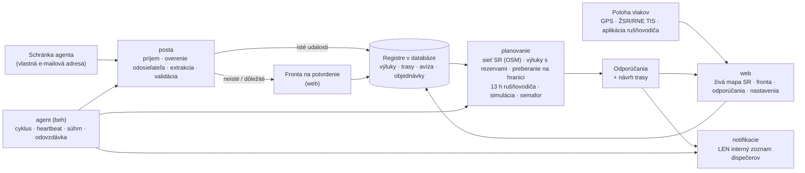

# Architektúra Agenta dispečera

Dokument podľa pravidla 1 v `PROMPT.md`: komponenty, dátový tok, rozhodnutia a ich dôvody.

## Prehľad

**Princíp:** agent je riadený pracovný tok, nie voľne uvažujúci jazykový model. Postup je pevný: udalosť → extrakcia (pravidlá, voliteľne LLM) → validácia → plánovanie (deterministický kód) → odporúčanie → upozornenie len dispečerom. Navonok agent nič nevykonáva.

## Komponenty a súbory

| Komponent | Súbory | Úloha |
|---|---|---|
| Konfigurácia | `vlaky/config.py` | Všetky nastavenia sú premenné prostredia `VLAKY_*` (vzor v `.env.example`). |
| Databáza | `vlaky/db.py`, `vlaky/models.py` | SQLAlchemy 2. SQLite na vývoj a testy, PostgreSQL na serveri. Časy sa ukladajú v UTC. |
| Sieť SR | `vlaky/siet/osm_import.py`, `vlaky/siet/graf.py`, `data/siet/*` | Graf z OpenStreetMap (23 176 uzlov, 27 098 úsekov, 1 115 dopravní s kódmi UIC a skratkami ŽSR). Zabezpečuje hľadanie staníc, trasovanie podľa rozchodu a trakcie, obchádzky, úseky výluk vrátane súbežných koľají a priradenie GPS polohy ku koľaji. |
| Hraničné priechody | `vlaky/hranice.py`, `data/hranice.json` | 23 priechodov podľa Sieťového vyhlásenia ŽSR 2027 a preberacie stanice (PPS). |
| E-maily | `vlaky/posta/*` | Zdroje (adresár, IMAP, Microsoft Graph), parser s prílohami, overenie odosielateľa (zoznam a SPF/DKIM/DMARC), karanténa, extrakcia (pravidlá SK/CZ a voliteľne LLM), validácia, fronta na potvrdenie, použitie udalostí. |
| Plánovanie | `vlaky/planovanie/planovac.py`, `vlaky/rozhodovanie.py` | Vyhodnotenie vlaku: trasa, výluky, pripravenosť, pridelené trasy, rušňovodič, simulácia Monte Carlo, semafor, odporúčanie, návrh trasy. |
| Notifikácie | `vlaky/notifikacie/*` | E-mail (SMTP), Teams, SMS – iba interný zoznam (kontrola v kóde), tieňová prevádzka, deduplikácia, súhrny. |
| Beh agenta | `vlaky/agent/beh.py`, `zdravie.py`, `odovzdavka.py` | Cyklus (schránka → prepočet → upozornenia → návrhy pre nové objednávky), heartbeat na externý monitoring, súhrn INFO, odovzdávka služby, denná správa, zámok proti dvom inštanciám. |
| Stráženie | `vlaky/agent/strazenie.py` | Upozornenia 90/60/30 min pred 13 h limitom rušňovodiča a pri prekročení, neplánované státie vlaku (> 20 min), GDPR – mazanie starých polôh (90 dní) a obsahu e-mailov (365 dní). |
| Odpovede dispečerov | `vlaky/posta/odpovede.py` | Odpoveď `PRIJAŤ` / `ZAMIETNUŤ dôvod` na e-mail agenta – len z interného zoznamu a po overení odosielateľa. Mení iba stav odporúčania. |
| Kalibrácia (F4) | `vlaky/planovanie/kalibracia.py` | Z histórie navrhne P50/P90 dôb preberania na hraniciach a zdržaní na 100 km. Použije sa až po schválení vedúcim (`python -m vlaky kalibracia --aplikovat`). |
| Nasadenie rušňovodičov (F4) | `vlaky/planovanie/nasadenie.py` | Model CP-SAT (OR-Tools): 13 h zmena, odpočinok 11 h, znalosť trate, prekryvy a čo najkratšie presuny. Výsledok je len návrh. |
| Koncepty správ | `vlaky/planovanie/planovac.py` (`_drafts`) | Text objednávky ad hoc trasy pre ŽSR (IS KIS, P5) a informácia pre zákazníka. Agent ich neodosiela. |
| Web | `vlaky/web/*` | Živá mapa SR, tabuľka vlakov, fronta na potvrdenie, odporúčania (prijať, upraviť, zamietnuť), vlaky, výluky, hranice, rušňovodiči (13 h), nastavenia, audit, zdravie, stránka pre rušňovodiča. |
| Prevádzka | `Dockerfile`, `docker-compose.yml`, `deploy/*`, `docs/PREVADZKA.md` | VPS v EÚ, Docker Compose (PostgreSQL, web, agent, Caddy s TLS), zálohy, monitoring, systemd varianta. |
| Ukážka | `vlaky/simulacia/demo.py`, `data/ukazkove_emaily/*` | Fiktívne vlaky, výluky a e-maily na reálnej sieti a simulátor polohy. |
| Referencia | `referencia/*` | Spustiteľná špecifikácia rozhodovacích pravidiel. Kanonický modul `vlaky/rozhodovanie.py` musí dávať rovnaké výsledky (test). |

## Rozhodnutia a ich dôvody

1. **Sieť z OpenStreetMap, nie z RINF.** Dáta OSM pre SR sú čerstvé (extrakt z predchádzajúceho dňa) a obsahujú kódy UIC, skratky ŽSR, elektrifikáciu, napätie, rozchod, rýchlosti a čísla tratí. Prístup k RINF/ERA nebol z vývojového prostredia dostupný. Importér `import-osm` sa dá na serveri spustiť kedykoľvek znova. Údaje TTP od ŽSR sa môžu doplniť cez `LocationInfo` (čakanie, odstavenie, výmena rušňovodiča, dĺžky koľají). Licencia ODbL: uvádzať „© prispievatelia OpenStreetMap“ (mapa to robí).
2. **Výluka zasiahne celý úsek – a nič navyše.** Úsek výluky sa určí ako cesta medzi obvodmi dvoch dopravní (motorová aj elektrická trakcia) po rozchode, ktorý obe dopravne obsluhujú, plus súbežné koľaje rovnakého rozchodu do 40 m. Inak by vlak „obišiel“ výluku po druhej koľaji tej istej trate. Rozchod dopravne určia koľaje pri nej a jej staničné koľaje či výhybky do 400 m; ak dopravne spoločný rozchod nemajú, úsek sa hľadá po oboch. Súbežná trať iného rozchodu (ŠRT popri trati 190 medzi Nižnou Myšľou a Kuzmicami) do úseku nepatrí; dlhá hrana, ktorá leží pri úseku len čiastočne, sa pridá len ako tá istá trať (spoločné číslo trate). Ak by úsek viedol po oboch rozchodoch, rozhodne číslo trate z výluky. Koľaje v obvode koncových dopravní (zhlavia spoločné s inými traťami) sa do úseku nepočítajú, takže výluka odbočnej trate (napr. Vrútky – Martin) nezastaví vlak na hlavnej trati. Výluka, ktorú sa nepodarí umiestniť na sieť, sa neignoruje: vlak, ktorého sa môže týkať, nedostane ZELENÚ a dispečer vidí dôvod.
   - **Výluka alebo mimoriadnosť v jednej dopravni (od = do):** zahŕňa koľaje rozchodu, ktorý dopravňa obsluhuje, ak ich časť leží do 600 m od bodu alebo uzla dopravne (pri odbočke, výhybke č. a vlečke len 200 m) a sú s koľajami dopravne spojené – aj hlavné koľaje, ktoré stanicou len prechádzajú. Trať, ktorá s koľajami dopravne nie je spojená ani do 1,5 km (napr. most), k nej nepatrí. Dopravňa s koľajami jedného rozchodu a bez koľaje pre oba rozchody v obvode (Slivník ŠRT, Ruskov) súbežnú trať iného rozchodu nezahŕňa; výslovne uvedené číslo trate pridá koľaje tejto trate. Vlaku sa takáto výluka týka len v časti trasy v obvode dopravne: idúci vlak, ktorý stanicu prešiel, sa jej netýka a pomalá jazda v stanici sa počíta len v obvode.
   - **Názvy dopravní:** skratky (Výh., Odb., Zast.) sa rozvinú. Pri rovnakých názvoch sa použije poradie vyhľadávania (stanica pred zriaďovacou stanicou) a všetky záznamy s tým istým názvom do 2 km od seba (napr. stanica a zriaďovacia stanica Žilina-Teplička); iný záznam sa použije len vtedy, ak je k druhej dopravni aspoň o polovicu bližšie.
   - **Poistka:** výluka v dopravni, ktorá je bodom trasy vlaku, sa vlaku priradí aj tak; rovnako výluka medzi dvoma dopravňami trasy, ktorej úsek v modeli siete trasu medzi nimi nezasiahne (Žilina-Teplička – Varín). Dopravňa sa pritom počíta, len ak obsluhuje rozchod vlaku. Výnimkou je úsek na trati s číslom z výluky, ktoré trasa medzi dopravňami nemá (výluka trate 190 a vlak na ŠRT).
3. **Rozhodovanie je deterministické a testované.** Používa simuláciu Monte Carlo so spoločnými náhodnými číslami. Hrubý prechod 24 h po 10 min ide s 600 vzorkami, najlepší kandidáti sa spresnia s 4 000 vzorkami. Prepočet vlaku trvá 1 – 2 s.
4. **Konzervatívnosť.** Nepotvrdené výluky (aj tie, ktoré čakajú vo fronte na potvrdenie) sa započítavajú. Bez čerstvých dát o polohe, pri polohe mimo plánovanej trasy, pri idúcom vlaku bez záznamu o nástupe rušňovodiča a bez úspešnej kontroly schránky v posledných 30 min nie je ZELENÁ (čas kontroly sa zapíše len po úspešnom načítaní schránky). Rušňovodič bez rezervy do 13 h znamená aspoň ORANŽOVÚ. Vlak bez pridelenej trasy dostane pokyn „objednať trasu“ s lehotou `new_path_lead_min`; odstavenie idúceho vlaku vždy znamená novú trasu s touto lehotou. Preberanie na hranici sa plánuje s dobou P90. Výluky sa načítajú pre celé obdobie možného odchodu (aj vlaky a objednávky na niekoľko dní dopredu). Chyba výpočtu jedného vlaku nenechá platné staré odporúčanie: vlak dostane ESKALOVAŤ s popisom chyby. Každý vlak sa prepočíta vo vlastnej vnorenej transakcii (SAVEPOINT; na SQLite sa predtým otvorí transakcia `BEGIN IMMEDIATE`), takže ani chyba databázy pri jednom vlaku nezastaví ostatné.
   - **Výluky čakajúce na potvrdenie:** výluka z e-mailu, ktorá čaká na potvrdenie a dostala záznam „navrh“ (napr. každá výluka do 72 h), spustí prepočet vlakov v tom istom cykle agenta ako automaticky zapísaná výluka (súhrn pošty `planning`, agent neprepočítava druhýkrát); čakajúca udalosť bez záznamu pre plánovač (napr. „iné“) prepočet nespúšťa. Zápis záznamu „navrh“ beží v samostatnom SAVEPOINT a hodnoty sa skracujú na dĺžky stĺpcov, takže chyba databázy nezahodí udalosti e-mailu. Potvrdenie udalosti nikdy potichu neprepíše úpravy, ktoré dispečer urobil v registri výluk v zázname udalosti (`validation.register_fields`); výslovná oprava vo fronte má prednosť.
   - **Limit 18 h (PIS, odstavenie):** ráta sa od začiatku státia na koľajach ŽSR (`trains.standing_since_utc`), nie od posledného prepočtu. Zapisuje ho len modul `vlaky/planovanie/stav.py`: príchod na vstupnú hranicu zapíše čas príchodu; prevzatie a odstavenie ponechajú doterajší začiatok, inak najskoršiu platnú kotvu (príchod na hranicu, zmeškaná trasa), inak čas zmeny – po jazde vždy čas odstavenia; odchod (aj hlásenie rušňovodiča „odchod“, ktoré zapíše skutočný čas odchodu `trains.departed_utc`), ukončenie, zrušenie a odovzdanie ho vymažú. Pred každou úpravou vlaku vo webe sa začiatok státia zapíše z doterajších kotiev, takže ani zmena času pripravenosti či stavu limit neposunie; hlásenie „pripravený“ nezmení minulý ani chýbajúci čas pripravenosti, ak by tým kotva zmizla. Minulá pridelená trasa je kotvou len pre túto jazdu (trasa vlaku alebo trasa s jeho číslom bez priradeného vlaku v deň jazdy ± 1 deň; vlak bez dátumu jazdy a časov = najbližšia jazda) a len ak na nej vlak stál pripravený na koľajach ŽSR a nevyšiel – nie pri odstavenom vlaku ani pri vlaku ešte v zahraničí. Príchod na hranicu prestáva byť kotvou, keď vlak po ňom skutočne vyšiel. Pre staršie záznamy bez začiatku státia sa použijú náhradné kotvy (príchod na hranicu, čas pripravenosti odstaveného alebo prevzatého vlaku). Ak limit uplynie skôr, ako je vlak pripravený, odporúčanie je len ESKALOVAŤ.
   - **Posuny odchodu:** posun pevného odchodu o menej ako 30 min nie je nové odporúčanie ani upozornenie – porovnáva sa s odchodom, ktorý dispečer dostal. Odchod „čo najskôr“ (idúci vlak, najskoršia nová trasa po lehote P5, najmenej zlá možnosť pri eskalácii) sa s časom posúva sám a nie je zmenou situácie – nevytvára nové odporúčanie ani upozornenie. Pri idúcom vlaku sa namiesto odchodu porovnáva predpokladaný príchod (posun o 30 min a viac = nové odporúčanie); výnimkou je vlak bez polohy aj času odchodu – jeho príchod sa posúva s časom, preto sa neporovnáva. Poloha idúceho vlaku bez GPS sa odhaduje od skutočného odchodu (hlásenie rušňovodiča), inak od plánovaného. Odtlačok eskalácie neobsahuje trasu najmenej zlej možnosti. Prijaté odporúčanie sa pri malej zmene nemení; nahradí ho len podstatná zmena.
   - **Rušňovodič bez záznamu o nástupe:** pri idúcom vlaku sa pracovný čas len odhaduje – nástup = odchod vlaku (skutočný z hlásenia „odchod“, inak plánovaný alebo podľa pridelenej trasy) mínus príprava. Všade sa uvádza ako „odhad: vystriedať najneskôr o … (nástup rušňovodiča nie je zadaný)“, bez času odchodu ako „limit 13 h sa nedá overiť – zadajte nástup rušňovodiča“; stav je aspoň ORANŽOVÁ, ČERVENÁ, ak by limit prekročil aj odhad. Naplánované vystriedanie nezakryje zmenu, ktorá prebieha – stráži sa limit rušňovodiča v službe.
   - **Termíny z e-mailov:** dva po sebe idúce dni („12./13.11.“, „z 12.11. na 13.11.“) sú noc (jedno obdobie so začiatkom 12.11.) len pri označení noci („v noci“, „nočná“, „v nociach“) alebo pri časovom okne cez polnoc; inak „12./13.11.“ znamená oba dni a „z 12.11. na 13.11.“ presun na nový deň (rovnako „presúva sa / mení sa / preložená z … na …“). Zoznam dní či nocí s jedným časovým oknom („12.11. a 13.11.2026 od 8:00 do 14:00“, aj skrátene „v dňoch 03., 04. a 05.11.2026“, „v nociach 03./04. a 04./05.11.2026“, „od 3. do 5.11.2026“) dá samostatné obdobie pre každý deň (mesiac a rok z posledného dátumu, aj cez prelom mesiaca). Skoršie časové okno (napr. kontaktné hodiny) sa k výluke nepripája. Dátum vydania, vyhotovenia, podpisu či rozhodnutia a pôvodný termín („namiesto“, „zo dňa“) sa za termín nepovažujú. Čo sa nedá bezpečne prečítať (čísla dní bez bodky, zlé poradie, dátum v odseku nepriradený k žiadnemu obdobiu), sa nevymýšľa – udalosť dostane nižšiu istotu a poznámku „overte termín“.
5. **Notifikácie len interne, vynútené v kóde.** Funkcia `_guard` porovná každého príjemcu so zoznamom z konfigurácie. Pri SMTP ide vždy jeden príjemca, bez kópií. Test overuje, že správu mimo zoznamu nemožno odoslať.
   - **Deduplikácia:** odporúčanie sa potlačí, len ak je zhodné s poslednou správou o vlaku, ktorú príjemca dostal (pri inom odporúčaní so zhodným obsahom aj s poslednou správou dispečingu); návrat A → B → A sa pošle, ESKALOVAŤ má stály kľúč.
   - **Doručovanie:** istič na kanál v rámci cyklu agenta – po chybe spojenia alebo servera (SMTP 421, HTTP 5xx, 408, 429) sa kanál už nepripája; odmietnutie jedného príjemcu istič nevypne a príjemca s neúspešným posledným pokusom ide na koniec poradia. Limit spojenia 10 s, opakovanie s odstupom 5 – 60 min len neúspešným príjemcom (KRITICKÉ pri výpadku kanála v spoločnom 5-min okne; aktuálne odporúčania najviac 48 h). Súhrn, denná správa a odovzdávka sú vybavené až po doručení všetkým. Chyba jedného odporúčania nezastaví ostatné (potvrdenie transakcie po každom odporúčaní). Nedoručené správy sú chybou každého cyklu (heartbeat `/fail`) aj zdravia (detail `dorucenie`). Prevádzka: `docs/PREVADZKA.md`, kapitola 6.5.
6. **LLM je voliteľné.** Bez kľúča alebo bez názvu modelu (`VLAKY_LLM_MODEL`, aplikácia nemá predvolený model) funguje extrakcia pravidlami a všetko neisté ide na potvrdenie. S kľúčom má LLM len schému výstupu, žiadne nástroje, a jeho výstup sa overuje.
7. **Jednoduchá prevádzka.** Jedna databáza, dva procesy (web, agent) a Caddy. SSE na webe číta zmeny z databázy, takže web a agent môžu bežať oddelene. Zámok v databáze zabráni dvom agentom. Nové stĺpce v tabuľkách sa pri štarte doplnia automaticky (`init_db`).
8. **Bezpečnosť webu.** Prihlásenie: bcrypt mimo slučky udalostí, najviac 3 súbežné overenia hesla (inak po 2 s odpoveď 503), obmedzenie neúspešných pokusov podľa IP (IPv6 podľa siete /64) aj podľa účtu (úspešné prihlásenie nenuluje počítadlo IP), zablokované pokusy sa do auditu zapíšu najviac raz za okno, odhlásenie zneplatní všetky relácie používateľa aj na serveri. CSRF token pri každom formulári, roly overené pri každej požiadavke. CSP povoľuje skripty len z vlastného pôvodu a presnej verzie MapLibre. V produkcii web nenaštartuje bez silného `VLAKY_SECRET_KEY` (≥ 32 znakov) a `https://` adresy. Odkaz pre rušňovodiča: podpísaný token vo fragmente URL, 24 h, zrušiteľný; nástup sa nedá zopakovať (13 h limit sa nedá vynulovať), najviac 6 hlásení stavu a 6 hlásení o probléme za 10 min (po hlásení stavu sa vlak prepočíta vždy), odmietnuté požiadavky sa do auditu zapíšu najviac raz za 10 min, poloha z mobilu najviac raz za 10 s, nie staršia ako 15 min a bez nereálnych skokov. Text od rušňovodiča ide do Teams bez maskovaných odkazov.

## Výkon (namerané vo vývojovom prostredí)

- načítanie siete 0,7 s; trasa naprieč SR 5 – 100 ms; úsek výluky so súbežnými koľajami ~0,2 s (cache),
- vyhodnotenie jedného vlaku 1 – 2 s; ukážka so 6 vlakmi ~6 s vrátane prípravy dát.

## Známe obmedzenia

- Jazdné doby z grafu sú odhad (traťová rýchlosť, obmedzená rýchlosťou vlaku, + 5 %). Presné časy prinesie pridelená trasa a história jázd.
- Dopravca nevidí grafikon ŽSR. Aplikácia preto navrhuje okná pre ad hoc trasu, nie konkrétnu voľnú trasu.
- Doby preberania na hraniciach sú počiatočné odhady. Treba ich kalibrovať z vlastnej histórie.
- Integrácia s RNE TIS a TAF TSI je pripravená ako vstup polôh a udalostí cez API. Priame napojenie vyžaduje zmluvu a prístupy.
- Odstup opakovania nedoručených správ (5, 10, 20, 40, 60 min), 5-min okno pre KRITICKÉ a 48 h pre odporúčania sú konštanty vo `vlaky/notifikacie/odosielanie.py` (`RETRY_FIRST_MIN`, `RETRY_MAX_MIN`, `RETRY_HOURS`), zatiaľ nie nastavenia. Limit spojenia 10 s (`CONNECT_TIMEOUT_S`) prepíše nastavenie `VLAKY_NOTIFY_CONNECT_TIMEOUT_S`.
- Návrh k objednávke, ktorý prišiel aspoň jednému dispečerovi, sa ostatným neopakuje (objednávka prejde do stavu „navrhnutá“).
