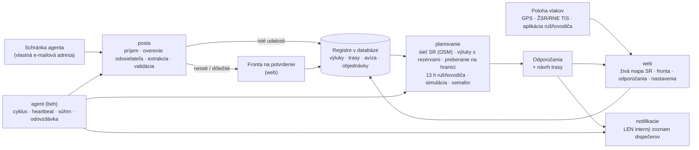

# Architektúra Agenta dispečera

Dokument podľa pravidla 1 v `PROMPT.md`: komponenty, dátový tok, rozhodnutia a ich dôvody.

## Prehľad

**Princíp:** agent je riadený pracovný tok, nie voľne uvažujúci jazykový model. Postup je pevný: udalosť → extrakcia (pravidlá, voliteľne LLM) → validácia → plánovanie (deterministický kód) → odporúčanie → upozornenie len dispečerom. Navonok agent nič nevykonáva.

## Komponenty a súbory

| Komponent | Súbory | Úloha |
|---|---|---|
| Konfigurácia | `vlaky/config.py` | Všetky nastavenia sú premenné prostredia `VLAKY_*` (vzor v `.env.example`). |
| Databáza | `vlaky/db.py`, `vlaky/models.py` | SQLAlchemy 2. SQLite na vývoj a testy, PostgreSQL na serveri. Časy sa ukladajú v UTC. |
| Sieť SR | `vlaky/siet/osm_import.py`, `vlaky/siet/graf.py`, `data/siet/*` | Graf z OpenStreetMap (23 176 uzlov, 27 098 úsekov, 1 115 dopravní s kódmi UIC a skratkami ŽSR). Zabezpečuje hľadanie staníc, trasovanie podľa rozchodu a trakcie, obchádzky, úseky výluk vrátane súbežných koľají a priradenie GPS polohy ku koľaji. |
| Hraničné priechody | `vlaky/hranice.py`, `data/hranice.json` | 23 priechodov podľa Sieťového vyhlásenia ŽSR 2027 a preberacie stanice (PPS). |
| E-maily | `vlaky/posta/*` | Zdroje (adresár, IMAP, Microsoft Graph), parser s prílohami, overenie odosielateľa (zoznam a SPF/DKIM/DMARC), karanténa, extrakcia (pravidlá SK/CZ a voliteľne LLM), validácia, fronta na potvrdenie, použitie udalostí. |
| Plánovanie | `vlaky/planovanie/planovac.py`, `vlaky/rozhodovanie.py` | Vyhodnotenie vlaku: trasa, výluky, pripravenosť, pridelené trasy, rušňovodič, simulácia Monte Carlo, semafor, odporúčanie, návrh trasy. |
| Notifikácie | `vlaky/notifikacie/*` | E-mail (SMTP), Teams, SMS – iba interný zoznam (kontrola v kóde), tieňová prevádzka, deduplikácia, súhrny. |
| Beh agenta | `vlaky/agent/beh.py`, `zdravie.py`, `odovzdavka.py` | Cyklus (schránka → prepočet → upozornenia → návrhy pre nové objednávky), heartbeat na externý monitoring, súhrn INFO, odovzdávka služby, denná správa, zámok proti dvom inštanciám. |
| Stráženie | `vlaky/agent/strazenie.py` | Upozornenia 90/60/30 min pred 13 h limitom rušňovodiča a pri prekročení, neplánované státie vlaku (> 20 min), GDPR – mazanie starých polôh (90 dní) a obsahu e-mailov (365 dní). |
| Odpovede dispečerov | `vlaky/posta/odpovede.py` | Odpoveď `PRIJAŤ` / `ZAMIETNUŤ dôvod` na e-mail agenta – len z interného zoznamu a po overení odosielateľa. Mení iba stav odporúčania. |
| Kalibrácia (F4) | `vlaky/planovanie/kalibracia.py` | Z histórie navrhne P50/P90 dôb preberania na hraniciach a zdržaní na 100 km. Použije sa až po schválení vedúcim (`python -m vlaky kalibracia --aplikovat`). |
| Nasadenie rušňovodičov (F4) | `vlaky/planovanie/nasadenie.py` | Model CP-SAT (OR-Tools): 13 h zmena, odpočinok 11 h, znalosť trate, prekryvy a čo najkratšie presuny. Výsledok je len návrh. |
| Koncepty správ | `vlaky/planovanie/planovac.py` (`_drafts`) | Text objednávky ad hoc trasy pre ŽSR (IS KIS, P5) a informácia pre zákazníka. Agent ich neodosiela. |
| Web | `vlaky/web/*` | Živá mapa SR, tabuľka vlakov, fronta na potvrdenie, odporúčania (prijať, upraviť, zamietnuť), vlaky, výluky, hranice, rušňovodiči (13 h), nastavenia, audit, zdravie, stránka pre rušňovodiča. |
| Prevádzka | `Dockerfile`, `docker-compose.yml`, `deploy/*`, `docs/PREVADZKA.md` | VPS v EÚ, Docker Compose (PostgreSQL, web, agent, Caddy s TLS), zálohy, monitoring, systemd varianta. |
| Ukážka | `vlaky/simulacia/demo.py`, `data/ukazkove_emaily/*` | Fiktívne vlaky, výluky a e-maily na reálnej sieti a simulátor polohy. |
| Referencia | `referencia/*` | Spustiteľná špecifikácia rozhodovacích pravidiel. Kanonický modul `vlaky/rozhodovanie.py` musí dávať rovnaké výsledky (test). |

## Rozhodnutia a ich dôvody

1. **Sieť z OpenStreetMap, nie z RINF.** Dáta OSM pre SR sú čerstvé (extrakt z predchádzajúceho dňa) a obsahujú kódy UIC, skratky ŽSR, elektrifikáciu, napätie, rozchod, rýchlosti a čísla tratí. Prístup k RINF/ERA nebol z vývojového prostredia dostupný. Importér `import-osm` sa dá na serveri spustiť kedykoľvek znova. Údaje TTP od ŽSR sa môžu doplniť cez `LocationInfo` (čakanie, odstavenie, výmena rušňovodiča, dĺžky koľají). Licencia ODbL: uvádzať „© prispievatelia OpenStreetMap“ (mapa to robí).
2. **Výluka zasiahne celý úsek – a nič navyše.** Úsek výluky sa určí ako cesta medzi obvodmi dvoch dopravní (pre oba rozchody, motorová aj elektrická trakcia) plus všetky súbežné koľaje do 40 m. Inak by vlak „obišiel“ výluku po druhej koľaji tej istej trate. Koľaje v obvode koncových dopravní (zhlavia spoločné s inými traťami) sa do úseku nepočítajú, takže výluka odbočnej trate (napr. Vrútky – Martin) nezastaví vlak na hlavnej trati. Výluka „v stanici“ (od = do) zahŕňa všetky koľaje v obvode stanice. Názvy so skratkami (Výh., Odb., Zast.) sa rozvinú; pri rovnakých názvoch sa vyberie najbližšia dvojica dopravní. Výluka, ktorú sa nepodarí umiestniť na sieť, sa neignoruje: vlak, ktorého sa môže týkať, nedostane ZELENÚ a dispečer vidí dôvod.
3. **Rozhodovanie je deterministické a testované.** Používa simuláciu Monte Carlo so spoločnými náhodnými číslami. Hrubý prechod 24 h po 10 min ide s 600 vzorkami, najlepší kandidáti sa spresnia s 4 000 vzorkami. Prepočet vlaku trvá 1 – 2 s.
4. **Konzervatívnosť.** Nepotvrdené výluky (aj tie, ktoré čakajú vo fronte na potvrdenie) sa započítavajú. Bez čerstvých dát o polohe, pri polohe mimo plánovanej trasy, pri idúcom vlaku bez záznamu o nástupe rušňovodiča a bez úspešnej kontroly schránky v posledných 30 min nie je ZELENÁ (čas kontroly sa zapíše len po úspešnom načítaní schránky). Rušňovodič bez rezervy do 13 h znamená aspoň ORANŽOVÚ. Vlak bez pridelenej trasy dostane pokyn „objednať trasu“ s lehotou `new_path_lead_min`; odstavenie idúceho vlaku vždy znamená novú trasu s touto lehotou. Preberanie na hranici sa plánuje s dobou P90. Limit 18 h (PIS, odstavenie) sa ráta od začiatku státia, nie od posledného prepočtu. Výluky sa načítajú pre celé obdobie možného odchodu (aj vlaky a objednávky na niekoľko dní dopredu). Chyba výpočtu jedného vlaku nenechá platné staré odporúčanie: vlak dostane ESKALOVAŤ s popisom chyby. Malé posuny odchodu (< 30 min) neposielajú nové upozornenie, ale porovnávajú sa s pôvodne oznámeným odchodom a prijaté odporúčania sa už nemenia.
5. **Notifikácie len interne, vynútené v kóde.** Funkcia `_guard` porovná každého príjemcu so zoznamom z konfigurácie. Pri SMTP ide vždy jeden príjemca, bez kópií. Test overuje, že správu mimo zoznamu nemožno odoslať.
6. **LLM je voliteľné.** Bez kľúča funguje extrakcia pravidlami a všetko neisté ide na potvrdenie. S kľúčom má LLM len schému výstupu, žiadne nástroje, a jeho výstup sa overuje.
7. **Jednoduchá prevádzka.** Jedna databáza, dva procesy (web, agent) a Caddy. SSE na webe číta zmeny z databázy, takže web a agent môžu bežať oddelene. Zámok v databáze zabráni dvom agentom. Nové stĺpce v tabuľkách sa pri štarte doplnia automaticky (`init_db`).
8. **Bezpečnosť webu.** Prihlásenie: bcrypt mimo slučky udalostí, obmedzenie neúspešných pokusov podľa IP aj podľa účtu (úspešné prihlásenie nenuluje počítadlo IP), odhlásenie zneplatní všetky relácie používateľa aj na serveri. CSRF token pri každom formulári, roly overené pri každej požiadavke. CSP povoľuje skripty len z vlastného pôvodu a presnej verzie MapLibre. V produkcii web nenaštartuje bez silného `VLAKY_SECRET_KEY` (≥ 32 znakov) a `https://` adresy. Odkaz pre rušňovodiča: podpísaný token vo fragmente URL, 24 h, zrušiteľný; nástup sa nedá zopakovať (13 h limit sa nedá vynulovať), najviac 6 hlásení za 10 min, poloha z mobilu najviac raz za 10 s, nie staršia ako 15 min a bez nereálnych skokov. Text od rušňovodiča ide do Teams bez maskovaných odkazov.

## Výkon (namerané vo vývojovom prostredí)

- načítanie siete 0,7 s; trasa naprieč SR 5 – 100 ms; úsek výluky so súbežnými koľajami ~0,2 s (cache),
- vyhodnotenie jedného vlaku 1 – 2 s; ukážka so 6 vlakmi ~6 s vrátane prípravy dát.

## Známe obmedzenia

- Jazdné doby z grafu sú odhad (traťová rýchlosť, obmedzená rýchlosťou vlaku, + 5 %). Presné časy prinesie pridelená trasa a história jázd.
- Dopravca nevidí grafikon ŽSR. Aplikácia preto navrhuje okná pre ad hoc trasu, nie konkrétnu voľnú trasu.
- Doby preberania na hraniciach sú počiatočné odhady. Treba ich kalibrovať z vlastnej histórie.
- Integrácia s RNE TIS a TAF TSI je pripravená ako vstup polôh a udalostí cez API. Priame napojenie vyžaduje zmluvu a prístupy.
