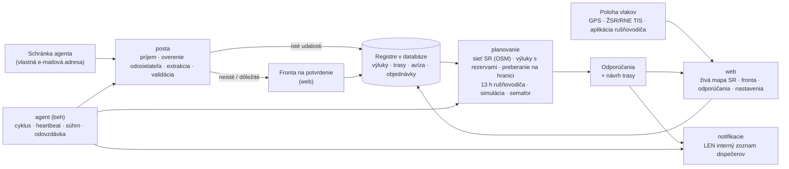

# Architektúra Agenta dispečera

Dokument podľa pravidla 1 v `PROMPT.md`: komponenty, dátový tok, rozhodnutia a ich dôvody.

## Prehľad

**Princíp:** agent je riadený pracovný tok, nie voľne uvažujúci jazykový model. Postup je pevný: udalosť → extrakcia (pravidlá, voliteľne LLM) → validácia → plánovanie (deterministický kód) → odporúčanie → upozornenie len dispečerom. Navonok agent nič nevykonáva.

## Komponenty a súbory

| Komponent | Súbory | Úloha |
|---|---|---|
| Konfigurácia | `vlaky/config.py` | Všetky nastavenia sú premenné prostredia `VLAKY_*` (vzor v `.env.example`). |
| Databáza | `vlaky/db.py`, `vlaky/models.py` | SQLAlchemy 2. SQLite na vývoj a testy, PostgreSQL na serveri. Časy sa ukladajú v UTC. |
| Sieť SR | `vlaky/siet/osm_import.py`, `vlaky/siet/graf.py`, `data/siet/*` | Graf z OpenStreetMap (23 176 uzlov, 27 098 úsekov, 1 115 dopravní s kódmi UIC a skratkami ŽSR). Zabezpečuje hľadanie staníc, trasovanie podľa rozchodu a trakcie, obchádzky, úseky výluk vrátane súbežných koľají a priradenie GPS polohy ku koľaji. |
| Hraničné priechody | `vlaky/hranice.py`, `data/hranice.json` | 23 priechodov podľa Sieťového vyhlásenia ŽSR 2027 a preberacie stanice (PPS). |
| E-maily | `vlaky/posta/*` | Zdroje (adresár, IMAP, Microsoft Graph), parser s prílohami, overenie odosielateľa (zoznam a SPF/DKIM/DMARC), karanténa, extrakcia (pravidlá SK/CZ a voliteľne LLM), validácia, fronta na potvrdenie, použitie udalostí. |
| Plánovanie | `vlaky/planovanie/planovac.py`, `vlaky/rozhodovanie.py` | Vyhodnotenie vlaku: trasa, výluky, pripravenosť, pridelené trasy, rušňovodič, simulácia Monte Carlo, semafor, odporúčanie, návrh trasy. |
| Notifikácie | `vlaky/notifikacie/*` | E-mail (SMTP), Teams, SMS – iba interný zoznam (kontrola v kóde), tieňová prevádzka, deduplikácia, súhrny. |
| Beh agenta | `vlaky/agent/beh.py`, `zdravie.py`, `odovzdavka.py` | Cyklus (schránka → prepočet → upozornenia → návrhy pre nové objednávky), heartbeat na externý monitoring, súhrn INFO, odovzdávka služby, denná správa, zámok proti dvom inštanciám. |
| Stráženie | `vlaky/agent/strazenie.py` | Upozornenia 90/60/30 min pred 13 h limitom rušňovodiča a pri prekročení, neplánované státie vlaku (> 20 min), GDPR – mazanie starých polôh (90 dní) a obsahu e-mailov (365 dní). |
| Odpovede dispečerov | `vlaky/posta/odpovede.py` | Odpoveď `PRIJAŤ` / `ZAMIETNUŤ dôvod` na e-mail agenta – len z interného zoznamu a po overení odosielateľa, príkaz ako celé prvé slovo prvého riadku a len k aktuálnemu odporúčaniu vlaku (o zastaranom sa nerozhoduje, rovnako ako vo webe). Mení iba stav odporúčania. Nezapísaný príkaz agent dispečerovi krátko vysvetlí e-mailom (len jemu, s odkazom na aktuálne odporúčanie; na odpoveď bez príkazu najviac raz za interval deduplikácie). Automatické správy (neprítomnosť, potvrdenie o prečítaní) nespracúva a neodpovedá na ne. |
| Kalibrácia (F4) | `vlaky/planovanie/kalibracia.py` | Z histórie navrhne P50/P90 dôb preberania na hraniciach a zdržaní na 100 km. Použije sa až po schválení vedúcim (`python -m vlaky kalibracia --aplikovat`). |
| Nasadenie rušňovodičov (F4) | `vlaky/planovanie/nasadenie.py` | Model CP-SAT (OR-Tools): 13 h zmena, odpočinok 11 h, znalosť trate, prekryvy a čo najkratšie presuny. Výsledok je len návrh. |
| Koncepty správ | `vlaky/planovanie/planovac.py` (`_drafts`) | Text objednávky ad hoc trasy pre ŽSR (IS KIS, P5) a informácia pre zákazníka. Agent ich neodosiela. |
| Web | `vlaky/web/*` | Živá mapa SR, tabuľka vlakov, fronta na potvrdenie, odporúčania (prijať, upraviť, zamietnuť), vlaky, výluky, hranice, rušňovodiči (13 h), nastavenia, audit, zdravie, stránka pre rušňovodiča. |
| Prevádzka | `Dockerfile`, `docker-compose.yml`, `deploy/*`, `docs/PREVADZKA.md` | VPS v EÚ, Docker Compose (PostgreSQL, web, agent, Caddy s TLS), zálohy, monitoring, systemd varianta. |
| Ukážka | `vlaky/simulacia/demo.py`, `data/ukazkove_emaily/*` | Fiktívne vlaky, výluky a e-maily na reálnej sieti a simulátor polohy. |
| Referencia | `referencia/*` | Spustiteľná špecifikácia rozhodovacích pravidiel. Kanonický modul `vlaky/rozhodovanie.py` musí dávať rovnaké výsledky (test). |

## Rozhodnutia a ich dôvody

1. **Sieť z OpenStreetMap, nie z RINF.** Dáta OSM pre SR sú čerstvé (extrakt z predchádzajúceho dňa) a obsahujú kódy UIC, skratky ŽSR, elektrifikáciu, napätie, rozchod, rýchlosti a čísla tratí. Prístup k RINF/ERA nebol z vývojového prostredia dostupný. Importér `import-osm` sa dá na serveri spustiť kedykoľvek znova. Údaje TTP od ŽSR sa môžu doplniť cez `LocationInfo` (čakanie, odstavenie, výmena rušňovodiča, dĺžky koľají). Licencia ODbL: uvádzať „© prispievatelia OpenStreetMap“ (mapa to robí).
2. **Výluka zasiahne celý úsek – a nič navyše.** Úsek výluky sa určí ako cesta medzi obvodmi dvoch dopravní (motorová aj elektrická trakcia) po rozchode, ktorý obe dopravne obsluhujú, plus súbežné koľaje rovnakého rozchodu do 40 m. Inak by vlak „obišiel“ výluku po druhej koľaji tej istej trate. Rozchod dopravne určia koľaje pri nej a jej staničné koľaje či výhybky do 400 m; ak dopravne spoločný rozchod nemajú, úsek sa hľadá po oboch. Súbežná trať iného rozchodu (ŠRT popri trati 190 medzi Nižnou Myšľou a Kuzmicami) do úseku nepatrí; dlhá hrana, ktorá leží pri úseku len čiastočne, sa pridá len ako tá istá trať (spoločné číslo trate). Ak by úsek viedol po oboch rozchodoch, rozhodne číslo trate z výluky. Koľaje v obvode koncových dopravní (zhlavia spoločné s inými traťami) sa do úseku nepočítajú, takže výluka odbočnej trate (napr. Vrútky – Martin) nezastaví vlak na hlavnej trati. Výluka, ktorú sa nepodarí umiestniť na sieť, sa neignoruje: vlak, ktorého sa môže týkať, nedostane ZELENÚ a dispečer vidí dôvod.
   - **Výluka alebo mimoriadnosť v jednej dopravni (od = do):** zahŕňa koľaje rozchodu, ktorý dopravňa obsluhuje, ak ich časť leží do 600 m od bodu alebo uzla dopravne (pri odbočke, výhybke č. a vlečke len 200 m) a sú s koľajami dopravne spojené – aj hlavné koľaje, ktoré stanicou len prechádzajú. Trať, ktorá s koľajami dopravne nie je spojená ani do 1,5 km (napr. most), k nej nepatrí. Dopravňa s koľajami jedného rozchodu a bez koľaje pre oba rozchody v obvode (Slivník ŠRT, Ruskov) súbežnú trať iného rozchodu nezahŕňa; výslovne uvedené číslo trate pridá koľaje tejto trate. Vlaku sa takáto výluka týka len v časti trasy v obvode dopravne: idúci vlak, ktorý stanicu prešiel, sa jej netýka a pomalá jazda v stanici sa počíta len v obvode.
   - **Názvy dopravní:** skratky (Výh., Odb., Zast.) sa rozvinú. Pri rovnakých názvoch sa použije poradie vyhľadávania (stanica pred zriaďovacou stanicou) a všetky záznamy s tým istým názvom do 2 km od seba (napr. stanica a zriaďovacia stanica Žilina-Teplička); iný záznam sa použije len vtedy, ak je k druhej dopravni aspoň o polovicu bližšie.
   - **Poistka:** výluka v dopravni, ktorá je bodom trasy vlaku, sa vlaku priradí aj tak; rovnako výluka medzi dvoma dopravňami trasy, ktorej úsek v modeli siete trasu medzi nimi nezasiahne (Žilina-Teplička – Varín). Dopravňa sa pritom počíta, len ak obsluhuje rozchod vlaku. Výnimkou je úsek na trati s číslom z výluky, ktoré trasa medzi dopravňami nemá (výluka trate 190 a vlak na ŠRT).
3. **Rozhodovanie je deterministické a testované.** Používa simuláciu Monte Carlo so spoločnými náhodnými číslami. Hrubý prechod 24 h po krokoch `VLAKY_STEP_MINUTES` (predvolene 10 min) ide s 600 vzorkami, najlepší kandidáti sa spresnia s 4 000 vzorkami. Prepočet vlaku trvá 1 – 2 s. Odchody sa hľadajú v pevnej mriežke – v násobkoch kroku v absolútnom čase (napr. 09:10, 09:20, …); prvý skúmaný odchod je čas pripravenosti. Mriežka sa neposúva s časom prepočtu, takže ďalší cyklus agenta bez zmeny údajov dá ten istý odchod aj semafor (pri 15-min cykle a 10-min kroku by sa inak najskorší odchod striedal o 5 min a semafor pri hranici rezervy blikal ZELENÁ/ORANŽOVÁ).
4. **Konzervatívnosť.** Nepotvrdené výluky (aj tie, ktoré čakajú vo fronte na potvrdenie) sa započítavajú. Bez čerstvých dát o polohe, pri polohe mimo plánovanej trasy, pri idúcom vlaku bez záznamu o nástupe rušňovodiča a bez úspešnej kontroly schránky v posledných 30 min nie je ZELENÁ (čas kontroly sa zapíše len po úspešnom a úplnom načítaní schránky – pozri „Nahromadená pošta a čas cyklu“). Rušňovodič bez rezervy do 13 h znamená aspoň ORANŽOVÚ. Vlak bez pridelenej trasy dostane pokyn „objednať trasu“ s lehotou `new_path_lead_min`; odstavenie idúceho vlaku vždy znamená novú trasu s touto lehotou. Výluky sa načítajú pre celé obdobie možného odchodu (aj vlaky a objednávky na niekoľko dní dopredu). Chyba výpočtu jedného vlaku nenechá platné staré odporúčanie: vlak dostane ESKALOVAŤ s popisom chyby. Záznam o chybe výpočtu má vlastný odtlačok: skutočná eskalácia po cykle s chybou (aj po zázname o chybe zo staršej verzie) je nové odporúčanie s upozornením (KRITICKÉ aj SMS) a chyba po eskalácii nie je tichá. Vyššia priorita pri rovnakom odtlačku (napr. KRITICKÉ po DÔLEŽITOM) je vždy nové odporúčanie. Každý vlak sa prepočíta vo vlastnej vnorenej transakcii (SAVEPOINT; na SQLite sa predtým otvorí transakcia `BEGIN IMMEDIATE`), takže ani chyba databázy pri jednom vlaku nezastaví ostatné.
   - **Preberanie na hranici (vlak zo zahraničia):** plánuje sa s dobou preberania P90. Vlak je „v zahraničí“, kým nie je zapísaný jeho príchod na vstupnú hranicu (preberanie „očakávané“ alebo stav „na ceste k hranici“ bez preberania) – nikdy vlak, ktorý podľa svojho stavu už stojí na koľajach ŽSR (prevzatý, odstavený: nedopísané preberanie je len evidencia a limit 18 h mu beží). Avízo v budúcnosti a do 30 min po ňom (príchod sa zapisuje s oneskorením) je plán príchodu: pripravenosť = avízo + P90. Uplynuté avízo bez zapísaného príchodu nie je príchod (rovnako chýbajúce avízo bez budúceho času pripravenosti): bez času pripravenosti zapísaného po avíze sa počíta najskôr s príchodom teraz + P90 („Vlak ešte neprišiel na hranicu (…; avízo …, meškanie … min)“ a či vlak stihne pridelenú trasu); s časom pripravenosti zapísaným po avíze (hlásenie rušňovodiča „pripravený“ alebo dispečer) sa počíta s ním, nie však skôr ako avízo + P90 – pridelená trasa sa nezahodí a dôvod povie „Príchod na hranicu (…) nie je zapísaný“ a čo by sa stalo, keby vlak ešte neprišiel. Pripravenosť staršia ako avízo neplatí. Kým dispečer nezapíše príchod alebo nové avízo, vlak je nanajvýš ORANŽOVÝ.
   - **Výluky čakajúce na potvrdenie:** výluka z e-mailu, ktorá čaká na potvrdenie a dostala záznam „navrh“ (napr. každá výluka do 72 h), spustí prepočet vlakov v tom istom cykle agenta ako automaticky zapísaná výluka (súhrn pošty `planning`); pravidelný prepočet, ktorý je v tom istom cykle na rade, agent vynechá a posunie (`last_evaluate`). Ak prepočet po e-maile zlyhá celý, agent v tom istom cykle prepočíta vlaky znova (inak by ZELENÁ ostala do pravidelného prepočtu); ak zlyhal len pri niektorých vlakoch (tie už majú záznam o chybe výpočtu), znova len tie – a ak zlyhá aj to, cyklus hlási chybu (heartbeat `/fail`). Čakajúce zrušenie či zmena pridelenej trasy (nie ponuka trasy z KIS) a výluka, pomalá jazda či mimoriadnosť bez záznamu pre plánovač (termín sa nepodarilo prečítať, podozrivý e-mail, chyba zápisu, potvrdená udalosť so zlyhaným zápisom) tiež spustia prepočet v tom istom cykle a dispečeri hneď dostanú upozornenie DÔLEŽITÉ s odkazom do fronty (jedna správa za cyklus, ku každej udalosti len raz). Plánovač s ich údajmi počítať nevie, preto pri každom vlaku zistí (`vlaky.posta.spracovanie.pending_uncertainty`), či sa ho taká udalosť môže týkať – zrušenie či zmena trasy, s ktorou počíta, alebo úsek výluky na trase vlaku, umiestnený na sieť rovnako ako výluka z registra (aj pre vlak, ktorý začína alebo končí vnútri úseku; úsek, ktorý sa na sieť umiestniť nedá, sa týka vlaku s jeho dopravňou na trase, a ak nie je známa žiadna jeho dopravňa, každého vlaku). Taký vlak nedostane ZELENÚ, kým dispečer udalosť nepotvrdí (s opravou) alebo nezamietne, a dôvod je v odporúčaní. Výluka, ktorá už má záznam v registri, sem nepatrí (s tou plánovač počíta), rovnako udalosť, ktorej záznam medzitým prevzala novšia zapísaná udalosť (potvrdená zmena či zrušenie tej istej výluky – novšia má prednosť). Ostatné čakajúce udalosti (napr. „iné“) prepočet nespúšťajú. Zápis záznamu „navrh“ beží v samostatnom SAVEPOINT a hodnoty sa skracujú na dĺžky stĺpcov, takže chyba databázy nezahodí udalosti e-mailu. Potvrdenie udalosti nikdy potichu neprepíše úpravy, ktoré dispečer urobil v registri výluk v zázname udalosti (`validation.register_fields`); výslovná oprava vo fronte má prednosť.
   - **Poradie udalostí z e-mailov:** záznam v registri patrí udalosti, ktorá ho naposledy zapísala; staršia udalosť stav novšej neprepíše (pri potvrdení je nahradená a fronta povie „Udalosť potvrdená, ale nič sa nezapísalo“). Potvrdené zrušenie výluky odstráni dočasné záznamy starších čakajúcich zmien tej istej výluky (audit `zmeny_zrusenej_vyluky_odstranene`) – plánovač s ich termínom prestane počítať, fronta pri nich upozorní a ich neskoršie potvrdenie výluku znova nezaloží. Čakajúce zmeny novšie ako zrušenie ostávajú. Ak dispečer potvrdené zrušenie zamietne, výluka sa obnoví a staršie čakajúce zmeny dostanú dočasný záznam znova.
   - **Súbežná úprava výluky:** formulár úpravy nesie odtlačok stavu záznamu (verzia, stav, údaje, udalosť, ktorej záznam patrí). Ak výluku medzitým zmenil niekto iný (napr. potvrdená zmena z e-mailu alebo kolega), uloženie sa odmietne (HTTP 409, audit `closure_update_conflict`) a formulár ukáže aktuálne údaje aj neuložené zadanie dispečera. Poznámka a technický koniec výluky „do odvolania“ do odtlačku nepatria – posun konca agentom formulár nezneplatní (koniec ošetrí zobrazený koniec).
   - **Limit 18 h (PIS, odstavenie):** ráta sa od začiatku státia na koľajach ŽSR (`trains.standing_since_utc`), nie od posledného prepočtu. Zapisuje ho len modul `vlaky/planovanie/stav.py`: príchod na vstupnú hranicu zapíše čas príchodu; prevzatie a odstavenie ponechajú doterajší začiatok, inak najskoršiu platnú kotvu (príchod na hranicu, zmeškaná trasa), inak čas zmeny – po jazde vždy čas odstavenia; odchod (aj hlásenie rušňovodiča „odchod“, ktoré zapíše skutočný čas odchodu `trains.departed_utc`), ukončenie, zrušenie a odovzdanie ho vymažú. Pred každou úpravou vlaku vo webe sa začiatok státia zapíše z doterajších kotiev, takže ani zmena času pripravenosti či stavu limit neposunie; hlásenie „pripravený“ nezmení minulý ani chýbajúci čas pripravenosti, ak by tým kotva zmizla. Minulá pridelená trasa je kotvou len pre túto jazdu (trasa vlaku alebo trasa s jeho číslom bez priradeného vlaku v deň jazdy ± 1 deň; vlak bez dátumu jazdy a časov = najbližšia jazda) a len ak na nej vlak stál pripravený na koľajach ŽSR a nevyšiel – nie pri odstavenom vlaku ani pri vlaku ešte v zahraničí. Príchod na hranicu prestáva byť kotvou, keď vlak po ňom skutočne vyšiel. Pre staršie záznamy bez začiatku státia sa použijú náhradné kotvy (príchod na hranicu, čas pripravenosti odstaveného alebo prevzatého vlaku). Ak limit uplynie skôr, ako je vlak pripravený, odporúčanie je len ESKALOVAŤ. Dôvod rozlišuje, či limit už uplynul („stojí dlhšie ako 18 h“), alebo uplynie v uvedenom čase ešte pred pripravenosťou – vtedy môže dispečer vlak ešte pripraviť skôr alebo dohodnúť so ŽSR novú trasu. Návrat z jazdy na stojaci stav je opravou omylom zaznamenaného odchodu (hlásenie „odchod“ alebo stav „v jazde“, keď vlak nevyšiel) – obnoví sa začiatok státia aj čas odchodu spred omylu (`stav.set_status`) a limit 18 h beží ďalej –, ak tak rozhodne dispečer vo formulári vlaku (pri zmene stavu z „v jazde“ voľba „odchod bol omyl – vlak nevyšiel“ / „vlak išiel“), inak ak polohy po odchode ukazujú, že vlak stál (posledná nanajvýš 30 min stará), alebo ak návrat príde do 30 min od odchodu a žiadna poloha neukazuje pohyb viac ako 2 km. Inak (skutočná jazda) státie začína odstavením. Správa po uložení vždy povie, ktoré pravidlo sa použilo. Čas prechodu do stavu „v jazde“ (aj ručnou zmenou vo webe) si modul pamätá v tabuľke key_value („jazda:<id vlaku>“, `stav.running_since`) – slúži aj ako kotva odhadu polohy a nástupu rušňovodiča; pri odchode z jazdy sa záznam zmaže. Aplikácia rušňovodiča pred odoslaním „Odchod“ žiada potvrdenie.
   - **Posuny odchodu:** posun pevného odchodu o menej ako 30 min nie je nové odporúčanie ani upozornenie – porovnáva sa s odchodom, ktorý dispečer dostal. Odchod „čo najskôr“ (idúci vlak, najskoršia nová trasa po lehote P5, najmenej zlá možnosť pri eskalácii) sa s časom posúva sám a nie je zmenou situácie – nevytvára nové odporúčanie ani upozornenie. Pri idúcom vlaku sa namiesto odchodu porovnáva predpokladaný príchod (posun o 30 min a viac = nové odporúčanie); výnimkou je vlak bez polohy aj času odchodu – jeho príchod sa posúva s časom, preto sa neporovnáva. Poloha idúceho vlaku bez GPS sa odhaduje od najneskoršieho možného odchodu: skutočného (hlásenie rušňovodiča), inak od času, keď vlak prešiel do stavu „v jazde“ (vlak išiel najneskôr vtedy – oneskorený vlak, ktorý dispečer označí „v jazde“ pri odchode, tak nie je hneď „podľa plánu v cieli“ a výluky pred ním nezmiznú), inak od minulého plánovaného odchodu (vlak zadaný rovno ako idúci). Odhad neprejde cez blokujúcu výluku, ktorá platila, keď by k nej vlak podľa plánu prišiel – vlak podľa neho čaká pred ňou do jej konca. Stará poloha (staršia ako `VLAKY_POSITION_STALE_MINUTES`) sa nezahodí, ale je dolná hranica: vlak nikdy nie je ďalej, než kde bol naposledy (výluka pred meškajúcim vlakom tak nezmizne), výsledok nie je ZELENÝ a príchod sa neporovnáva (s časom sa posúva, nové odporúčanie preto nevzniká). Ak by však vlak od nej (bez polohy od odchodu) podľa plánu, aj s čakaním pred výlukami, už bol v cieli, agent odporučí POKRAČOVAŤ ORANŽOVÁ „podľa plánu by už mal byť v cieli – overte polohu a po príchode ukončite jazdu“ – bez výluk za vlakom, bez návrhu trasy a bez eskalácie. Odtlačok eskalácie neobsahuje trasu najmenej zlej možnosti. Prijaté odporúčanie sa pri malej zmene nemení; nahradí ho len podstatná zmena.
   - **Vlak v cieli:** v cieli je idúci vlak na konci trasy (posledných 50 m), vlak, ktorého príchod do cieľovej dopravne hlási ŽSR/TIS (udalosť jazdy cez `/api/udalosti-jazdy` – dopravňa je istá, hoci jej bod leží mimo konca trasy), a vlak v obvode cieľovej dopravne (do 600 m od jej bodu alebo uzla). Trasa v grafe končí na okraji obvodu, preto vlak čakajúci pred vjazdom (napr. 900 m pred koncom trasy) v cieli nie je a rušňovodič sa ráta ako v službe. Pri blokujúcej výluke v cieľovej dopravni alebo na úseku trasy, ktorý do nej vedie, sa uzná len koniec trasy a hlásenie ŽSR/TIS (vlak môže stáť pred stanicou – výluka sa započíta); výluka trate za cieľom (jej druhá dopravňa nie je na trase vlaku) príchod neovplyvní. Príchod je prvá z nepretržitého radu posledných polôh v cieli (aj pri poslednej známej polohe) – ďalšie polohy z cieľa ho ani koniec pracovného času rušňovodiča (príchod + ukončenie) neposúvajú a čakanie pred vjazdom ho neskracuje. Vlak v cieli sa neprepočítava od východiska: dostane POKRAČOVAŤ „vlak je v cieli (…, príchod …) – ukončite jazdu“ bez výluk za vlakom, návrhu trasy, variantov a eskalácie; ZELENÁ len s čerstvou kontrolou schránky a známym nástupom rušňovodiča.
   - **Rušňovodič bez záznamu o nástupe:** pri idúcom vlaku sa pracovný čas len odhaduje – nástup = najskorší možný odchod vlaku (skutočný z hlásenia „odchod“, inak plánovaný, ak nie je neskorší ako čas prechodu do stavu „v jazde“, inak podľa pridelenej trasy, inak čas prechodu do jazdy) mínus príprava; odhad sa s časom neposúva (budúci plánovaný odchod sa nepoužije). Všade sa uvádza ako „odhad: vystriedať najneskôr o … (nástup rušňovodiča nie je zadaný)“, bez času odchodu ako „limit 13 h sa nedá overiť – zadajte nástup rušňovodiča“; stav je aspoň ORANŽOVÁ, ČERVENÁ, ak by limit prekročil aj odhad. Naplánované vystriedanie nezakryje zmenu, ktorá prebieha, ani naplánovanú zmenu, ktorá je na rade – k odchodu patrí zmena, ktorá je na rade, nie neskoršie vystriedanie. Zaznamenaná zmena má vždy svoj nástup (k menu rušňovodiča sa nepripíše vymyslený); ak začína až po odchode mínus príprava (tolerancia 15 min), stav je aspoň ORANŽOVÁ s návrhom posunúť nástup alebo zvoliť neskorší odchod. Hlásenie „Nástup na zmenu“ z aplikácie rušňovodiča začne zmenu, ktorá je na rade (nástup najneskôr o 30 min), nie neskoršie vystriedanie; vystriedanie naplánované aspoň 30 min po začiatku bežiacej zmeny začne zmenu ďalšieho rušňovodiča a bežiacu ukončí. Bez naplánovanej zmeny vznikne skutočná zmena so spoločným neaktívnym rušňovodičom „neznámy (nástup z mobilu)“ (dispečer doplní meno), takže limit 13 h aj upozornenia 90/60/30 min bežia od nahláseného nástupu. Ak vlak už ide (nástup nahlásený dodatočne), začiatok zmeny je najneskôr odchod mínus príprava (pri naplánovanej zmene k odchodu nie neskôr ako jej nástup) a neskoršie naplánované vystriedanie sa takým hlásením nezačne.
   - **Stabilita odporúčaní a rozhodnutie dispečera:** okrem pevnej mriežky odchodov (bod 3) platí: voľba POČKAŤ/ODSTAVIŤ pri tom istom odchode (± tolerancia trasy), trase a semafore sa bez zmeny údajov nemení, kým je náklad doterajšej voľby najviac o `robustness_premium` (10 %) vyšší – bod zlomu čakať/odstaviť (5 h) tak s plynúcim časom nevyvolá nové odporúčanie. Vlak v stave „odstavený“ alebo s prijatým ODSTAVIŤ už jednorazový náklad odstavenia neplatí, takže ho agent neprepne na POČKAŤ (držať ho pripravený s rušňovodičom) len preto, že čas plynie. **Rozhodnutie dispečera** je posledné prijaté (aj upravené) odporúčanie vlaku; platí, kým dispečer neprijme iné, aj keď medzitým vzniklo ďalšie odporúčanie (napr. ORANŽOVÁ pri výpadku schránky) – nie však rozhodnutie spred posledného skutočného odchodu vlaku. Nová trasa z prijatého odporúčania (objednaná v lehote P5) sa ponúka aj po vstupe do lehoty 6 h, kým jej čas (± tolerancia trasy) neuplynie, kým je bezpečná a kým ŽSR neodpovie – nová alebo zmenená pridelená trasa vlaku, ktorú odporúčanie ešte nepoznalo, je odpoveď a ďalej platia pridelené trasy; prijaté odporúčanie sa len preto nenahradí neskoršou plávajúcou trasou. Neprijaté odporúčanie s pevným časom novej trasy sa po vstupe do lehoty nahradí (trasu už nemožno objednať včas). Odchod teraz na objednanú, no nepridelenú trasu nikdy nie je ZELENÝ („overte pridelenie v IS KIS“); súhrn takého odporúčania nevyzýva trasu objednať znova.
   - **Texty a návrh k objednávke:** ODSTAVIŤ s odchodom na vlastnú pridelenú trasu (v tolerancii) znie „vypraviť na pridelenú trasu o …“ (nie „pôvodnú trasu odrieknuť, nová trasa“), vlak bez trasy „objednať trasu na …“, odstavený vlak „vlak ostáva odstavený“; koncept pre zákazníka pri odchode na pridelenú trasu neuvádza obmedzenie na trati. Koncept objednávky ad hoc trasy pre ŽSR je v e-maile aj na webe len pri odchode, ktorý novú trasu potrebuje. Návrh prepravy k objednávke (`plan_order`) má rovnaké poistky ZELENEJ ako vlak, pri každej trase objednávky: variant je nanajvýš ORANŽOVÝ bez úplnej kontroly schránky v posledných 30 min, pri výluke na jeho trase, ktorú sa nepodarilo umiestniť na sieť, a pri čakajúcej udalosti z e-mailu, s ktorou plánovač nevie počítať (pozri „Výluky čakajúce na potvrdenie“); dôvod uvedie vysvetlenie aj e-mail s návrhom.
   - **Nahromadená pošta a čas cyklu:** kontrola schránky sa počíta, len keď je schránka dočítaná – zdroj (adresár, IMAP, Graph) po načítaní dávky 50 e-mailov hlási, či ostali ďalšie, a IMAP zastavený na e-maile, ktorý sa nedal uložiť, dočítaný nie je. Čiastočné čítanie čas kontroly neposunie (`mail_last_ok` bez `ts`, s poslednou úplnou kontrolou `last_full` a začiatkom dočítavania `since`), takže plánovač ani web ho neberú ako čerstvý a ZELENÁ nie je, kým sa schránka nedočíta: odporúčanie uvedie „Agent ešte dočítava nahromadenú poštu (posledná úplná kontrola schránky pred X min) – výluky nemusia byť aktuálne.“, web „schránka agenta sa dočítava (posledná úplná kontrola pred X min)“. Ďalšia dávka ide o 5 s. Aby dispečeri pri každej hromadnej pošte nedostali o zelených vlakoch správu „ORANŽOVÁ“, pravidelný prepočet počká na dočítanie, zhoršenie ZELENÁ → ORANŽOVÁ pri rovnakom rozhodnutí z prepočtu počas dočítavania sa neposiela (oboje najviac `VLAKY_REEVALUATE_MINUTES` od začiatku dočítavania) a v cykle, v ktorom sa schránka dočíta, agent prepočíta všetky vlaky (`last_evaluate.neuplna_schranka`, spúšťač „schránka dočítaná“). Zmena rozhodnutia, prvé odporúčanie vlaku a KRITICKÉ sa posielajú hneď (odložiť všetko by nešlo: plánovač určuje prioritu podľa posledného uloženého odporúčania, nie podľa poslaného). Kroky po čítaní schránky (prepočet, upozornenia, stráženie, odovzdávka) počítajú s aktuálnym časom, nie so začiatkom cyklu – čítanie môže trvať dlho (nahromadená pošta, časový limit jazykového modelu); zmeškaná odovzdávka služby sa doplní do 90 min po výmene.
   - **Obmedzený semafor na webe:** web nikde neukáže ZELENÚ, ktorú obmedzil plánovač alebo vek dát agenta. Keď semafor obmedzil plánovač (schránka alebo poloha pri prepočte staršia ako limit, poloha mimo plánovanej trasy, idúci vlak bez záznamu o nástupe rušňovodiča, výluka mimo siete, zvolená ZELENÁ varianta pri inej farbe odporúčania) alebo web (agent nemá čerstvé dáta – vtedy je aktuálne odporúčanie vlaku všade ORANŽOVÉ s poznámkou „pôvodne ZELENÁ“, aj v histórii odporúčaní a v upozorneniach nástenky; staršie odporúčania si farbu ponechajú), varianty v detaile odporúčania majú najviac farbu odporúčania a okná odchodu sú nadpísané „Okná odchodu podľa výluk – len informatívne“ aj s dôvodom. Neobmedzená ORANŽOVÁ (lacnejšia ORANŽOVÁ pred drahšou ZELENOU) ukáže drahšiu ZELENÚ variantu a jej okná bez obmedzenia. Detail aktuálneho odporúčania počíta zostávajúci pracovný čas rušňovodiča, jeho farbu a vek polohy, schránky a cyklu agenta k teraz; hodnoty pri prepočte sú uvedené zvlášť.
   - **Termíny z e-mailov:** dva po sebe idúce dni („12./13.11.“, „z 12.11. na 13.11.“, „z 12. na 13. novembra“) sú noc (jedno obdobie so začiatkom 12.11.) len pri označení noci („v noci“, „nočná“, „v nociach“ – hľadá sa pred celým zoznamom či rozsahom nocí) alebo pri časovom okne cez polnoc; inak „12./13.11.“ znamená oba dni a „z 12.11. na 13.11.“ presun na nový deň (rovnako „presúva sa / mení sa / preložená z … na …“). Okno v noci, ktoré začína po polnoci (pred 12:00), patrí k druhému dňu noci („v noci z 12. na 13.11. od 0:30 do 4:30“ = 13.11. 0:30 – 4:30); večerné okno a okno cez polnoc začínajú prvým dňom (aj dve okná jednej noci „od 23:30 do 24:00 a od 0:00 do 3:00“). Platí to aj pre zoznam a rozsah nocí a pre noc zapísanú dvoma dátumami („12.11.2026/13.11.2026“, „12.11./13.11.2026“); rozsah nocí („v nociach od 12./13. do 14./15.11.“) je denné okno cez všetky noci. Zoznam dní či nocí s jedným časovým oknom („12.11. a 13.11.2026 od 8:00 do 14:00“, aj skrátene „v dňoch 03., 04. a 05.11.2026“, „v nociach 03./04. a 04./05.11.2026“, „od 3. do 5.11.2026“) dá samostatné obdobie pre každý deň (chýbajúci mesiac a rok sa doplnia z nasledujúcich dátumov, aj cez prelom mesiaca); dni oddelené čiarkou, každý s vlastným oknom („12.11.2026 od 8:00 do 14:00, 13.11.2026 od 9:00 do 15:00“), sú samostatné obdobia. Rok prechádza celým zoznamom sprava doľava a zoznam sa číta chronologicky („28.12. a 2.1.2027“ = prelom roka). Zoznam, ktorého dni sú od seba viac ako ~2 mesiace, chronologický nie je: deň dávno pred prijatím e-mailu dostane nasledujúci rok, ak tak leží tesne za ďalším dátumom („3.12. a 27.11.2026“ → 3.12.2026, „2.1. a 28.12.2026“ → 2.1.2027), a udalosť dostane nižšiu istotu a poznámku „overte termín“. Skoršie časové okno (napr. kontaktné hodiny) sa k výluke nepripája. Dátum vydania, vyhotovenia, podpisu či rozhodnutia a pôvodný termín („namiesto“, „zo dňa“) sa za termín nepovažujú. V odpovedi s citovanou pôvodnou správou (riadky „>“, „Dňa … napísal(a):“, pri predmete „RE:“ aj oddeľovač „Original Message“ / „Pôvodná správa“ či blok hlavičiek „Od: … Odoslané: …“) sa termín berie len z nového textu, ak má nový text vlastný termín – dátum oznámenia, prijatia, „zo dňa“ či dátum v podpise citáciu nevymaže; citácia ostáva súvislosťou (úsek, číslo výluky). Preposlaná správa („Fwd:“) citáciou nie je. Čo sa nedá bezpečne prečítať (čísla dní bez bodky, zlé poradie, dátum v odseku nepriradený k žiadnemu obdobiu), sa nevymýšľa – udalosť dostane nižšiu istotu a poznámku „overte termín“.
   - **Mimoriadnosti, zrušenia a skončenia z e-mailov:** miesto „v (železničnej) stanici X“, „v žst./ŽST X“, „v obvode stanice X“ je dopravňa X (od = do) – mimoriadnosť dostane záznam „navrh“ ako každá výluka čakajúca na potvrdenie a po potvrdení je overenou výlukou v tejto dopravni. Obdobie berie len z vety o mimoriadnosti, nie okno náhradnej dopravy či kontaktu na dispečera; uvedené „od … do …“ určuje aj koniec (neskorší predpokladaný koniec ŽSR má prednosť – prísnejší prípad). Bez konca platí do odvolania (technický koniec + 30 dní) a dispečer dostane „overte koniec“ (rovnako, keď sa čas v texte nepriradil). Oznámenie ŽSR o skončení mimoriadnosti („ukončenie mimoriadnej udalosti“, „mimoriadna udalosť bola ukončená“, „prevádzka je obnovená“, „obe koľaje sú zjazdné“, „porucha bola odstránená“) nie je nová mimoriadnosť a do registra výluk sa nezapisuje: čaká vo fronte ako „iné“ s miestom a časom obnovenia. Mimoriadnosť sa automaticky nezruší, lebo oznámenie nemá číslo a podľa úseku by sa mohla zrušiť iná výluka (napr. plánovaný ROV) – ukončí ju dispečer v registri výluk. Ak text uvádza, že obmedzenie trvá (zápor „prevádzka nebola obnovená“, „trvá“, predpokladané či budúce obnovenie, obnovenie len po jednej koľaji, len motorové vlaky, vypnuté trakčné vedenie, odklon, náhradná doprava, „nie je zjazdná“), ostáva mimoriadnosťou (prísnejší prípad). Obmedzenie rýchlosti po obnovení prevádzky je samostatná pomalá jazda (do odvolania, ak nie je uvedený koniec). Zrušenie pomalej jazdy či POTR („ruší sa pomalá jazda … zavedená TLG č. 37/2026“, „Odvolávame POTR č. 12/2026“) je zrušenie s číslom rušeného dokumentu, nie s číslom telegramu, ktorý ruší, ani dokumentu, „na základe“ ktorého sa ruší. Celý e-mail je zrušením, len ak inde neohlasuje novú výluku či pomalú jazdu s termínom; e-mail s novou výlukou (ROV), ktorý zároveň ruší pomalú jazdu, ostáva novou výlukou a zrušenie s číslom je v ňom ďalšia udalosť (vždy ju potvrdzuje dispečer), bez čísla len upozornenie. „Do odvolania pomalá jazda“, „zrušenie … oznámime“ ani znovu oznámená POTR zrušením nie sú.
5. **Notifikácie len interne, vynútené v kóde.** Funkcia `_guard` porovná každého príjemcu so zoznamom z konfigurácie. Pri SMTP ide vždy jeden príjemca, bez kópií. Test overuje, že správu mimo zoznamu nemožno odoslať.
   - **Deduplikácia:** odporúčanie sa potlačí, len ak je zhodné s poslednou správou o vlaku, ktorú príjemca dostal (pri inom odporúčaní so zhodným obsahom aj s poslednou správou dispečingu); návrat A → B → A sa pošle, ESKALOVAŤ má stály kľúč.
   - **Doručovanie:** istič na kanál v rámci cyklu agenta – po chybe spojenia alebo servera (SMTP 421, HTTP 5xx, 408, 429) sa kanál už nepripája; odmietnutie jedného príjemcu istič nevypne a príjemca s neúspešným posledným pokusom ide na koniec poradia. Limit spojenia 10 s, opakovanie s odstupom 5 – 60 min len neúspešným príjemcom (KRITICKÉ pri výpadku kanála v spoločnom 5-min okne; aktuálne odporúčania najviac 48 h). Súhrn, denná správa a odovzdávka sú vybavené až po doručení všetkým. Chyba jedného odporúčania nezastaví ostatné (potvrdenie transakcie po každom odporúčaní). Nedoručené správy sú chybou každého cyklu (heartbeat `/fail`) aj zdravia (detail `dorucenie`). Prevádzka: `docs/PREVADZKA.md`, kapitola 6.5.
   - **Jednorazové upozornenia a nedoručené správy:** hlásenie rušňovodiča o probléme (kľúč `problem:`) a pripomienka výluky do odvolania (`do_odvolania:`) nemajú vlastné opakovanie – pri zlyhaní ich opakuje agent (`retry_one_shot`) rovnakým odstupom ako ostatné správy, najviac 48 h od prvého pokusu, pripomienku len kým výluka stále platí do odvolania (`one_shot_current`). Hlásenie rušňovodiča uvádza čas nahlásenia („Nahlásené: …“), aby bolo zjavné, že prišlo neskôr; aplikácia rušňovodiča pri nedoručenom upozornení netvrdí „odoslané“, ale ukáže, že hlásenie je uložené a agent upozornenie zopakuje. Nedoručené správy (`zdravie.undelivered`) sa počítajú po správe a príjemcovi: odporúčanie podľa odporúčania, kanála a príjemcu (kľúč správy obsahuje odchod a pri opakovaní sa mení), ostatné správy podľa kľúča – jednorazové upozornenie iná doručená správa nevybaví. Denná správa uvádza nedoručené správy aj počet neúspešných pokusov za 24 h. Správa len v outboxe (server správ nie je nastavený) je doručená len vo vývoji, v testoch a v ukážke; v ostrej prevádzke je to chyba doručenia (stav `chyba`) a kanál s príjemcami bez servera správ hlási zdravie (`konfiguracia`, `transport_problems`), každý cyklus aj štart agenta. Fronta na potvrdenie sa v hlavičke webu, na stránke `/zdravie`, v súhrne, odovzdávke aj dennej správe počíta rovnako (`zdravie.queue_counts`: čakajúce udalosti, automaticky zapísané a dispečerom neoverené výluky – „z toho zapísané automaticky – overte: N“ –, potvrdené udalosti so zlyhaným zápisom).
   - **Vlastné správy agenta:** e-mail od adresy agenta (`VLAKY_SMTP_FROM`, pri odosielaní cez Microsoft Graph aj `VLAKY_GRAPH_MAILBOX`) alebo s hlavičkou `X-Agent-Dispecer` sa neuloží ani nespracuje – zostane len záznam `email_vlastny_preskoceny` v audite (s výsledkom overenia odosielateľa). Kópia notifikácie z dispečerskej schránky (pravidlo toku pošty) tak nevytvorí udalosť vo fronte ani záznam v karanténe a súhrn sa sám neudržiava. Hlavička `Auto-Submitted` sama nestačí – posiela ju aj KIS. Odchádzajúce e-maily agenta majú značku `X-Agent-Dispecer` (aj pri odosielaní cez Microsoft Graph, ktorý povoľuje len hlavičky `X-…`) a `X-Auto-Response-Suppress: All`, pri SMTP aj `Auto-Submitted: auto-generated` – automatické odpovede (neprítomnosť) na ne nemajú odpovedať.
   - **Opakované Message-ID:** e-mail s rovnakým Message-ID, odosielateľom aj obsahom (predmet, text, prílohy) je opakované doručenie a preskočí sa (aj s inou hlavičkou Received). Iný obsah – od iného aj od toho istého odosielateľa (KIS či poštový server Message-ID zopakoval) – sa uloží ako samostatný e-mail (Message-ID s dodatkom `#…`) a kolízia je v audite (`email_message_id_kolizia`, `rovnaky_odosielatel`); neoverená kópia s iným obsahom od toho istého odosielateľa sa neuloží a zostane len v audite (`ulozeny: false`). Microsoft Graph bez stiahnutia preskočí len opätovné doručenie tej istej správy (rovnaký odosielateľ a čas prijatia, aj kópia uložená pri kolízii Message-ID); inú správu s rovnakým Message-ID stiahne a o kópii rozhodne obsah.
6. **LLM je voliteľné.** Bez kľúča alebo bez názvu modelu (`VLAKY_LLM_MODEL`, aplikácia nemá predvolený model) funguje extrakcia pravidlami a všetko neisté ide na potvrdenie. S kľúčom má LLM len schému výstupu, žiadne nástroje, a jeho výstup sa overuje. Istič: po chybe spojenia s API (časový limit, nedostupný server, HTTP 429/5xx) sa LLM 10 min nepoužije a zvyšok e-mailov sa spracuje pravidlami (konštanta `BREAKER_S` vo `vlaky/posta/llm.py`) – dávka nahromadenej pošty tak nečaká na časový limit pri každom e-maile.
7. **Jednoduchá prevádzka.** Jedna databáza, dva procesy (web, agent) a Caddy. SSE na webe číta zmeny z databázy, takže web a agent môžu bežať oddelene. Zámok v databáze zabráni dvom agentom. Nové stĺpce v tabuľkách sa pri štarte doplnia automaticky (`init_db`).
8. **Bezpečnosť webu.** Prihlásenie: bcrypt mimo slučky udalostí, najviac 3 súbežné overenia hesla (inak po 2 s odpoveď 503), obmedzenie neúspešných pokusov podľa IP (IPv6 podľa siete /64) aj podľa účtu (úspešné prihlásenie nenuluje počítadlo IP); limit drží najviac 10 000 kľúčov v poradí podľa posledného neúspechu a žiadny pokus neprechádza všetky záznamy – pri plnej pamäti vypadnú najprv vypršané, potom najstarší nezablokovaný záznam, zablokované až nad dvojnásobkom (20 000), takže sa nový útočník zablokuje aj pri plnej pamäti. Prihlásenie s prázdnym menom alebo heslom má spoločný rozpočet pre všetky adresy (100 naraz, 20 za sekundu, potom odpoveď 429) a zápis do limitu pokusov beží mimo slučky udalostí; zablokované pokusy sa do auditu zapíšu najviac raz za okno, odhlásenie zneplatní všetky relácie používateľa aj na serveri. CSRF token pri každom formulári, roly overené pri každej požiadavke. CSP povoľuje skripty len z vlastného pôvodu a presnej verzie MapLibre. V produkcii web nenaštartuje bez silného `VLAKY_SECRET_KEY` (≥ 32 znakov) a `https://` adresy. Odkaz pre rušňovodiča: podpísaný token vo fragmente URL, 24 h, zrušiteľný; nástup sa nedá zopakovať (13 h limit sa nedá vynulovať; ktorú zmenu nástup začne, je v bode 4 – „Rušňovodič bez záznamu o nástupe“), najviac 6 hlásení stavu a 6 hlásení o probléme za 10 min (po hlásení stavu sa vlak prepočíta vždy), odmietnuté požiadavky sa do auditu zapíšu najviac raz za 10 min, poloha z mobilu najviac raz za 10 s, nie staršia ako 15 min a bez nereálnych skokov. Text od rušňovodiča ide do Teams bez maskovaných odkazov.
9. **Mapa na nástenke.** Výber vlaku (zoznam, vyhľadávanie, značka na mape) posunie mapu jediným pohybom: na širokej alebo nízkej mape je vlak v strede a okno s detailom vedľa neho, na úzkej mape (mobil na výšku) je vlak hore v strede a okno pod ním. Okno je najviac také veľké ako miesto v mape, jeho obsah sa posúva. Na úzkej alebo nízkej obrazovke (šírka do 900 px alebo výška do 560 px) sa nástenka posúva, zoznam vlakov je pod mapou a mapa má aspoň 300 px (najviac výšku okna prehliadača pod lištou); po výbere vlaku sa stránka posunie k mape. Klávesnica: vybraný vlak presunie fokus na nadpis svojho okna (dialóg „Detail vlaku …“), nové údaje fokus v okne ponechajú na tom istom tlačidle a fokus inde nevezmú, Escape alebo × ho vrátia na vlak v zozname. Mapa a nástenka vyberajú rušňovodiča vlaku rovnako ako plánovač: zmenu v službe, inak naplánovanú, ktorá je na rade, inak najbližšiu naplánovanú.

## Výkon (namerané vo vývojovom prostredí)

- načítanie siete 0,7 s; trasa naprieč SR 5 – 100 ms; úsek výluky so súbežnými koľajami ~0,2 s (cache),
- vyhodnotenie jedného vlaku 1 – 2 s; ukážka so 6 vlakmi ~6 s vrátane prípravy dát.

## Známe obmedzenia

- SQLite je len na vývoj, testy a ukážku. Prepočet všetkých vlakov drží počas behu zámok zápisu (`BEGIN IMMEDIATE`, kvôli vnoreným transakciám), takže web pri väčšom počte vlakov môže so zápisom chvíľu čakať (najviac 30 s). V prevádzke sa používa PostgreSQL, kde toto obmedzenie nie je.
- Jazdné doby z grafu sú odhad (traťová rýchlosť, obmedzená rýchlosťou vlaku, + 5 %). Presné časy prinesie pridelená trasa a história jázd.
- Dopravca nevidí grafikon ŽSR. Aplikácia preto navrhuje okná pre ad hoc trasu, nie konkrétnu voľnú trasu.
- Doby preberania na hraniciach sú počiatočné odhady. Treba ich kalibrovať z vlastnej histórie.
- Integrácia s RNE TIS a TAF TSI je pripravená ako vstup polôh a udalostí cez API. Priame napojenie vyžaduje zmluvu a prístupy.
- Odstup opakovania nedoručených správ (5, 10, 20, 40, 60 min), 5-min okno pre KRITICKÉ a 48 h pre odporúčania aj jednorazové upozornenia sú konštanty vo `vlaky/notifikacie/odosielanie.py` (`RETRY_FIRST_MIN`, `RETRY_MAX_MIN`, `RETRY_HOURS`), zatiaľ nie nastavenia. Limit spojenia 10 s (`CONNECT_TIMEOUT_S`) prepíše nastavenie `VLAKY_NOTIFY_CONNECT_TIMEOUT_S`.
- Návrh k objednávke, ktorý prišiel aspoň jednému dispečerovi, sa ostatným neopakuje (objednávka prejde do stavu „navrhnutá“).
- Čas pripravenosti zapísaný vopred (napr. plán „avízo + 60 min“) sa nedá odlíšiť od hlásenia rušňovodiča „pripravený“: pri uplynutom avíze bez zapísaného príchodu sa s ním počíta (nie skôr ako avízo + P90), vlak je ORANŽOVÝ a dôvody uvádzajú, čo by sa stalo, keby vlak ešte neprišiel.
- Odpoveď ŽSR na objednanú trasu agent rozpozná len ako novú alebo zmenenú pridelenú trasu vlaku; pri starších prijatých odporúčaniach bez zoznamu pridelených trás platí čas z prijatého odporúčania, kým neuplynie. Poznámku k úprave (stav „upravené“) agent nečíta – berie ju ako prijatie odporúčania.
- Čakajúca udalosť z e-mailu, s ktorou plánovač nevie počítať (napr. výluka s neprečítaným termínom), obmedzí každý vlak, ktorého trasa jej úsekom vedie, počas celého čakania na potvrdenie – aj idúci vlak, ktorý úsek už prešiel; termín plánovač pozná až po potvrdení s opravou. Vylúči ju len známy začiatok či koniec mimo obdobia možnej jazdy.
- Oznámenie o skončení mimoriadnosti sa do registra nezapisuje automaticky. Mimoriadnosť platí, kým ju dispečer neukončí v registri výluk, a vlaky cez miesto dovtedy nedostanú ZELENÚ. Automatické ukončenie by vyžadovalo priradenie len k mimoriadnostiam (nie k výlukám) toho istého miesta, vrátane mimoriadnosti v stanici pri oznámení s úsekom.
- Pravidlá zatiaľ nečítajú termín s dňom v týždni v zátvorke („od 12.11.2026 (štvrtok) 8:00 do …“), zápis „od 8:00 12.11.2026 do 14:00 13.11.2026“ ani „dňa 12.11.2026 od 22:00 hod. do 13.11.2026 do 04:00 hod.“ a pri odpovedi, ktorej nový text má len čas bez dátumu, ostáva termín z citácie – udalosť vždy ide na potvrdenie dispečerovi.
- Počas dočítavania nahromadenej pošty prepočet po e-maile (napr. pre výluku z prvej dávky) beží hneď a plánovač vlaky obmedzí na ORANŽOVÚ: zmena rozhodnutia (napr. ODSTAVIŤ) príde dispečerom ako ORANŽOVÁ, a ak je vlak po dočítaní ZELENÝ s tým istým rozhodnutím, nové odporúčanie má prioritu INFO (bez e-mailu, len v súhrne a na webe). E-mail doručený počas dlhého čítania schránky sa započíta až v ďalšom cykle (čerstvosť sa ráta od začiatku čítania).
- Automaticky zapísané výluky čakajúce na overenie súhrn (INFO) samy nevyvolajú – uvádza ich odovzdávka služby, denná správa, počítadlo fronty na webe a súhrn, ak sa posiela z iného dôvodu.
- Neznáme premenné `VLAKY_*` (možný preklep) zdravie len uvedie, chybu nespôsobia; chybu spôsobí až kanál s príjemcami bez servera správ v ostrej prevádzke.
- Web rozpozná obmedzenie semaforu plánovačom z uložených údajov (vek schránky a polohy pri prepočte, neznámy nástup rušňovodiča) a z textu dôvodov plánovača (poloha mimo plánovanej trasy, chýbajúca poloha, výluka mimo siete), kým plánovač neukladá zoznam obmedzení (`data_age.obmedzenie`).
- Kým sa vlak po prepnutí do stavu „v jazde“ prepočíta (na pozadí, zvyčajne pár sekúnd), detail posledného ZELENÉHO odporúčania môže mať v hlavičke ZELENÚ a varianty obmedzené na ORANŽOVÚ s dôvodom „pri prepočte chýbala čerstvá poloha idúceho vlaku“.
